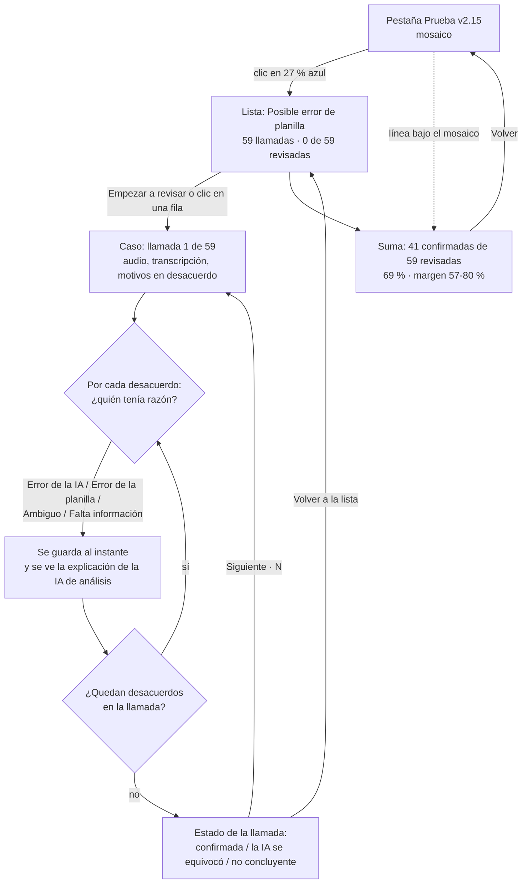

# Verificación del "Posible error de planilla" · Propuesta (Fase 1, primera entrega)

- **Fecha:** 2026-11-12 · **Base:** `03-orden-y-detalle-brief.md` (§8 acuerdos A1-A7, §9 decisiones G1-G13 aprobadas).
- **Objetivo:** que Johannes verifique a mano las llamadas detrás de cada cifra del mosaico, deje registrado quién tenía
  razón y que la suma responda la pregunta del jefe: **¿qué tan seguros estamos del 27 %?**
- **Trazabilidad:** P-07, P-08 → R-14..R-18 → este documento. Decisiones aplicadas: G2 (4 salidas), G3 (cifra aparte),
  G4 (las 59, orden aleatorio, margen, explicación después), G5 (vista dedicada), G13 (jefe en solo lectura).
- **Fuera de esta entrega (segunda):** glosario aplicado en todas las pantallas (G6), pantalla única de análisis (G7),
  Discrepancias sobre las 220 (G8), Calidad de la IA desde la última (G9), evolución entre versiones (G10), KPIs nuevos
  (G11), Operación (G12). Esta entrega no los contradice: las rutas y componentes nuevos se reutilizan allá.
- **Sin IA pagada:** todo sale de resultados ya guardados (`PromptEvaluation.results`, análisis de causa ya corrido, `Case`).

## 1. Organización de la información

Tres niveles nuevos debajo del mosaico, de lo general a lo específico (A2), con el mismo universo: las 220 llamadas de
validación de la versión elegida.

```
Versión v2.15 · pestaña Prueba (existente)
└─ Nivel 1 · Cifra        Mosaico "Acuerdo con el revisor": cada segmento, rótulo de grupo y fila de leyenda es un enlace
   └─ Nivel 2 · Lista     /admin/prompts/v2.15/calls?segment=reviewer
      │                   Llamadas del segmento, avance de la verificación, suma con margen
      └─ Nivel 3 · Caso   /admin/prompts/v2.15/calls/{caseId}?segment=reviewer
                          Audio + transcripción + IA (v2.15) vs. planilla por motivo + registro + "Siguiente"
```

- **Unidades (glosario G6, aplicado desde ya en lo nuevo):** la lista cuenta **llamadas** (lo que cuenta el mosaico); el
  registro se hace por **desacuerdo** (un motivo de una llamada en que la IA y el revisor no marcan lo mismo). Nada nuevo dice "caso".
- **Segmentos con lista:** los cinco (rojo, amarillo, azul, gris, verde). El foco y la suma destacada son del azul (A1).
  En el verde la lista muestra llamadas que coinciden en el veredicto pero pueden tener desacuerdos por motivo.
- **Las URLs se pueden compartir** (con la cuenta del jefe, G13): el segmento, el filtro y el orden viven en la URL.

## 2. Flujo: cifra → lista → caso → registro → suma



- **Pasos:** de la cifra al primer registro, 3 clics (segmento → "Empezar a revisar" → salida). Cada desacuerdo siguiente, 1 clic
  o 1 tecla. Pasar a la llamada siguiente, 1 tecla.
- **Sin callejones:** desde el caso siempre hay "Volver a la lista" y "Siguiente"; desde la lista, "Volver a v2.15". Un
  registro se cambia o se borra en el mismo lugar (no hay confirmación: no es destructivo y queda en el Registro de actividad).
- **Orden aleatorio (G4):** fijo por versión y segmento (semilla = id de la prueba + segmento), igual para todos, para que
  "Siguiente" no dependa de quién revisa y la muestra parcial no quede sesgada por el orden de las llamadas. "Siguiente" salta
  a la próxima **pendiente** en ese orden.
- **Explicación después (G4, H-17):** la explicación de la IA de análisis de cada desacuerdo aparece cuando ese desacuerdo ya
  tiene registro. Antes se ve un botón "Mostrar explicación ahora"; si se usa, el registro queda marcado como "con explicación a
  la vista" y la suma lo dice.

## 3. Patrones

| Necesidad | Patrón | Reutiliza |
|---|---|---|
| Cifra que lleva al detalle | Segmento, rótulo de grupo y fila de leyenda como `<a>` con foco visible y subrayado al pasar; `aria-label` "Ver las 59 llamadas: Posible error de planilla" | `AgreementMosaic`, `AgreementLegend` |
| Lista de llamadas | Tabla `.tbl` de una página (≤ 220 filas, sin paginación), con filtros arriba como chips de estado y selector de motivo | patrón de "Llamadas en desacuerdo" de Calidad de la IA |
| Avance y suma | Barra de progreso + tarjeta de suma con margen en texto | `FollowUpProgress`, `.summary-box` |
| Revisión secuencial | Vista dedicada tipo cola: encabezado con posición "12 de 59", contenido, barra de acción fija abajo, atajos de teclado | cola del auditor (`/queue` → `/calls/[id]`) |
| Audio y transcripción | Mismos componentes del detalle de llamada; cada cita de la IA salta el audio a su tiempo | `components/call/audio-player.tsx`, `transcript.tsx` (A6) |
| Registro por desacuerdo | Grupo de 4 botones de opción (`role="radiogroup"`) + nota opcional plegada; guarda al elegir, con aviso "Guardado" | `seg`, `toast` |
| Explicación diferida | Bloque plegado que se abre solo al registrar | `details` |
| Solo lectura (jefe) | Mismo contenido; el grupo de botones se reemplaza por el resultado registrado, en texto | `role` del usuario |

## 4. Reglas que definen lo que se ve

### 4.1 Desacuerdos de una llamada (para la versión elegida)

Por motivo, igual que `agreement.compute`: IA dudosa = **sin decisión**; IA y planilla iguales = **coincide**; distintas =
**desacuerdo** (rojo si la planilla dice No cumple; amarillo si la IA dice No cumple), y **azul** si ese (motivo, llamada)
está en patrones del análisis de causa y todos con causa `auditor` (D2). La vista del caso muestra arriba los desacuerdos y
los sin decisión ("por verificar") y pliega los que coinciden.

### 4.2 Qué se guarda y por qué no depende de la versión (H-15)

La persona elige una de cuatro salidas; se guarda **la respuesta correcta del motivo**, no "quién ganó":

| Botón | Se guarda | Cuando la IA dijo… |
|---|---|---|
| Error de la IA | correcto = lo que dice la planilla | Cumple o No cumple, distinto a la planilla |
| Error de la planilla | correcto = lo contrario de la planilla | ídem |
| Ambiguo | sin respuesta, `ambiguous` | — |
| Falta información | sin respuesta, `missing_info` (la llamada no alcanza para decidir; ej. tipificación sin dato en SAP) | — |

En un motivo **sin decisión de la IA**, los dos primeros botones se llaman **"La planilla tiene razón"** y **"La planilla se
equivocó"** (no hay IA a la que culpar). Como se guarda la respuesta correcta, el mismo registro sirve para v2.10, v2.15 y las
que vengan: en cada versión se recalcula si la IA de esa versión acertó.

### 4.3 Estado de una llamada

| Estado | Regla |
|---|---|
| Pendiente | Algún desacuerdo sin registro y ninguna regla de abajo aplica todavía |
| Confirmada (error de planilla) | Todos sus desacuerdos registrados como error de la planilla |
| La IA se equivocó | Al menos un desacuerdo registrado como error de la IA |
| No concluyente | Ninguno es error de la IA y al menos uno es Ambiguo o Falta información |

Para el azul, "confirmada" es la que valida el 27 %. Para rojo y amarillo, "La IA se equivocó" es lo esperado y
"Confirmada" muestra planillas erradas que el análisis no detectó.

### 4.4 Suma y margen (G3, G4)

- **Tasa de confirmación = confirmadas / revisadas** (no concluyentes y "la IA se equivocó" cuentan en el denominador: es la
  lectura conservadora).
- **Margen:** intervalo de Wilson al 95 % sobre las revisadas, recalculado con cada registro. Con todas revisadas, el texto
  dice que es el total de esta prueba y el margen describe qué esperar en otras llamadas.
- **Impacto en el total:** confirmadas / 220, rotulado "error de planilla confirmado". **Las métricas oficiales no cambian**
  (G3 C); la vista "con planilla corregida" queda para cuando el gerente lo valide.

## 5. Wireframes en texto

### 5.1 Pestaña Prueba: el mosaico se vuelve clicable (cambio mínimo)

```
Acuerdo con el revisor · v2.15                                              [?]
% del total de llamadas · n = 220 llamadas · Clic en un bloque para ver sus llamadas
┌──────┬──────────────┬─┬──────────────────────────────────────────────────────┐
│ ROJO │ AZUL ////////│G│                        VERDE                          │
├──────┤ 27 % ////////│ │               Coincide con el revisor 57 %            │
│ AMAR │ ////////////// │                                                      │
└──────┴──────────────┴─┴──────────────────────────────────────────────────────┘
 Prompt o criterio · 15 % ›   Posible error de planilla · 27 % ›   Sin decisión · 1,4 % ›   Acuerdo · 57 % ›

 Verificación del posible error de planilla: 41 confirmadas de 59 revisadas (69 %, margen 57-80 %) · Ver llamadas ›
   (antes de revisar: "Aún no se verifica a mano. Revisa las 59 llamadas ›")

 [leyenda: cada fila termina en "Ver llamadas ›"]
```

### 5.2 Nivel 2 · Lista del segmento

```
‹ Volver a v2.15
Posible error de planilla · v2.15                                         [?]
59 llamadas de 220 de validación · según la IA de análisis, el error está en la planilla del revisor

┌─ Verificación ───────────────────────────────────────────────────────────────┐
│ ████████████░░░░░░░░  20 de 59 revisadas                                       │
│ Confirmadas 14 · La IA se equivocó 4 · No concluyentes 2 · Pendientes 39       │
│ Error de planilla confirmado en 14 de 20 revisadas: 70 % (margen 48-85 %)      │
│ Equivale a 6 % de las 220 llamadas hasta ahora.                                │
│ 3 registros se hicieron con la explicación de la IA a la vista.                │
│                                          [ Seguir revisando · 21 de 59 ]  (primario) │
└───────────────────────────────────────────────────────────────────────────────┘

Mostrar: (Todas 59) (Pendientes 39) (Confirmadas 14) (La IA se equivocó 4) (No concluyentes 2)   Motivo: [Todos ▾]
Orden: aleatorio fijo · [Ordenar por llamada]

 #  Llamada     Fecha    IA     Planilla   Motivos en desacuerdo        Verificación
 1  4410-0921   03-oct   Cumple No cumple  [M18] [M25]                 Confirmada
 2  4410-1188   07-oct   Cumple No cumple  [M27]                       Pendiente
 3  …                                                                  La IA se equivocó (M18)
```

- Cada fila abre el caso; los chips de motivo llevan el nombre en `title` y en texto para lector de pantalla.
- Otros segmentos: misma vista con su título, color y descripción; la tarjeta de verificación cambia de foco (§6.3).

### 5.3 Nivel 3 · Caso

```
‹ Volver a la lista       Posible error de planilla · llamada 21 de 59 (pendientes: 39)      [‹ Anterior] [Siguiente ›]
Llamada 4410-1188 · 07-oct · 6:42 min · v2.15 (prueba de validación)
IA v2.15: Cumple    Planilla: No cumple    Evaluador de la planilla: Evaluador 3
Comentario de la planilla: «No tipifica la gestión correctamente.»

[ ▶ audio ─────●──────────────────── 2:13 / 6:42  1x ]   (marcas de las citas de la IA)

┌ Transcripción ─────────────────────────┐ ┌ Por verificar (1) ──────────────────────────────────────┐
│ 02:10 Ejecutivo: …                      │ │ Motivo 27 · Tipificación correcta del motivo             │
│ 02:13 Cliente: …  ◀ cita de la IA       │ │ Criterio: <texto del criterio de la pauta>               │
│ …                                       │ │ IA v2.15: Cumple · «…cita…» 02:13 ▶                      │
│                                         │ │   Comentario de la IA: «…»                               │
│                                         │ │ Planilla: No cumple                                      │
│                                         │ │ ¿Quién tenía razón?                                      │
│                                         │ │ (1 Error de la IA) (2 Error de la planilla)              │
│                                         │ │ (3 Ambiguo) (4 Falta información)   + Agregar nota       │
│                                         │ │ ▸ Explicación de la IA de análisis: se muestra al registrar│
│                                         │ │   [Mostrar explicación ahora]                            │
│                                         │ └──────────────────────────────────────────────────────────┘
│                                         │ ▸ Coinciden con la planilla (31 motivos)
└─────────────────────────────────────────┘
Estado de la llamada: Pendiente  →  (al registrar) Confirmada: error de planilla
```

- Atajos: `1`-`4` registran el desacuerdo enfocado, `J`/`K` pasan al siguiente/anterior desacuerdo, `N` a la siguiente
  llamada pendiente, `Espacio` reproduce o pausa. Mismos criterios de la cola del auditor (no se activan dentro de la nota).
- Al registrar el último desacuerdo, el estado de la llamada cambia y el foco va a "Siguiente".
- Quien entra con solo lectura (jefe) ve "Verificado por {nombre} el {fecha}: Error de la planilla" en lugar de los botones.

## 6. Textos exactos

### 6.1 Pestaña Prueba

- Subtítulo del mosaico, al final: `· Clic en un bloque para ver sus llamadas`
- Enlace en rótulos y leyenda: `Ver llamadas ›` (`aria-label`: `Ver las {n} llamadas: {nombre de la parte}`)
- Línea de verificación (si azul > 0):
  - Sin registros: `Aún no se verifica a mano. Revisa las {n} llamadas ›`
  - Con registros: `Verificación del posible error de planilla: {c} confirmadas de {r} revisadas ({p} %, margen {lo}-{hi} %) · Ver llamadas ›`
  - Todas revisadas: `Verificación completa: {c} de {n} llamadas confirmadas como error de planilla ({p} %).`

### 6.2 Lista

- Volver: `Volver a v{X}`
- Título: `{nombre de la parte} · v{X}` (nombres de §11.3 de `02-mosaico-propuesta.md`)
- Subtítulo: `{n} llamadas de {N} de validación · {línea de apoyo de la parte}`
- Tarjeta: título `Verificación`; avance `{r} de {n} revisadas`; conteos `Confirmadas {a} · La IA se equivocó {b} · No concluyentes {c} · Pendientes {d}`
- Suma (azul): `Error de planilla confirmado en {a} de {r} revisadas: {p} % (margen {lo}-{hi} %)` + `Equivale a {q} % de las {N} llamadas hasta ahora.`
- Suma (rojo/amarillo): `La IA se equivocó en {b} de {r} revisadas: {p} % (margen {lo}-{hi} %)` + si `a > 0`: `{a} tenían la planilla errada.`
- Nota de sesgo (si aplica): `{k} registros se hicieron con la explicación de la IA a la vista.`
- Botón: `Empezar a revisar` (sin registros) / `Seguir revisando · {i} de {n}` / sin pendientes: `Revisión completa` (deshabilitado) + `Ver todas`
- Filtros: `Todas`, `Pendientes`, `Confirmadas`, `La IA se equivocó`, `No concluyentes`; `Motivo: Todos`
- Orden: `Orden aleatorio fijo` · `Ordenar por llamada`
- Columnas: `Llamada`, `Fecha`, `IA`, `Planilla`, `Motivos en desacuerdo`, `Verificación`
- Vacío por filtro: `No hay llamadas con este filtro.` + `Quitar filtro`
- Segmento vacío: `Ninguna llamada de esta prueba cae en esta parte.`
- Ayuda "?": `Las llamadas aparecen en un orden al azar, el mismo para todos, para que una revisión a medias no quede cargada hacia un tipo de llamada. El margen dice entre qué valores estaría la tasa si se revisaran muchas llamadas como estas, con 95 % de confianza.`

### 6.3 Caso

- Encabezado: `{parte} · llamada {i} de {n} (pendientes: {d})`; botones `Anterior`, `Siguiente`, `Volver a la lista`
- Línea: `Llamada {callId} · {fecha} · {m:ss} min · v{X} (prueba de validación)` (o `(vigente)` si es la versión en producción)
- Veredictos: `IA v{X}: {Cumple | No cumple | Dudosa}` · `Planilla: {Cumple | No cumple}` · `Evaluador de la planilla: {nombre}`
- `Comentario de la planilla: «{texto}»` / `La planilla no trae comentario.`
- Sección: `Por verificar ({k})`; plegado: `Coinciden con la planilla ({m} motivos)`
- Motivo: `Motivo {id} · {nombre}`; `Criterio: {texto de la pauta}`
- IA: `IA v{X}: {veredicto}` + cita `«{cita}» {mm:ss}` con botón `Escuchar desde {mm:ss}`; `Comentario de la IA: «{texto}»`; sin cita: `La IA no dejó cita para este motivo.`
- Planilla: `Planilla: {Cumple | No cumple}`
- Pregunta: `¿Quién tenía razón?`
- Botones: `Error de la IA` · `Error de la planilla` · `Ambiguo` · `Falta información`; con IA dudosa: `La planilla tiene razón` · `La planilla se equivocó` · `Ambiguo` · `Falta información`
- Ayudas (en `?` del grupo): `Ambiguo: la pauta admite las dos lecturas.` · `Falta información: con la llamada no se puede decidir (por ejemplo, el dato está en SAP y no en la grabación).`
- Nota: `Agregar nota` → `Nota (opcional)`
- Guardado: toast `Guardado: {salida} en el motivo {id}.` con `Deshacer`
- Explicación cerrada: `Explicación de la IA de análisis: se muestra al registrar, para no influir en tu decisión.` + `Mostrar explicación ahora`
- Explicación abierta: `Según la IA de análisis: {título del patrón}. {explicación}` + `Causa: {Error de la planilla | Regla del prompt | …}`; sin patrón: `La IA de análisis no agrupó este desacuerdo en un patrón.`
- Estado: `Estado de la llamada: {Pendiente | Confirmada: error de planilla | La IA se equivocó | No concluyente}`
- Solo lectura: `Verificado por {nombre} el {fecha}: {salida}.` / `Sin verificar.`
- Sin hallazgos guardados (H-09): banner `Esta prueba no guardó los comentarios ni las citas de la IA. Se muestran solo los veredictos por motivo.`
- Error al guardar: `No pudimos guardar. Revisa tu conexión e intenta de nuevo.` (el botón vuelve a su estado anterior)
- Fin de la lista: `Revisaste todas las llamadas de esta parte.` + `Volver a la lista`

### 6.4 Glosario (agregar a `../call-audit/06-ux-writing.md` §8 al implementar)

- **Desacuerdo:** un motivo de una llamada en que la IA y el revisor no marcan lo mismo.
- **Verificación:** registro humano de quién tenía razón en un desacuerdo. Vale para todas las versiones.
- **Confirmada:** llamada en que todos los desacuerdos resultaron error de la planilla.

## 7. Estados

| Estado | Qué se ve |
|---|---|
| Prueba sin análisis de causa | No hay azul; los segmentos rojo y amarillo igual abren su lista y se pueden verificar |
| Segmento con 0 llamadas | No es enlace; leyenda sin "Ver llamadas" |
| Cargando lista o caso | `skel` en la tabla y en el panel; el audio carga aparte |
| Audio no disponible | Mensaje del reproductor existente; la transcripción y el registro siguen |
| Prueba sin `findings` (H-09) | Banner de §6.3; solo veredictos por motivo |
| Planilla reimportada y distinta al registro | El registro se muestra con aviso: `La planilla cambió después de esta verificación. Revísala de nuevo.` y la llamada vuelve a Pendiente |
| Usuario sin permiso de registrar | Solo lectura (§5.3) |

## 8. Accesibilidad (WCAG 2.2 AA)

- Bloques del mosaico como enlaces con nombre accesible y foco visible (2.4.4, 2.4.7); el área mínima de 24 × 24 px se
  cumple con el rótulo y la fila de leyenda, porque un bloque de 1,4 % puede ser más chico (2.5.8, excepción por alternativa equivalente).
- Grupo de salidas: `radiogroup` con etiqueta "¿Quién tenía razón? Motivo {id}"; cambio de estado anunciado con `aria-live="polite"`.
- Atajos de una tecla desactivables y sin efecto dentro de campos de texto (2.1.4).
- Estados de verificación en texto, no solo en color (1.4.1). Barra de avance con `role="progressbar"` y valores.
- El foco no se pierde al pasar de llamada: va al encabezado del caso (2.4.3).

## 9. Contrato de datos (backend → UI)

Base: `{version}` es la versión; se usa su prueba de validación terminada (`is_test`) o, si es la vigente sin prueba, sus
corridas vigentes sobre las mismas llamadas. `segment ∈ promptFn | promptFp | reviewer | undecided | agree` (mismos nombres
que `AgreementBreakdown`).

### 9.1 Lista

`GET /api/admin/prompts/{version}/agreement/calls?segment=reviewer`

```ts
type Outcome = "ai_error" | "reviewer_error" | "ambiguous" | "missing_info";
type CallVerification = "pending" | "confirmed" | "ai_wrong" | "inconclusive";
type VerificationSummary = {
  calls: number; reviewed: number; confirmed: number; aiWrong: number; inconclusive: number;
  ci95: [number, number] | null;   // Wilson sobre confirmed/reviewed (azul) o aiWrong/reviewed (rojo, amarillo)
  seenFirst: number;               // registros hechos con la explicación a la vista
};
type SegmentCalls = {
  version: string; evaluationId: string | null; source: "prompt_test" | "current_run";
  n: number;                       // 220
  segment: Segment; seed: string;  // orden aleatorio fijo
  items: {
    caseId: string; callId: string; callDate: string; order: number;
    aiVerdict: "compliant" | "non_compliant" | "uncertain"; reviewerVerdict: "compliant" | "non_compliant";
    disagreements: { criterionId: number; kind: "fp" | "fn" | "undecided"; blue: boolean; outcome: Outcome | null }[];
    verification: CallVerification;
  }[];
  summary: VerificationSummary;
};
```

- Sin paginación (máx. 220). El filtro por estado y motivo es del lado de la UI.
- Mismo cálculo que `agreement.compute`; `order` = posición en el orden aleatorio fijo.

### 9.2 Caso con la versión probada (corrige P-08)

`GET /api/admin/prompts/{version}/agreement/calls/{caseId}?segment=reviewer`

```ts
type CaseComparison = {
  caseId: string; callId: string; callDate: string; durationMs: number;
  version: string; model: string; source: "prompt_test" | "current_run"; segment: Segment;
  aiVerdict: "compliant" | "non_compliant" | "uncertain";
  reviewer: { verdict: "compliant" | "non_compliant"; comment: string | null; evaluator: string | null };
  findingsAvailable: boolean;      // H-09
  criteria: {
    criterionId: number;
    kind: "agree" | "fp" | "fn" | "undecided";
    blue: boolean;
    ai: { verdict: string; comment: string | null; evidence: { quote: string; startMs: number; quoteValidated: boolean }[] };
    reviewerFail: boolean;
    analysis: { patternId: string; title: string; cause: string; explanation: string } | null;  // del análisis de causa ya corrido
    verification: { outcome: Outcome; note: string | null; by: string; at: string; seenFirst: boolean; stale: boolean } | null;
  }[];
  position: { index: number; total: number; pending: number; prevCaseId: string | null; nextPendingCaseId: string | null };
};
```

- Audio y transcripción: `GET /api/cases/{caseId}` existente (el admin ya lo ve en solo lectura). Las citas de la prueba
  están enmascaradas (es el texto que vio el modelo); se muestran tal cual.
- `analysis` se devuelve siempre; la UI lo oculta hasta que hay registro (G4). Ningún dato nuevo cuesta IA.

### 9.3 Registro y suma

- `PUT /api/admin/verifications/{caseId}/{criterionId}` · cuerpo `{ outcome: Outcome, note?: string, version: string, seenFirst: boolean }`
  → `200 { verification, call: CallVerification, summary: VerificationSummary }`. Idempotente; cambiar la salida reemplaza.
- `DELETE /api/admin/verifications/{caseId}/{criterionId}` → `204` (deshacer).
- Solo `qubico_admin` escribe; el rol de solo lectura (G13) recibe `403` y la UI no muestra los botones.
- Cada escritura va al Registro de actividad (quién, cuándo, de qué a qué).
- **Suma en el mosaico:** `EvaluationMetrics.agreement.verification?: Record<Segment, VerificationSummary>` (la línea de §6.1).

## 10. Modelo de datos de la verificación

**Decisión propuesta: tabla nueva `disagreement_verifications`; no se extiende `DiscrepancyClassification`.**

| | `DiscrepancyClassification` (hoy) | Lo que pide la verificación |
|---|---|---|
| Unidad | Llamada (PK `case_id`) | Llamada × motivo |
| Significado | "La IA acertó / se equivocó" relativo a una salida de la IA | Respuesta correcta del motivo, independiente de la versión (H-15) |
| Actor y flujo | Supervisor, árbol de discrepancias, estado de presentación | Admin Qubico, verificación de la prueba |
| Salidas | `ai_correct` / `ai_wrong` | 4 salidas, dos sin respuesta |

Extenderla obligaría a cambiar su clave y su significado y rompería `manual_view` y el Cambio 09.

```
disagreement_verifications
  id                 str(32) PK
  case_id            FK cases.id
  criterion_id       int
  outcome            str(20)   reviewer_error | ai_error | ambiguous | missing_info   (lo que eligió la persona)
  correct            str(20)?  compliant | non_compliant | null (null en ambiguous / missing_info)
  reviewer_fail_at   bool      lo que decía la planilla al registrar (detecta reimportaciones: stale)
  ai_verdict_at      str(20)   lo que decía la IA de la versión desde la que se registró
  version_at         str(20)   versión desde la que se registró (contexto, no clave)
  seen_first         bool      la explicación de la IA de análisis estaba a la vista antes de registrar
  note               text?
  decided_by_id      FK users.id
  decided_at         datetime
  UNIQUE (case_id, criterion_id)
```

- `correct` se deriva al guardar: `ai_error` → valor de la planilla; `reviewer_error` → lo contrario. Para otra versión,
  "la IA acertó" = su valor == `correct`. `outcome` se guarda igual, para auditar lo que se eligió.
- Un registro por desacuerdo (el último manda); el historial vive en el Registro de actividad.
- Segunda entrega: `manual_view` la suma como cuarta fuente de "revisión manual Qubico", para que Discrepancias la use.
- Migración Alembic nueva; sin datos que migrar.

## 11. Impacto en el código (para después de aprobar)

| Dónde | Cambio |
|---|---|
| `src/call_audit/agreement.py` | Función que devuelve la clasificación por llamada y por motivo (hoy solo cuenta); orden aleatorio con semilla; resumen de verificación y Wilson |
| `src/call_audit/persistence/models.py` + migración | `DisagreementVerification` |
| `src/call_audit/api/routes_admin.py` | Endpoints §9; `agreement.verification` en las métricas; permiso de solo lectura (rol de G13) |
| `frontend/src/components/admin/agreement-charts.tsx` | Bloques, rótulos y leyenda como enlaces; línea de verificación |
| `frontend/src/app/(app)/admin/prompts/[version]/calls/page.tsx` (nuevo) | Lista (§5.2) |
| `frontend/src/app/(app)/admin/prompts/[version]/calls/[caseId]/page.tsx` (nuevo) | Caso (§5.3), con `AudioPlayer` y `Transcript` |
| `frontend/src/lib/api/*` | Tipos y métodos de §9 |
| Rol de solo lectura (G13) | Rol nuevo en `Role`, menú y guardas de las rutas de admin. Puede ir en esta entrega o justo antes de crear la cuenta del jefe (D5 de la siguiente gate) |

## 12. Revisión rápida

| Chequeo | Resultado |
|---|---|
| Trazabilidad | P-07 → §1-§2; P-08 → §9.2; R-14 → §5.1; R-15 → §4.2, §10; R-16 → §4.4, §6; R-17 → §5.3; R-18 → §1 |
| Patrones | Reutiliza mosaico, cola, reproductor, transcripción, `seg`, `.tbl`, toast con deshacer |
| Glosario | "Desacuerdo" y "verificación" nuevos; "caso" no aparece en textos nuevos |
| Dark patterns | No aplica |
| Costo | Cero IA |

## 13. Supuestos y riesgos

- **[SUPUESTO] H-18:** el registro por motivo alcanza; nadie pide un veredicto de llamada aparte (sale de §4.3).
- **[SUPUESTO] H-19:** con un solo verificador basta para presentarle al gerente; si después verifican dos personas, se
  agrega acuerdo entre verificadores (fuera de alcance).
- **Riesgo:** el rótulo "Posible error de planilla" ya sugiere la respuesta. Se mitiga con el orden aleatorio, la explicación
  diferida y la tasa conservadora; no se puede ocultar el segmento sin perder el drill-down.
- **Riesgo:** en v2.15 el azul se calculó con un análisis de causa que agrupa por patrón; un desacuerdo azul puede venir de un
  patrón con pocos casos. La explicación se muestra tal cual, con su título y causa.

## 14. Decisiones de esta gate (V1-V5)

| ID | Pregunta | Opciones | Recomendada |
|---|---|---|---|
| V1 | ¿Se aprueba el modelo de datos? | A tabla nueva que guarda la respuesta correcta del motivo (§10) · B extender `DiscrepancyClassification` · C tabla nueva que guarda solo "quién ganó" por versión (hay que verificar de nuevo en cada versión) | A |
| V2 | "Mostrar explicación ahora" | A permitido, y el registro queda marcado y la suma lo cuenta · B prohibido hasta registrar · C sin restricción ni marca | A |
| V3 | Segmentos verificables en esta entrega | A los cinco, con foco y suma destacada en el azul · B solo el azul · C azul, rojo y amarillo | A |
| V4 | Rutas | A páginas propias `/admin/prompts/[version]/calls` y `/calls/[caseId]`, que se pueden compartir y que la pantalla única de la segunda entrega reutiliza · B dentro de la pestaña Prueba, sin URL propia | A |
| V5 | Rol de solo lectura para el jefe (G13) | A en esta entrega, para que pueda ver los casos verificados apenas tenga cuenta · B en una entrega aparte, y mientras tanto no se le crea cuenta · C cuenta admin temporal | A |
