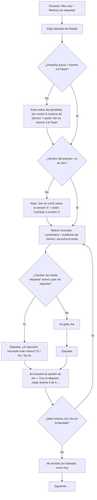

# Fases 4–7a (comprimidas) · Especificación · "Segunda opinión Jev"

Fecha: 2026-10-20 · Estado: **APROBADA para implementar** (gate único, Johannes, 2026-10-20; ver `estado.md`).
Cubre: flujo (4), patrones y accesibilidad (5), microcopy (6) y wireframe en texto (7a), para la pestaña **Revisión** (§2–7) y la pestaña **Dashboard** (§8).

## 0. Decisiones aprobadas

| ID | Decisión |
|---|---|
| D-J1 | Proceso reducido, un solo gate |
| D-J2 | Variante principal: Jev 1.13 · español · ciego (`D.jev.main`, constante editable) |
| D-J3 | Umbral 0,5 (regla del experimento) + marca "cerca del umbral" para 0,40 ≤ p < 0,60 |
| D-J4 | Etiqueta "¿El ejecutivo incumple el motivo?" Sí / No / No sé, en el bloque del motivo; Jev oculto hasta etiquetar, activo por defecto, con "Mostrar igual" |
| D-J5 | Columna `motivos_etiquetados` en `revision_capa2.csv`; `jev_review.py report` usa la etiqueta del par cuando existe y cae en la referencia por llamada si no |
| D-J6 | Alcance ampliado: tarjeta resumen de Jev en la pestaña Dashboard (§8) |
| H-J6 | Confirmado: llamada 230188, Excel APROBADA, revisión manual RECHAZADA por otro motivo; el motivo 16 de Gemini era error y Jev acertó al revertirlo. Caso de prueba para la implementación (debe contar como acierto de Jev). |

## 1. Crítica de la propuesta original (resuelta con las decisiones de §0)

| Punto de la propuesta | Qué se mantiene | Qué cambia y por qué |
|---|---|---|
| 1. Línea "Segunda opinión Jev" bajo cada motivo `incumple` en la pestaña de Gemini | Ubicación (junto a la evidencia de Gemini, donde se juzga) | Mostrar siempre las **4 variantes ciegas** en una grilla 2×2 (modelo × idioma), y plegar las 4 "con hallazgo" con aviso de anclaje. Una sola variante destacada esconde el desacuerdo entre variantes, que es justo lo que hay que juzgar (P-03). La variante principal sigue existiendo, pero para el filtro y el marcador del listado. |
| "p = 0,17 → revierte / confirma" | Número + palabra | Con valores agrupados en 0,4–0,8, marcar "cerca del umbral" cuando 0,40 ≤ p < 0,60 (P-04). El umbral de decisión sigue siendo 0,5 (regla del experimento). |
| 2. Filtro "Jev revierte algún motivo" + marcador | Sí | Un `<select>` propio "Jev" (no mezclar con "IA vs Excel"), con opciones para encontrar pendientes de etiquetar y contradicciones. Marcador de texto en la fila, no solo color. |
| 3. Etiqueta por motivo "¿Jev acertó?" en "Mi revisión" | Etiqueta por par: imprescindible (P-01) | (a) Preguntar la **verdad del motivo** ("¿El ejecutivo incumple este motivo?") y no "¿Jev acertó?": con una sola etiqueta se califican las 8 variantes y también a Gemini, y no obliga a pensar en Jev. (b) Ubicarla **en el bloque del motivo**, junto a la evidencia y el audio, no en la caja "Mi revisión" (que queda con un resumen de avance). (c) Opción de **ocultar Jev hasta etiquetar**, para que la etiqueta de Johannes no se ancle en Jev, igual que Jev se ancla en Gemini. |
| No mencionado | — | Aviso a nivel de llamada: hoy la pestaña activa por defecto puede no ser Gemini y el bloque quedaría invisible. Consecuencia en la llamada ("con la variante principal, Gemini quedaría sin motivos incumplidos"), que es lo que importa para la capa 3. Estado de versión del prompt distinta. |

## 2. Datos que necesita la vista (para `dashboard.py`)

```
D.jev = {
  source: "gemini-3-8-flash",
  version: "<versión del prompt de Gemini sobre la que corrió Jev>",
  threshold: 0.5,
  near: [0.4, 0.6],                       // banda "cerca del umbral" (D-J3)
  main: "jev-1.13.0|es|blind",            // variante principal (D-J2)
  variants: [ { key: "jev-1.13.0|es|blind", model: "Jev 1.13", lang: "es", mode: "blind",
                cost_usd: 0.0123, latency_ms: 850 }, ... 8 ],   // costo total de los 28 pares y latencia promedio
  calls: { "<stem>": { manual: "RECHAZADA" | "APROBADA" | "DUDOSA" | "", other_bad: [1, ...] } },
                                          // referencia por llamada y otros motivos incumple de Gemini (regla de rescate)
  pairs: { "<stem>": { "<id motivo>": { "<key variante>": 0.17 | null, ... } } }
}
```

- Fuente: `<run-dir>/jev/<source>/<model>/<lang>_<mode>/` (lo que ya escribe `jev_review.py`). `null` = Jev no respondió.
- Si no hay corrida Jev, `D.jev` no existe y **nada** de esta especificación se renderiza (ni filtro ni bloques).
- No se agrega texto nuevo de la llamada: solo números por par (L-J1).

## 3. Flujo (CUJ-J1: juzgar a Jev par por par)



Auditoría del flujo:

| Revisión | Hallazgo | Acción |
|---|---|---|
| Pasos de más | Abrir `report.html` aparte para ver el número | Eliminado: el número vive junto a la evidencia |
| Cuello de botella | La pestaña activa recuerda el último modelo; si es otro, el bloque Jev no se ve | Aviso con botón que cambia a Gemini (1 clic) |
| Cuello de botella | Versión del prompt distinta a la de Jev | Nota con botón para cambiar de versión |
| Redundancia | Etiqueta por llamada ("¿Acertó cada IA?") y por motivo pueden contradecirse | Se mantienen ambas (miden cosas distintas); la caja "Mi revisión" muestra el avance por motivo para no olvidarlo |
| Callejón sin salida | "No sé" sin forma de explicar | La nota por llamada sigue disponible; placeholder sugiere anotar el motivo |
| Conteo | Hoy: dashboard → terminal/explorador → `report.html` → buscar fila → volver (≈6 acciones por par, con cambio de ventana) | Propuesto: filtro → llamada → (1 clic a Gemini si hace falta) → etiqueta (≈3 acciones por par, sin salir) |

## 4. Especificación por zona

### 4.1 Listado (pestaña "Revisión")

- **Filtro nuevo** `#f-jev` a la derecha de "Mi revisión", con `aria-label="Filtrar por opinión de Jev"`. Opciones (con conteo entre paréntesis, calculado al generar):
  - `Jev: todas`
  - `Con opinión de Jev (21)`
  - `Jev revierte algún motivo (8)` — según la variante principal
  - `Jev confirma todos los motivos (13)` — según la variante principal
  - `Motivos sin etiquetar (21)` — llamadas con al menos un par sin etiqueta
  - `Jev contradice mi etiqueta` — variante principal ≠ etiqueta (solo pares etiquetados como Sí/No)
  - (los números son ilustrativos)
- **Marcador en la fila**: en la celda de la llamada, bajo el ejecutivo (línea `.rv`), texto `Jev: revierte 1 de 2` o `Jev: confirma 2 de 2`, con `title` "Variante principal (Jev 1.13 · español · ciego)". Solo texto (sin color nuevo), para no competir con los chips de veredicto.
- **Contador** (`#count`): agregar `· motivos Jev etiquetados 5/28` cuando existe `D.jev`.

### 4.2 Detalle: aviso a nivel de llamada

Solo si la llamada tiene pares Jev. Va entre la caja "Mi revisión" y las pestañas de modelo (`.mtabs`). Patrón: nota (`.note`), no alerta.

> **Jev revisó 2 motivos que Gemini 3.8 Flash marcó como incumplidos.** Variante principal: revierte 1 de 2. [Ver en Gemini 3.8 Flash] *(botón solo si la pestaña activa es otra)*

Si la variante principal revierte **todos** los pares, la llamada no tiene motivo 1 y Gemini no tiene otros `incumple` sin revisar (misma regla de "rescatada" que `jev_review.py`):

> Con la variante principal, Gemini 3.8 Flash quedaría sin motivos incumplidos en esta llamada.

Además, en el botón de la pestaña Gemini 3.8 Flash se agrega texto `· Jev 2` (con `aria-label` "Gemini 3.8 Flash, rechazada, 2 motivos con opinión de Jev").

### 4.3 Detalle: bloque por motivo (pestaña Gemini 3.8 Flash)

Se inserta dentro del `.crit` del motivo, después de la evidencia, solo si `D.jev.pairs[stem][id]` existe y la versión activa es `D.jev.version`. Contenedor: `<section class="jev" aria-labelledby="jev-<stem>-<id>">`, con borde izquierdo neutro (`--border`) y fondo `--raised`, para distinguirlo del hallazgo de Gemini.

Wireframe (estado: etiquetado, Jev visible):

```
 [incumple] 16. <nombre del motivo>    confianza alta
 <comentario de Gemini>
   01:23 EJECUTIVO: "…"   (evidencia clicable, como hoy)

 ┌─ Segunda opinión Jev · motivo 16 ──────────────────────────────────┐
 │ Tu etiqueta · ¿El ejecutivo incumple el motivo 16?                  │
 │   ( ) Sí, incumple    (•) No, cumple    ( ) No sé                   │
 │                                                                     │
 │ Ciego (solo el criterio)          Español            Inglés         │
 │   Jev 1.13            [0,17 · revierte]★     [0,42 · revierte ┆]    │
 │   Jev 1.14 preview    [0,55 · confirma ┆]    [0,61 · confirma]      │
 │ ★ variante principal · ┆ cerca del umbral (0,40–0,60)               │
 │                                                                     │
 │ Con tu etiqueta: ciego acierta 2 de 4 · principal acierta ·         │
 │ Gemini 3.8 Flash falla.                                             │
 │                                                                     │
 │ ▸ Con el hallazgo de Gemini (4 de 4 confirman) — no es independiente│
 └─────────────────────────────────────────────────────────────────────┘
```

- **Orden**: etiqueta primero, opinión después (el orden de lectura invita a decidir antes de mirar).
- **Grilla**: `<table>` real con `<caption>` "Probabilidad de incumplimiento según Jev, modo ciego", `<th scope="col">` Español / Inglés y `<th scope="row">` Jev 1.13 / Jev 1.14 preview. Cada celda: `0,17 · revierte` (coma decimal, 2 decimales). `null` → `— · sin respuesta`.
- **Color**: reutiliza la semántica de los chips existentes: confirma = `.RECHAZADA` (mismo color que "incumple"), revierte = `.APROBADA` (mismo color que "cumple"). Es el color del **estado**, no de acierto; el acierto solo se dice en texto tras etiquetar. Siempre hay palabra, nunca solo color (WCAG 1.4.1).
- **Cerca del umbral**: borde punteado (mismo recurso que `.chip.leve`) + texto oculto para lectores "cerca del umbral" + leyenda.
- **Variante principal**: estrella ★ y `font-weight:700` + leyenda; `aria-describedby` a la leyenda.
- **Con hallazgo**: `<details>` cerrado. `<summary>`: "Con el hallazgo de Gemini (N de 4 confirman) — no es independiente". Dentro, la misma grilla 2×2 y la nota: "En este modo Jev ve el comentario y la evidencia de Gemini, y casi siempre le da la razón. Úsalo solo como referencia."
- **Línea de acierto** (solo con etiqueta Sí/No): "Con tu etiqueta: ciego acierta X de 4 · principal acierta/falla · Gemini 3.8 Flash acierta/falla." Con "No sé": "Sin etiqueta concluyente: no se calcula acierto." En `aria-live="polite"`.
- **Ocultar Jev hasta etiquetar** (si D-J4 lo aprueba): si el par no tiene etiqueta, en lugar de grilla y "con hallazgo" se muestra: "La opinión de Jev aparece cuando etiquetes el motivo." + botón secundario "Mostrar igual". Etiquetar revela la grilla en el mismo lugar (sin mover el foco). Se guarda si la etiqueta se puso sin ver a Jev.

### 4.4 Casos y estados

| Estado | Qué se ve |
|---|---|
| Sin `D.jev` | Nada nuevo en ninguna parte |
| Llamada sin pares Jev | Nada nuevo en el detalle |
| Pestaña activa ≠ Gemini | Aviso 4.2 con botón "Ver en Gemini 3.8 Flash" |
| Versión ≠ `D.jev.version` | En la pestaña Gemini, sobre los motivos: "La opinión de Jev corresponde a la versión X del prompt. [Cambiar a versión X]" |
| Motivo 1 incumple en una llamada con Jev | Bajo el motivo: "Jev no evalúa el motivo 1: lo calcula el código a partir de las esperas." |
| Variante sin respuesta | Celda `— · sin respuesta` (`title` "Jev no respondió en esta variante") |
| Par sin etiquetar | Radios vacíos; con ocultar activo, Jev oculto |
| Etiquetado "No sé" | Grilla visible, sin línea de acierto |
| Guardado | Reutiliza `#savestate` existente ("Guardado en revision_capa2.csv" / aviso de solo navegador) |
| Dashboard compartido (`share_dashboard.py`) | Igual; la etiqueta queda en el navegador como hoy (L-03) |

### 4.5 Caja "Mi revisión" (cambio mínimo)

- Se mantiene el veredicto por llamada, "¿Acertó cada IA?" y la nota.
- Se agrega una línea, solo si la llamada tiene pares Jev: "Motivos con Jev: 1 de 2 etiquetados" + enlace "Ir al motivo pendiente" (cambia a Gemini y hace scroll + foco al fieldset del primer par sin etiqueta).
- Casilla (si D-J4): "Ocultar la opinión de Jev hasta que etiquete el motivo" — preferencia por navegador (`localStorage`, `try/catch`), activa por defecto.
- Placeholder de la nota: se agrega "…o por qué un motivo quedó en 'No sé'".

### 4.6 Persistencia (según D-J5)

- En memoria: `reviews[stem].motives = { "16": { v: "si" | "no" | "nose", blind: true|false, at: ISO } }`. El `at` del registro de la llamada se actualiza igual (la mezcla CSV/localStorage actual sigue funcionando por llamada).
- CSV: una columna nueva al final de las de revisión, `motivos_etiquetados`, formato `16=no/ciego;7=si/visto` (`ciego` = etiquetado sin ver Jev). No requiere cambiar `review_server.py`.
- Consecuencia fuera de la UI (para quien implemente): `jev_review.py report` debería usar la etiqueta del par cuando exista, y caer en el veredicto por llamada solo si no la hay. Sin esto, el caso del motivo 16 se sigue contando como error de Jev.

## 5. Accesibilidad (WCAG 2.2 AA)

- Etiqueta: `<fieldset>` + `<legend>` "¿El ejecutivo incumple el motivo 16?"; radios nativos con `<label>` que envuelve el texto; área clicable ≥ 24×24 px (2.5.8).
- Grilla: `<table>` con `caption` y `th scope`; números con `font-variant-numeric: tabular-nums`.
- No depender del color: siempre "revierte/confirma", ★ con leyenda, banda cerca del umbral con texto para lectores de pantalla.
- Contraste: solo tokens existentes (`--good-soft/--good-ink`, `--crit-soft/--crit-ink`), ya usados en chips en claro y oscuro. Verificar el borde punteado contra `--raised` en oscuro (≥ 3:1, 1.4.11).
- Foco: "Ir al motivo pendiente" mueve el foco al `fieldset`; revelar la grilla no roba el foco; `details/summary` nativo.
- Teclado: el filtro, los radios y los botones nuevos son controles nativos. No se agregan atajos nuevos (evita choques con los existentes de anterior/siguiente).
- Anuncios: línea de acierto con `aria-live="polite"`.

## 6. Microcopy (español chileno, tono neutro de herramienta interna)

| Lugar | Texto |
|---|---|
| Título del bloque | Segunda opinión Jev · motivo {id} |
| Pregunta de etiqueta | ¿El ejecutivo incumple el motivo {id}? |
| Opciones | Sí, incumple · No, cumple · No sé |
| Caption grilla | Probabilidad de incumplimiento según Jev, modo ciego |
| Celda | {p} · revierte / {p} · confirma / — · sin respuesta |
| Leyenda | ★ variante principal ({modelo} · {idioma} · ciego) · borde punteado: cerca del umbral (0,40–0,60). Umbral 0,5: desde 0,5 confirma el rechazo de Gemini; bajo 0,5 lo revierte. |
| Summary con hallazgo | Con el hallazgo de Gemini ({n} de 4 confirman) — no es independiente |
| Nota con hallazgo | En este modo Jev ve el comentario y la evidencia de Gemini, y casi siempre le da la razón. Úsalo solo como referencia. |
| Línea de acierto | Con tu etiqueta: ciego acierta {x} de 4 · principal {acierta/falla} · Gemini 3.8 Flash {acierta/falla}. |
| "No sé" | Sin etiqueta concluyente: no se calcula acierto. |
| Oculto | La opinión de Jev aparece cuando etiquetes el motivo. [Mostrar igual] |
| Aviso llamada | Jev revisó {n} motivos que Gemini 3.8 Flash marcó como incumplidos. Variante principal: revierte {r} de {n}. [Ver en Gemini 3.8 Flash] |
| Rescate | Con la variante principal, Gemini 3.8 Flash quedaría sin motivos incumplidos en esta llamada. |
| Versión | La opinión de Jev corresponde a la versión {v} del prompt. [Cambiar a versión {v}] |
| Motivo 1 | Jev no evalúa el motivo 1: lo calcula el código a partir de las esperas. |
| Mi revisión | Motivos con Jev: {k} de {n} etiquetados · [Ir al motivo pendiente] |
| Casilla | Ocultar la opinión de Jev hasta que etiquete el motivo |
| Filtro | Jev: todas · Con opinión de Jev ({n}) · Jev revierte algún motivo ({n}) · Jev confirma todos los motivos ({n}) · Motivos sin etiquetar ({n}) · Jev contradice mi etiqueta |
| Marcador fila | Jev: revierte {r} de {n} / Jev: confirma {n} de {n} |

Glosario (agregar al de la pestaña padre): **revierte** = p < 0,5, Jev contradice el rechazo de Gemini en ese motivo · **confirma** = p ≥ 0,5 · **ciego** = Jev solo ve el criterio y la llamada · **con hallazgo** = además ve el comentario y la evidencia de Gemini · **variante principal** = la que usan el filtro y el marcador.

## 7. Trazabilidad

| Elemento | Cubre |
|---|---|
| Etiqueta por motivo (verdad del motivo) + columna CSV | P-01, K-J2 |
| Bloque junto a la evidencia, aviso de llamada, botón a Gemini | P-02, K-J1 |
| Ciego visible / con hallazgo plegado con aviso | P-03, K-J3 |
| Banda cerca del umbral, número siempre visible | P-04 |
| Filtro y marcador | P-05 |
| Ocultar Jev hasta etiquetar | H-J3 |
| Solo números, sin texto nuevo de la llamada; CSV fuera del repo | L-J1, L-J2 |

## 8. Pestaña Dashboard · tarjeta "Jev como segunda opinión" (D-J6)

"El dashboard" es la página "Revisión capa 2 · llamadas reales" (archivo vigente `transcripts/layer2_real_100_v2.7/dashboard.html`, versiones v2.8, v2.7, v2.7 corrida 2 y v2.6). La tarjeta responde: **¿Jev baja las falsas alarmas de Gemini 3.8 Flash sin perder incumplimientos reales, y qué variante sirve?**

### 8.1 Ubicación

Tarjeta de ancho completo (`.card`, `margin-top:12px`) **justo después de la fila de dos tarjetas** ("¿Qué opción calza mejor con el cliente?" y "¿Acierta el veredicto de la llamada?") y **antes** de "¿En qué criterios se equivoca cada opción?". Es un ajuste a nivel de llamada sobre las falsas alarmas de un modelo, la misma pregunta que esa fila. No entra al hero ni al ranking, y los selectores de métrica y de consenso **no** la afectan (lo dice el subtítulo).

En "Cómo leer las métricas" se agregan las entradas de §8.6.

### 8.2 Contenido (de arriba abajo)

1. **Título (`h3`)**: ¿Sirve Jev como segunda opinión sobre Gemini 3.8 Flash?
2. **Subtítulo (`.note`)**: Experimento sobre la versión v2.8: {28} motivos que Gemini 3.8 Flash marcó como incumplidos en {21} llamadas que el Excel aprobó. Jev solo responde una probabilidad de incumplimiento: desde 0,5 confirma el rechazo y bajo 0,5 lo revierte. No depende de los selectores de métrica ni de consenso.
3. **Titular con conclusión (`p.lead`)**: según el estado (§8.4).
4. **Tres cifras (`.tiles`, reutilizado)**, para la variante principal (Jev 1.13 · español · ciego):
   - **Falsas alarmas de Gemini 3.8 Flash**: `{fa} → {fa − c}` de {aprobadas} aprobadas por el Excel · "si se aplicara Jev 1.13 · español · ciego". `fa` = mismo cálculo que la matriz 2×2 para Gemini en v2.8; `c` = llamadas rescatadas.
   - **Motivos etiquetados**: `{k} de 28`, con "· {s} sin ver a Jev" cuando k > 0.
   - **Incumplimientos reales que Jev revierte**: `{e}` según tus etiquetas ("—" si k = 0). Es el error caro: cada uno es un incumplimiento que dejaría de verse.
5. **Tabla por variante** (§8.3).
6. **Nota de muestra (`.note`)**: Con 28 motivos, cada uno vale 3,6 puntos: diferencias de 1 o 2 motivos entre variantes no son concluyentes. Por eso se muestran conteos y no porcentajes.
7. **Acción**: botón "Etiquetar motivos pendientes ({28 − etiquetados}) →". Cambia a la pestaña Revisión con el filtro Jev = "Motivos sin etiquetar" y pone el foco en ese `<select>`. Se oculta cuando todos los pares tienen etiqueta (incluido "No sé").

### 8.3 Tabla por variante

`<table>` dentro de un contenedor con `overflow-x:auto`. Caption: "Resultado de cada variante de Jev sobre los 28 motivos".

| Columna | Contenido | Regla |
|---|---|---|
| Variante | "Jev 1.13 · español ★" | `th scope="row"`; ★ = principal |
| Revierte | `{r} de 28` | p < 0,5; sin juicio de acierto |
| Acierta según tus etiquetas | `{x} de {k}` | Solo pares Sí/No; acierto = (p ≥ 0,5) coincide con "Sí, incumple". "—" si k = 0 |
| Revierte un incumplimiento real | `{e}` | Etiqueta Sí y p < 0,5 (error caro) |
| Confirma una falsa alarma | `{f}` | Etiqueta No y p ≥ 0,5 |
| Llamadas rescatadas | `{c} de 21` y, debajo en `.rv`: "{ok} bien · {mal} con incumplimiento real · {pend} sin etiquetar" | Rescate = todos los motivos de la llamada bajo 0,5 y sin motivo 1 (regla de `jev_review.py`). "Bien" = todos sus motivos etiquetados No; "con incumplimiento real" = alguno etiquetado Sí |
| Referencia por llamada (aprox.) | `{y} de 28` | Texto `--muted`. Usa la etiqueta del par si existe y, si no, la revisión manual de la llamada (lo esperado es revertir, salvo que la revisión manual la haya rechazado). Mismo cálculo que `jev_review.py report` tras D-J5. `title`: "Aproximada: la revisión por llamada no dice qué motivo falló." |
| Costo estimado | `{usd} USD` (4 decimales) | `title`: "Calculado con el precio de entrada registrado en jev_review.py; confírmalo en la consola de TypeSafe antes de presupuestar." |
| Latencia prom. | `{s} s` (1 decimal) | |

Filas, en tres grupos (`<tbody>` con encabezado de grupo `<th colspan scope="rowgroup">`):

1. **Ciego (solo el criterio)**: 4 filas, la principal primero.
2. **Con hallazgo de Gemini (no es independiente)**: 4 filas con texto `--muted`. Encabezado del grupo: "Ve el comentario y la evidencia de Gemini y casi siempre le da la razón: úsalo solo como referencia."
3. **Línea base**: "Gemini 3.8 Flash sola (confirma todo)". Revierte 0; acierta = n.º de etiquetas Sí; revierte incumplimiento real 0; confirma falsa alarma = n.º de etiquetas No; rescatadas 0; costo y latencia "—".

Resaltado:
- En "Acierta según tus etiquetas", el mayor valor **entre las variantes ciegas** va en negrita con el texto "(mejor)". Si hay empate, "(empate)" en todas las empatadas. Las variantes con hallazgo no compiten por "mejor".
- En "Revierte un incumplimiento real", los valores > 0 van en `--crit-ink` con el número visible (no solo color).
- Sin verde ni rojo por celda.

### 8.4 Estados

| Estado | Comportamiento |
|---|---|
| **Sin `D.jev`** | La tarjeta no se renderiza; las entradas de glosario Jev tampoco. |
| **Versión ≠ v2.8** (`version !== D.jev.version`) | Tarjeta reducida: título + "Jev se corrió solo sobre la versión v2.8 del prompt, con Gemini 3.8 Flash como fuente." + botón "Ver la versión v2.8" (cambia el selector de versión). Sin cifras ni tabla, para no mezclar versiones. |
| **Sin etiquetas** (k = 0 y sin "No sé") | Titular: "Todavía no se puede saber si Jev acierta: no hay motivos etiquetados. Por ahora, la variante principal revierte {r} de 28 motivos y rescataría {c} de 21 llamadas." Las columnas de acierto, de error y "bien/mal" muestran "—"; "Referencia por llamada (aprox.)" queda como única medida de acierto. Botón de pendientes con el estilo destacado existente (`.btn.on`). |
| **Etiquetas parciales** | Titular: "Resultado preliminar con {k} de 28 motivos etiquetados: la variante principal acierta {x} de {k}; Gemini 3.8 Flash sola, {g} de {k}." Si e(principal) > 0, se agrega: "Ojo: revierte {e} incumplimiento(s) real(es)." |
| **Todos etiquetados** | Titular: "Con los 28 motivos revisados, la mejor variante ciega, {nombre}, acierta {x} de {k}; Gemini 3.8 Flash sola, {g} de {k}. Revierte {e} incumplimiento(s) real(es) y bajaría las falsas alarmas de Gemini de {fa} a {fa − c}." Con empate: "Las variantes ciegas {a} y {b} empatan con {x} de {k}." Botón de pendientes oculto. |
| **Pares "No sé"** | Se excluyen del denominador. Bajo la tabla: "{n} motivos marcados 'No sé' no cuentan para el acierto." |
| **Variante sin respuesta en algún par** | El denominador de esa fila baja ("{x} de {k'}"); `title`: "Jev no respondió en {m} motivos". |
| **Etiquetas guardadas solo en el navegador** | La tarjeta no cambia (el aviso ya vive en `#savestate`). Las cifras se recalculan cada vez que se entra a la pestaña Dashboard. |

### 8.5 Accesibilidad (WCAG 2.2 AA)

- `h3` como las demás tarjetas; tabla con `caption`, `th scope="col"`, `th scope="row"` y `scope="rowgroup"`.
- Nada depende solo del color: "(mejor)", "(empate)", ★ con la leyenda "★ variante principal" bajo la tabla, y el grupo "con hallazgo" identificado por su encabezado, no solo por el gris. `--muted` debe mantener un contraste de al menos 4,5:1 sobre el fondo de la tarjeta en claro y oscuro; si no llega, usar `--text-2`.
- Números con `tabular-nums` y alineados a la derecha; siempre "x de n", nunca solo %.
- El botón de pendientes es un `<button>` nativo; al cambiar de pestaña, el foco va a `#f-jev` ya filtrado.
- Bajo 900 px, la tabla hace scroll en su contenedor (`overflow-x:auto`, `tabindex="0"`, `role="region"`, `aria-label` = caption); la página no hace scroll horizontal.

### 8.6 Glosario (en "Cómo leer las métricas", solo si existe `D.jev`)

| Término | Definición |
|---|---|
| Jev | Modelo de TypeSafe AI que no escribe: responde una pregunta cerrada con una probabilidad. Se usó como segunda opinión sobre los motivos que Gemini 3.8 Flash marcó como incumplidos en llamadas que el Excel aprobó. |
| Revierte / confirma | Revierte: p < 0,5, Jev cree que el ejecutivo cumple. Confirma: p ≥ 0,5. Las probabilidades se agrupan entre 0,4 y 0,8: un valor cerca de 0,5 es poco seguro. |
| Ciego / con hallazgo | Ciego: Jev ve solo el criterio y la llamada. Con hallazgo: además ve el comentario y la evidencia de Gemini, y casi siempre le da la razón. |
| Acierta según tus etiquetas | Jev confirma un motivo que etiquetaste "Sí, incumple" o revierte uno que etiquetaste "No, cumple". |
| Llamada rescatada | Todos sus motivos quedan bajo 0,5 y no tiene motivo 1 (ese lo calcula el código): Gemini dejaría de marcarla. |

### 8.7 Trazabilidad

| Elemento | Cubre |
|---|---|
| Titular por estado y conteos "x de k" | K-J2, H-J4 |
| Grupo "con hallazgo" separado y atenuado | P-03, H-J1 |
| Columna y cifra "Revierte un incumplimiento real" | Meta de ≤ 20 % de falsos negativos (`docs/context.md`) |
| Falsas alarmas antes → después | Meta de ≤ 5 % de falsos positivos (`docs/context.md`) |
| Botón a pendientes | K-J1 |
| Costo "estimado" con aviso | Regla del repo: verificar precios antes de citarlos |
| Caso 230188 / motivo 16 | H-J6: debe contar como acierto de Jev |

## 9. Ronda 2 · Pregunta de opciones (Choice), confianza y pregunta enviada

Fecha: 2026-10-20 · Estado: **APROBADA para implementar** (Johannes, 2026-10-20). **D-J7:** variante principal Jev 1.13 · español · ciego · opciones → `D.jev.main = "jev-1.13.0|es|blind|choice"` (reemplaza a D-J2). **D-J8:** "decisión poco segura" si confianza < 50 % → `D.jev.lowConf = 0.5`. Pedidos de Johannes, con decisión ya tomada: (1) ver la confianza de Jev por decisión, **volviendo a correr con Choice**; (2) ver la pregunta enviada a Jev **dentro del dashboard, plegable por motivo**.

| ID | Dolencia / requisito |
|---|---|
| P-06 | Jev no da motivos: sin confianza por decisión no se sabe qué respuestas mirar con más cuidado. |
| P-07 | No se ve qué se le preguntó a Jev; sin eso no se puede juzgar si un error es de Jev o de la pregunta. |
| R-J1 | Mostrar la confianza que **entrega Jev**, no una calculada por nosotros. |
| R-J2 | Mostrar las instrucciones exactas de cada variante, sin duplicar el `state` (prompt de la llamada) que ya está en pantalla. |

### 9.1 Decisiones de diseño (no requieren a Johannes)

| Tema | Decisión | Por qué |
|---|---|---|
| Convivencia opciones / sí-no | **Opciones al frente, sí/no plegado** en el bloque por motivo. En la tarjeta del Dashboard, las 8 variantes ciegas (4 opciones + 4 sí/no) visibles en la tabla y las 8 con hallazgo en un `<details>`. Sin selector de tipo. | Comparar ambos tipos de pregunta en modo ciego es la pregunta del experimento (19 vs 16 coincidencias); un selector obligaría a alternar para comparar. 16 filas siempre visibles serían ruido, y las con hallazgo están ancladas (revierten 1 a 4). |
| Confianza en sí/no | **Solo p** ("p = 0,62"), sin "%" ni la palabra "confianza". Se mantiene "cerca del umbral" (0,40–0,60). **No** se usa max(p, 1−p). | R-J1: max(p, 1−p) sería una confianza inventada por nosotros, en otra escala que la de Choice; ponerlas lado a lado invita a compararlas como si fueran lo mismo. |
| Formato de la confianza Choice | Opción elegida + confianza en %: "cumple · 97 %". Enteros, con espacio antes del % (es-CL). | Lo que pidió Johannes ("% de confianza por decisión"). |
| Probabilidades de las tres opciones | En un plegable "Ver probabilidades por opción" bajo la grilla (tabla variante × opción). No en la celda. | La grilla debe leerse de un vistazo; 12 números en 4 celdas no. Los casos raros (no aplica, empate entre opciones) se revisan abriendo el plegable. |
| Pregunta enviada | Plegable por motivo "Ver la pregunta enviada a Jev", con selección de variante por idioma, modo y tipo de pregunta (por defecto la principal). Instrucciones exactas en bloque de texto preformateado; opciones con sus descripciones como lista; el `state` **no** se muestra, solo se describe. | R-J2. Las instrucciones cambian por motivo, idioma, modo y tipo (8 textos por motivo); el modelo no las cambia (si cambiaran, se agrega el modelo al selector). |

### 9.2 Datos (`dashboard.py`, cambia el contrato de §2)

```
D.jev.variants[i] = { key: "jev-1.13.0|es|blind|choice", model, lang, mode, type: "choice" | "yesno", cost_usd, latency_ms }
D.jev.pairs[stem][id][key] =
    type "yesno":  { p: 0.62 } | null
    type "choice": { choice: "incumple" | "cumple" | "no_aplica", conf: 0.97,
                     probs: { incumple: 0.01, cumple: 0.98, no_aplica: 0.01 } } | null
D.jev.prompts[stem][id]["<type>|<lang>|<mode>"] = "<instructions exactas>"
                       // si las instrucciones difieren entre modelos, la clave lleva el modelo delante
D.jev.options[lang] = [ { id: "incumple", desc: "<descripción enviada como criteria>" }, ... ]
D.jev.low_conf = 0.5                             // D-J8 (aprobada; implementado como low_conf)
D.jev.models = ["Jev 1.13", "Jev 1.14 preview"]  // etiquetas de modelo (implementación)
D.jev.prompts_by_model = false                   // true si las instrucciones difieren entre modelos
D.jev.outcomes[lang] = [ { id: "true" | "false", desc } ]  // respuestas enviadas como criteria en sí/no (desviación aceptada)
D.jev.main = "jev-1.13.0|es|blind|choice"        // D-J7 (aprobada; reemplaza a D-J2)
```

- **Decide (revierte/confirma):** sí/no: p < 0,5 revierte. Opciones: `cumple` o `no_aplica` revierte; `incumple` confirma. La regla de rescate y la "referencia por llamada" no cambian, salvo por esta definición.
- Nombre de variante en la UI: "Jev 1.13 · español · opciones" / "Jev 1.13 · español · sí/no" (+ " · ciego" / " · con hallazgo" donde haga falta). "Choice" no aparece en la UI (sí en el glosario).
- Fuera de la UI: `jev_review.py report` debería incluir las variantes Choice con la misma regla.

### 9.3 Bloque por motivo (reemplaza la parte "opinión" de §4.3; la etiqueta no cambia)

Wireframe (estado: etiquetado; Jev visible):

```
 ┌─ Segunda opinión Jev · motivo 16 ─────────────────────────────────────────┐
 │ ¿El ejecutivo incumple el motivo 16?  ( ) Sí, incumple (•) No, cumple ( ) No sé │
 │                                                                            │
 │ Ciego · pregunta de opciones      Español                Inglés            │
 │   Jev 1.13            [cumple · 97 %]★          [cumple · 64 %]            │
 │   Jev 1.14 preview    [incumple · 41 % ┆]       [cumple · 88 %]            │
 │ ★ variante principal · ┆ decisión poco segura (confianza bajo 50 %)       │
 │ ▸ Ver probabilidades por opción                                           │
 │                                                                            │
 │ Con tu etiqueta: opciones ciego acierta 3 de 4 · sí/no ciego 2 de 4 ·      │
 │ principal acierta · Gemini 3.8 Flash falla.                                │
 │                                                                            │
 │ ▸ Pregunta sí/no, ciego (4 variantes: 2 de 4 confirman)                    │
 │ ▸ Con el hallazgo de Gemini (opciones 4 de 4 confirman · sí/no 4 de 4)     │
 │   — no es independiente                                                    │
 │ ▸ Ver la pregunta enviada a Jev                                            │
 └────────────────────────────────────────────────────────────────────────────┘
```

- **Celda opciones:** chip con el color del estado (incumple = `.RECHAZADA`, cumple y no aplica = `.APROBADA`), texto "{opción} · {conf} %". Si conf < `lowConf`: borde punteado (mismo recurso que hoy) + texto para lectores "(decisión poco segura)". `no_aplica` se escribe "no aplica". `null` → "— · sin respuesta".
- **Celda sí/no** (dentro de su plegable): "p = 0,62 · confirma" / "p = 0,17 · revierte", borde punteado si 0,40 ≤ p < 0,60 con "(cerca del umbral)" para lectores. Es lo que hay hoy, con "p =" delante para que no se lea como confianza.
- **Leyenda única** bajo la grilla de opciones: "★ variante principal ({nombre}) · borde punteado: decisión poco segura (opciones: confianza bajo 50 %; sí/no: p entre 0,40 y 0,60). Opciones: «cumple» o «no aplica» revierten el rechazo de Gemini; «incumple» lo confirma."
- **Probabilidades por opción** (`<details>`): tabla con caption "Probabilidad que asigna Jev a cada opción, modo ciego"; filas = 4 variantes de opciones ciego (más 4 con hallazgo bajo un encabezado de grupo); columnas Incumple / Cumple / No aplica / Elige / Confianza. Porcentajes enteros; la opción elegida en negrita + "(elige)" no solo por estilo. Nota: "La confianza la entrega Jev aparte y puede no coincidir con la probabilidad de la opción elegida."
- **Ocultar Jev hasta etiquetar** (D-J4): oculta la grilla de opciones, las probabilidades y los dos plegables de opinión (sí/no y con hallazgo). **No** oculta "Ver la pregunta enviada a Jev" (no revela la respuesta).
- **Línea de acierto:** "Con tu etiqueta: opciones ciego acierta {a} de {na} · sí/no ciego {b} de {nb} · principal {acierta/falla} · Gemini 3.8 Flash {acierta/falla}." Denominadores = variantes con respuesta. Se anuncia por la región persistente `#jevlive` (hallazgo M-1).

### 9.4 Plegable "Ver la pregunta enviada a Jev"

Al final del bloque por motivo, `<details>` cerrado.

```
 ▾ Ver la pregunta enviada a Jev
   Variante:  Idioma (•) Español ( ) Inglés · Modo (•) Ciego ( ) Con hallazgo ·
              Pregunta (•) Opciones ( ) Sí/no
   Se usó igual con Jev 1.13 y Jev 1.14 preview.

   Instrucciones                                                    [Copiar]
   ┌──────────────────────────────────────────────────────────────────────┐
   │ <texto exacto, preformateado, con saltos de línea originales>         │
   └──────────────────────────────────────────────────────────────────────┘
   Opciones que recibió Jev (solo pregunta de opciones):
     • incumple — <descripción enviada>
     • cumple — <descripción enviada>
     • no_aplica — <descripción enviada>
   Además, Jev recibió el prompt de la llamada (metadatos, ficha, contrato,
   tipificación y transcripción; unos 6.000 tokens), el mismo que recibió
   Gemini 3.8 Flash. La transcripción está más abajo en esta pantalla.
```

- Tres grupos de radios (`fieldset` + `legend` "Idioma", "Modo", "Pregunta"), por defecto la combinación de la variante principal. Cambiar uno reemplaza el texto sin mover el foco.
- Texto en `<pre>` con `white-space: pre-wrap`, `max-height: 320px; overflow:auto`, `tabindex="0"`, `aria-label="Instrucciones enviadas a Jev, {idioma}, {modo}, {pregunta}"`. Fuente monoespaciada del sistema, 12 px.
- Las opciones se muestran con su `id` tal como se enviaron (`no_aplica`), porque es la pregunta literal.
- Botón "Copiar" (texto plano de las instrucciones; en `try/catch`; estado "Copiado" por 2 s anunciado en `#jevlive`). Sirve para reproducir la pregunta.
- Si las instrucciones difieren por modelo, se agrega un cuarto grupo "Modelo" y desaparece la línea "Se usó igual con…".
- Si falta el texto de una combinación: "No quedó registrada la pregunta de esta variante."

### 9.5 Tarjeta del Dashboard (cambios sobre §8)

- **Tabla:** grupos visibles "Ciego · pregunta de opciones" (4) y "Ciego · pregunta sí/no" (4), y la "Línea base". Las 8 con hallazgo pasan a un `<details>` bajo la tabla: "Ver las 8 variantes con hallazgo (ancladas a Gemini)", con la misma tabla y columnas.
- "(mejor)" / "(empate)" se calcula entre las **8 variantes ciegas**.
- **Columnas nuevas** (solo opciones; en sí/no "—" con `title` "La pregunta sí/no no entrega confianza"):
  - **Confianza mediana**: "{n} %".
  - **Acierta con confianza alta / baja**: "{x1} de {k1} · {x2} de {k2}" (≥ 50 % · < 50 %), solo con etiquetas. Responde si la confianza sirve para priorizar revisión (H-J7). Encabezado: "Acierta con confianza ≥ 50 % · < 50 %".
- **Titular** (§8.4): sin cambios de estructura; nombra variantes con el tipo de pregunta. En el estado "todos etiquetados", si la mejor ciega es de opciones, se agrega: "Con confianza bajo 50 %, acierta {x2} de {k2}."
- **Cifras (`.tiles`)** usan la variante principal (D-J7).
- **Glosario** (agregar): **Pregunta de opciones (Choice)**: Jev elige entre incumple, cumple y no aplica, y entrega su confianza en la opción elegida (0 a 100 %); «cumple» y «no aplica» revierten el rechazo de Gemini. **Pregunta sí/no**: Jev entrega solo la probabilidad de incumplimiento (p); no entrega confianza. **Decisión poco segura**: confianza bajo 50 % (opciones) o p entre 0,40 y 0,60 (sí/no). Y se ajusta "Revierte / confirma" para cubrir ambos tipos.

### 9.6 Filtro y marcador

Sin cambios de forma; usan la variante principal (D-J7). El marcador agrega la confianza mínima cuando la principal es de opciones: "Jev: revierte 1 de 2 · confianza mín. 41 %". Opción nueva en `#f-jev`: "Jev con decisión poco segura ({n})" (algún par de la principal con confianza < `lowConf`).

### 9.7 Accesibilidad

- Confianza siempre en texto ("97 %"); "decisión poco segura" con texto para lectores y en la leyenda, no solo por el borde.
- Tablas de probabilidades con `caption` y `scope`; elegida marcada con "(elige)".
- Radios de variante en `fieldset`/`legend`; `<pre>` con scroll propio y foco por teclado; botón "Copiar" nativo.
- Ningún `details` nuevo se abre solo; el orden de lectura es etiqueta → opinión → plegables.

### 9.8 Trazabilidad

| Elemento | Cubre |
|---|---|
| Opción + confianza en la celda; "decisión poco segura" | P-06, R-J1 |
| p sin convertir a confianza en sí/no | R-J1, P-04 |
| Probabilidades por opción plegables | P-06 |
| "Ver la pregunta enviada a Jev" sin `state` | P-07, R-J2, L-J1 |
| Ciego opciones vs ciego sí/no en la tabla | H-J8 |
| "Acierta con confianza alta / baja" | H-J7 |
