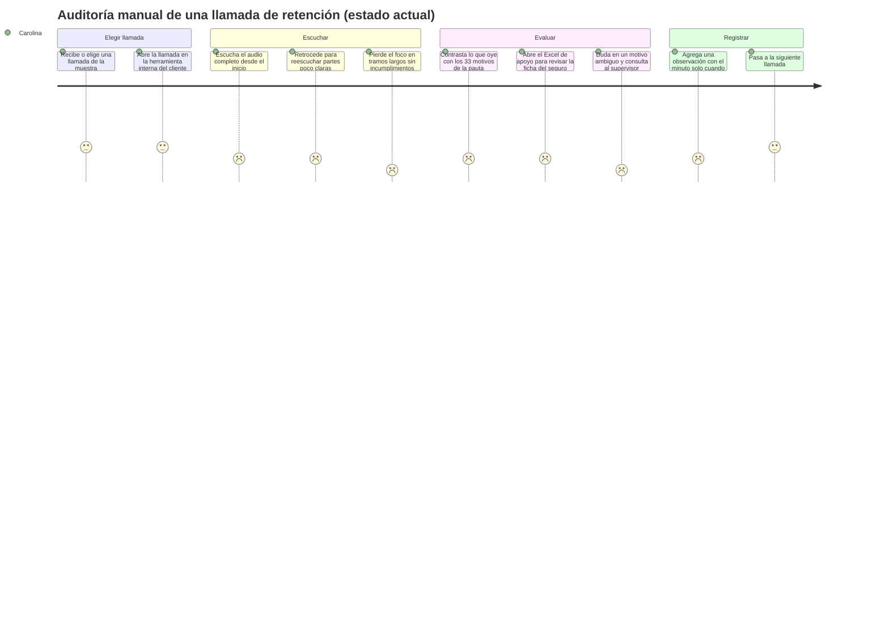

# Fase 1 · Investigación · Front de Call Audit (auditor y supervisor)

> Estado: **entregada para aprobación** (2026-10-14). Alcance: rol **auditor** y rol **supervisor**, este con todas sus historias MVP más la gestión de auditores (D-01, D-08, D-10, D-12; ver `00-brief.md`). Proceso completo (D-09).
> **No hubo entrevistas con usuarios reales.** Las personas son **proto-personas** y todo lo que no sale de los documentos del proyecto o de datos medidos va marcado **[SUPUESTO]** (ver `hipotesis.md`).
> Datos usados: documentos del repo, el material del zip y **métricas agregadas de forma** de las 100 transcripciones del benchmark de ASR (duración, turnos, hablantes). No se copió contenido de esas transcripciones, que tienen PII (L-19).

---

## 1. Desk research

### 1.1 El trabajo del auditor hoy

- El auditor escucha llamadas a mano y las evalúa contra la pauta de BancoEstado: **33 motivos de no calidad en 5 bloques** (acreditación y cierre, conocimiento del producto, gestión de la retención, trato, tipificación). La pauta no tiene puntaje: cada motivo se cumple o no.
- Solo alcanza a auditar una **muestra** (`context.md`). El resto de las llamadas no se revisa nunca.
- Para evaluar "conocimiento del producto" (motivos 2, 4, 5, 6, 28), el auditor tiene que saber las condiciones de cada seguro: hoy están en el Excel de apoyo con una hoja por producto, y en la capacitación S4P.
- **Herramienta actual (D-11, dato del usuario):** los auditores son personal del cliente, del contact center. Auditan con una **herramienta interna** en la que **escuchan el audio completo** y **agregan observaciones minuto a minuto, solo cuando algo no cumple**. El registro es por excepción: lo que no se anota se da por cumplido.
- Todavía no sabemos cuánto se demoran por llamada, cuántas auditan al día ni cómo es el formato exacto de la observación (H-03, en parte).
- **Implicancia clave:** Call Audit invierte el trabajo. El auditor ya no busca los incumplimientos escuchando todo: valida los que propone la IA. Para no sumar trabajo (H-24), la acción explícita se pide solo en lo `non_compliant` y `uncertain`. La marca de minuto ya es un hábito del auditor (H-25).

### 1.2 La forma de los datos (medido)

| Dato | Valor medido | Implicancia de diseño |
|---|---|---|
| Duración de la llamada (100 transcripciones del benchmark) | mín. ~4 min · **mediana ~10 min** · máx. ~29 min | Escuchar la llamada completa no es viable: el valor está en **saltar a la evidencia**. `context.md` supone ~4 min (H-12) |
| Turnos de habla por llamada | mín. 31 · **mediana 83** · máx. 314 | La transcripción es larga: hace falta scroll sincronizado con el audio, ir al turno actual y buscar dentro del texto |
| Palabras por turno | mediana 8 · p90 43 · máx. ~600 | Hay monólogos largos (ej. lectura de condiciones): la cita resaltada debe ubicarse dentro del turno, no solo marcar el turno |
| Hablantes | EJECUTIVO, CLIENTE y **OTRO** | Soportar un tercer hablante (H-13) |
| Catálogo de seguros | **66 productos**: 47 retenibles, 10 no retenibles, 9 no renunciables (4 tipos); 6 o más aseguradoras | La ficha del seguro tiene que estar a mano (D-02). La categoría cambia qué motivos aplican (ej. el 17: no retener un no retenible) |
| Contenido de una ficha | Datos de la llamada (N° MUS A Neto, póliza, vigencia, medio de pago), compañía, categoría, tipo de prima, devolución, retracto, coberturas, asistencias, tabla de primas, siniestros, observaciones | Mucha información: hay que jerarquizarla. Primero lo que define la evaluación (categoría, prima, devolución, retracto) y luego, a pedido, el detalle |
| Medios de pago | 10 códigos (CRE, CCT, CTV, HIP, TCR, ...) | Mostrar el código traducido a texto |

### 1.3 Normativa y contexto regulatorio relevante para el auditor

- **Ley 21.719** (reforma la Ley 19.628): los datos personales se enmascaran por defecto y las decisiones no pueden ser solo automatizadas (L-03, L-07). El auditor es la "persona" de la regla 5: su revisión es la que da validez al hallazgo.
- **Ley 19.496 / 21.398 (consumidor)**: varios motivos de la pauta protegen derechos del consumidor (retracto, devolución de primas, información correcta del producto). Un falso negativo no es solo un error de calidad: es un riesgo regulatorio para el cliente (L-16).
- **Código del Trabajo**: las grabaciones evalúan a trabajadores (ejecutivos); el lenguaje y las funciones no deben ser sancionatorios (L-06, L-15).
- **WCAG 2.2 AA / Ley 20.422**: uso intensivo de teclado; los atajos de una sola tecla deben poder desactivarse o reasignarse (criterio 2.1.4) (L-12).

### 1.4 Tendencias del dominio

- Las herramientas de QA de contact center pasaron de muestrear un 1–3 % de las llamadas a evaluarlas todas con IA (**auto-QA**). El humano pasa de evaluar a **validar** lo que propone la máquina.
- **Riesgo conocido de esta transición: sesgo de automatización.** Cuando la IA casi siempre acierta, el revisor deja de mirar la evidencia y confirma por inercia, sobre todo con cansancio (H-16). Mitigaciones habituales:
  - mostrar la evidencia antes que el veredicto en los ítems dudosos;
  - no permitir confirmar en bloque lo dudoso (ya está en HU-AUD-03);
  - incluir casos de control (la muestra de "cumple", HU-AUD-07);
  - medir el acuerdo contra un golden set.
- La **corrección estructurada** (un motivo de lista cerrada) se usa como señal de reentrenamiento. Es el dato más valioso según el plan de trabajo.

---

## 2. Benchmark competitivo

> Referentes del mercado de speech analytics y auto-QA. La descripción es de patrones públicos y generales de cada producto, **sin verificar contra su versión actual** **[SUPUESTO]**: las funciones cambian seguido. No se copia ningún diseño ni asset (L-13).

| Referente | Qué hace bien (patrón) | Qué hace mal o no aplica | Patrón que tomamos |
|---|---|---|---|
| **NICE CXone** (Interaction Analytics + Quality Management) | Formularios de evaluación configurables; reproductor con transcripción y marcas; flujo de disputa de evaluaciones | Muy configurable y denso; está pensado para operaciones grandes con un administrador dedicado | Disputa ↔ escalamiento; marcas de evidencia en la línea de tiempo |
| **CallMiner Eureka** | Categorías y búsqueda por frases sobre el 100 % de las llamadas; puntaje automático | Orientado a analistas, no a revisión en serie | Búsqueda dentro de la transcripción |
| **Observe.AI** (Auto QA) | Evaluación automática por criterio con el momento de la llamada que la justifica; el revisor confirma o cambia | Puntaje global por llamada (para BancoEstado no hay puntaje) | Criterio → evidencia → salto al audio |
| **Level AI** (QA automática con LLM) | Respuesta de la IA por pregunta del formulario, con explicación y cita | La explicación del LLM puede sonar segura aunque esté mal; hace falta validar la cita | Cita validada contra la transcripción (regla 4) y aviso cuando no aparece |
| **Genesys Cloud** (Speech & Text Analytics + Quality) | Integrado a la plataforma de contact center; evaluaciones con calibración | Atado a su propio ecosistema de telefonía | Calibración (Post) |

**Patrones que se repiten en todos**

1. Pantalla de revisión en **tres zonas**: reproductor y línea de tiempo; transcripción por hablante; formulario o checklist.
2. Cada criterio enlaza a **un momento** de la llamada.
3. Flujo de **disputa o escalamiento** con comentario.
4. Ninguno pone la **ficha del producto** junto a la evaluación. Es una oportunidad propia del dominio de retención de seguros (D-02).
5. La mayoría usa **puntaje**; aquí no aplica.

---

## 3. Plan de investigación con usuarios

> **No se ejecuta (D-16, 2026-10-14): no hay acceso a usuarios para entrevistas.** El plan queda documentado por si el acceso cambia. Las proto-personas quedan como definitivas para el proyecto y se validan en el test de usabilidad de la Fase 7; si tampoco hay acceso para el test, se usarán usuarios proxy y una evaluación heurística (H-29).

### 3.1 Objetivos

1. Entender cómo auditan hoy: herramienta, registro del resultado, tiempo por llamada y cuántas llamadas al día.
2. Saber cómo consultan las condiciones de los seguros durante la auditoría.
3. Identificar los motivos de la pauta más difíciles o ambiguos de evaluar.
4. Conocer su actitud frente a una IA que propone hallazgos: confianza, miedo, sesgo.
5. Validar la búsqueda por ejecutivo (D-07): cuándo y para qué la usarían.

### 3.2 Perfil a reclutar

- 3 a 5 auditores de calidad que auditen hoy llamadas de retención de BancoEstado, con mezcla de antigüedad (menos de 6 meses y más de 1 año).
- 2 a 3 supervisores de calidad, con equipos de auditores y de ejecutivos a cargo (D-08).
- Participación voluntaria; no se evalúa a nadie por participar (L-14).

### 3.3 Guion de entrevista (45 min, semiestructurada)

**Apertura (5 min)**: presentación, objetivo, consentimiento y permiso para grabar.

**Contexto (10 min)**
1. Cuéntame cómo es un día normal de trabajo, desde que llegas.
2. ¿Cómo eliges o te asignan las llamadas que auditas?
3. ¿Dónde registras el resultado de una auditoría? ¿Me lo puedes mostrar sin datos de clientes?

**La última auditoría (15 min)**
4. Piensa en la última llamada que auditaste. Cuéntame paso a paso qué hiciste.
5. ¿En qué momento tuviste que volver a escuchar una parte? ¿Por qué?
6. ¿Qué información tuviste que buscar fuera de la grabación? ¿Dónde la buscaste?
7. ¿Hubo algún motivo de la pauta en que dudaste? ¿Cómo lo resolviste?

**Productos y pauta (5 min)**
8. ¿Cómo sabes si lo que dijo el ejecutivo sobre un seguro es correcto?
9. ¿Qué motivos de la pauta te cuesta más evaluar?

**IA y búsqueda (8 min)**
10. Imagina que una herramienta te propone qué motivos se incumplieron. ¿Qué necesitarías ver para confiar o no confiar en esa propuesta?
11. ¿En qué situaciones buscarías las llamadas de un ejecutivo en particular?
12. Cuando no estás de acuerdo con un criterio, ¿qué haces hoy?

**Cierre (2 min)**: ¿Hay algo que no te pregunté y que debería saber?

> Reglas: preguntas abiertas, sin sugerir respuestas, pidiendo ejemplos concretos y recientes ("la última vez que…") en vez de opiniones generales.

### 3.3b Guion de entrevista para supervisores (45 min)

**Apertura (5 min)**: igual que con los auditores.

**Contexto (10 min)**
1. ¿A cuántos auditores y ejecutivos tienes a cargo? ¿Cómo se reparte tu semana?
2. ¿Cómo te enteras hoy de que un auditor tiene una duda o encontró algo grave?

**Control de la revisión (12 min)**
3. Cuéntame la última vez que no estuviste de acuerdo con lo que auditó alguien de tu equipo. ¿Qué hiciste?
4. ¿Revisas todas las auditorías o solo algunas? ¿Cómo eliges cuáles?
5. ¿Cómo sabes si dos auditores aplican la pauta de la misma forma?

**Seguimiento de ejecutivos (13 min)**
6. Cuéntame cómo fue la última vez que le diste feedback a un ejecutivo. ¿Qué información llevaste?
7. ¿Dónde queda registrado ese feedback? ¿Cómo haces el seguimiento?
8. ¿Qué indicadores miras a diario o cada semana? ¿Cuáles te piden tus jefaturas o el cliente?

**IA (3 min)**
9. Si una herramienta separa "lo que dijo la IA" de "lo que confirmó un auditor", ¿qué usarías para tomar decisiones sobre tu equipo?

**Cierre (2 min)**

### 3.4 Encuesta corta (opcional, para todo el equipo de auditores)

1. ¿Cuántas llamadas auditas en un día normal? (número)
2. ¿Cuánto te demoras en promedio por llamada? (menos de 5 min / 5–10 / 10–20 / más de 20)
3. ¿Con qué frecuencia necesitas consultar la ficha de un seguro durante una auditoría? (nunca → siempre, escala 1–5)
4. ¿Qué bloque de la pauta te cuesta más evaluar? (selección única + "otro")
5. ¿Usas atajos de teclado en tus herramientas de trabajo? (sí / no / no sé qué son)
6. ¿Qué tan cómodo te sentirías revisando hallazgos propuestos por una IA? (1–5 + comentario opcional)

### 3.5 Consentimiento informado (borrador para revisión legal, L-14)

> **Participación en la investigación para el diseño de Call Audit**
>
> Qubico está diseñando una herramienta para apoyar la auditoría de llamadas. Te invitamos a una conversación de unos 45 minutos sobre cómo haces tu trabajo hoy.
>
> - **Es voluntaria.** Puedes no participar, saltarte preguntas o retirarte cuando quieras, sin ninguna consecuencia laboral.
> - **No te estamos evaluando.** Nos interesa el proceso y la herramienta, no tu desempeño. Tu jefatura no recibirá tus respuestas individuales.
> - **Grabación:** si lo autorizas, grabaremos solo el audio para no perder detalles. La grabación la escucha únicamente el equipo de diseño de Qubico y se elimina dentro de los `TBD` días siguientes a la síntesis.
> - **Uso de la información:** solo para diseñar la herramienta. Las citas que usemos serán anónimas y sin datos que te identifiquen.
> - **No compartas datos de clientes.** Si muestras pantallas o ejemplos, que sean sin RUT, nombres ni números de póliza.
> - **Tus derechos:** puedes pedir acceso a tus datos o su eliminación escribiendo a `TBD` (contacto de Qubico).
>
> ☐ Acepto participar en la entrevista. ☐ Autorizo la grabación del audio. *(Ambas casillas se presentan sin marcar.)*
>
> Nombre: ______ Fecha: ______ Firma: ______

### 3.6 Síntesis

No aplica todavía: no hay transcripciones de entrevistas. Cuando las haya, se agregan aquí el mapa de afinidad, los hallazgos y las citas anonimizadas.

---

## 4. Dolencias identificadas (`P-xx`)

| ID | Dolencia | Evidencia |
|---|---|---|
| P-01 | Escuchar una llamada completa (mediana ~10 min) para encontrar unos pocos momentos relevantes | Medido (duración) + **D-11 (escuchan el audio completo)** |
| P-02 | Solo se audita una muestra: los incumplimientos del resto no se ven | `context.md` |
| P-03 | Anotar a mano el minuto de cada incumplimiento y volver a ubicarlo después cuesta tiempo | D-11 (observaciones minuto a minuto) + **[SUPUESTO sobre el costo]** |
| P-04 | Recordar o buscar las condiciones de 66 seguros (coberturas, prima, devolución, retracto) fuera de la herramienta de auditoría | Catálogo medido + D-02 |
| P-05 | Errores de transcripción (audio telefónico, español chileno) que llevan a un hallazgo equivocado | `context.md` (WER 15–25 %) |
| P-06 | Criterios de la pauta ambiguos o con reglas contradictorias entre el script y el Excel de apoyo | `client-open-questions.md` (#8, #9, #13, #15–#19) |
| P-07 | Cansancio y pérdida de foco en revisiones largas y repetitivas, con riesgo de confirmar por inercia | **[SUPUESTO]** + literatura (H-16) |
| P-08 | El registro por excepción (solo se anota lo que no cumple) no deja evidencia de lo que sí se verificó, ni un motivo estructurado | D-11 + **[SUPUESTO sobre el impacto]** |
| P-09 | No saber si su criterio coincide con el de otros auditores o con el del supervisor | HU-AUD-06 / HU-AUD-08 **[SUPUESTO]** |
| P-10 | Desconfianza o miedo frente a la IA: "¿me va a reemplazar?" o "¿y si me equivoco al contradecirla?" | **[SUPUESTO]** |
| P-11 | Exposición innecesaria a datos personales y sensibles de clientes (RUT, salud) | `privacy.md`, L-03/L-05 |
| P-12 | Dificultad para encontrar todas las llamadas de un ejecutivo en particular | D-07 |
| P-13 | Dos auditores trabajando el mismo caso, o perder lo avanzado si se cierra la pestaña | HU-AUD-01 (bloqueo `in_review`) |
| P-14 | **Supervisor:** las dudas y los casos graves de los auditores llegan por canales informales (chat, pasillo) y se pierden o se resuelven sin registro | D-08, HU-SUP-05 **[SUPUESTO]** |
| P-15 | **Supervisor:** no tiene forma práctica de controlar la calidad y la consistencia de las revisiones de su equipo | HU-SUP-06 a 08 **[SUPUESTO]** |
| P-16 | **Supervisor:** si corrige a un auditor, la decisión original se pierde o queda sin justificación | HU-SUP-07 |
| P-17 | **Supervisor:** prepara el feedback a los ejecutivos juntando evidencia a mano; el seguimiento de los compromisos queda en notas propias | HU-SUP-03/04, H-22 **[SUPUESTO]** |
| P-18 | **Supervisor:** no distingue lo que dijo la IA de lo confirmado por una persona, y corre el riesgo de actuar sobre hallazgos no revisados | HU-SUP-01, L-07 |
| P-19 | **Supervisor:** los incumplimientos críticos se conocen tarde (días después), cuando ya no sirve actuar | HU-SUP-05 **[SUPUESTO]** |

---

## 5. Mapa de empatía · Auditora (proto-persona primaria)

| Cuadrante | Contenido **[SUPUESTO salvo indicación]** |
|---|---|
| **Piensa** | "¿Esta llamada la tengo que escuchar entera?" · "¿Qué decía la ficha de este seguro sobre la devolución?" · "Si contradigo a la IA, ¿me van a preguntar por qué?" |
| **Siente** | Presión por cumplir la cuota diaria · fatiga auditiva al final del día · responsabilidad: su decisión afecta la evaluación de un ejecutivo |
| **Dice** | "La pauta no dice qué hacer en este caso" · "El audio está malo, no se entiende" · "Este ejecutivo siempre se salta el cierre" |
| **Hace** | Escucha el audio completo en la herramienta interna (D-11) · retrocede para reescuchar · anota una observación con el minuto solo cuando algo no cumple (D-11) · consulta el Excel de apoyo **[SUPUESTO]** · consulta al supervisor cuando duda **[SUPUESTO]** |
| **Dolores** | P-01, P-03, P-04, P-06, P-07, P-08 |
| **Ganancias** | Ir directo al momento clave · tener la ficha del seguro al lado · confirmar rápido lo obvio y pensar solo en lo dudoso · saber que su criterio queda registrado y sirve |

### 5b. Mapa de empatía · Supervisor (proto-persona)

| Cuadrante | Contenido **[SUPUESTO]** |
|---|---|
| **Piensa** | "¿Qué escalaron hoy y qué es urgente?" · "¿Este auditor está revisando muy rápido?" · "Necesito evidencia concreta para hablar con el ejecutivo" |
| **Siente** | Presión por indicadores de calidad ante el cliente · responsabilidad por decisiones que afectan a personas · poco tiempo |
| **Dice** | "Mándame el minuto exacto" · "Esto no es un incumplimiento, es criterio" · "¿Cuántas llevamos este mes?" |
| **Hace** | Responde dudas por chat · revisa algunas auditorías al azar · arma reportes en planilla · tiene reuniones de feedback uno a uno |
| **Dolores** | P-14, P-15, P-16, P-17, P-18, P-19 |
| **Ganancias** | Una bandeja única de lo que requiere su decisión · evidencia lista para el feedback · trazabilidad de quién decidió qué · confiar en los números porque están confirmados |

---

## 6. UX Personas

### 6.1 Persona primaria · Carolina, auditora de calidad (proto-persona)

- **Confianza:** baja. Se construyó con las HU, el contexto del proyecto y los datos medidos; no hubo entrevistas.
- **Contexto:** audita las llamadas de retención de seguros del cliente. Trabaja en escritorio, en Chrome o Edge, con audífonos (D-06). Nivel técnico medio: usa con soltura planillas y el sistema del contact center. Jornada completa revisando llamadas **[SUPUESTO]**.
- **Objetivos:**
  - revisar más llamadas por jornada sin perder precisión;
  - dejar decisiones defendibles, con evidencia;
  - resolver rápido lo dudoso.
- **Dolencias:** P-01, P-03, P-04, P-05, P-06, P-07, P-08, P-10, P-12, P-13.
- **Motivaciones:** hacer bien su trabajo; que la pauta se aplique de forma justa a los ejecutivos; que la herramienta le saque el trabajo mecánico.
- **Frustraciones:** audio malo; criterios ambiguos; buscar información en varios lugares; herramientas lentas.
- **Cómo interactúa con el producto:**
  - **frecuencia:** todo el día, todos los días hábiles **[SUPUESTO]**;
  - **momento:** sesiones largas de revisión en serie;
  - **canal:** web de escritorio;
  - **tareas principales:** tomar el siguiente caso, revisar los hallazgos con su evidencia, consultar la ficha del seguro, confirmar o corregir con un motivo, escalar, retomar sus revisiones, buscar las llamadas de un ejecutivo.
- **Cita representativa (ficticia):** "Muéstrame dónde lo dijo y qué decía el seguro; con eso decido yo."

### 6.2 Persona secundaria · Rodrigo, supervisor de calidad (proto-persona, usuario del MVP por D-08)

- **Confianza:** baja (sin entrevistas).
- **Contexto:** jefe de un equipo de auditores y responsable de dar feedback a los ejecutivos del contact center **[SUPUESTO: 5–15 auditores, decenas de ejecutivos; H-20]**. Trabaja en escritorio y a veces en notebook; en bloques cortos entre reuniones (H-19).
- **Objetivos:**
  - resolver el mismo día los escalamientos y las alertas;
  - asegurar que las revisiones de su equipo sean consistentes antes de que cuenten en los indicadores;
  - dar feedback a los ejecutivos con evidencia concreta y hacerle seguimiento;
  - reportar la calidad al cliente.
- **Dolencias:** P-06, P-09 (como receptor), P-14 a P-19.
- **Motivaciones:** mejorar la calidad del equipo con criterios justos; tener números en que confiar; no perder tiempo armando reportes.
- **Frustraciones:** canales informales; reescuchar llamadas para entender una duda; indicadores que mezclan IA y revisión humana.
- **Cómo interactúa con el producto:**
  - **frecuencia:** varias veces al día **[SUPUESTO]**;
  - **momento:** al inicio del día (alertas y escalados), entre reuniones (revisiones) y una vez por semana (feedback, reportes y altas de auditores);
  - **canal:** web de escritorio;
  - **tareas:**
    - atender escalamientos y alertas;
    - revisar y aprobar, reabrir o cambiar revisiones;
    - ver el dashboard y la ficha del ejecutivo;
    - registrar feedback;
    - exportar;
    - crear y desactivar auditores (D-12).
- **Cita representativa (ficticia):** "Si me escalan algo, quiero ver la llamada en el mismo minuto que la vio el auditor."

### 6.3 Afectado, no usuario · Ejecutivo del contact center

Lo evalúan, pero no usa la app (H-05). Las decisiones de diseño deben proteger su dignidad (L-06, L-18): lenguaje de hallazgos, revisión humana obligatoria y búsqueda por ejecutivo registrada.

---

## 7. Journey map actual · Carolina audita una llamada (sin Call Audit)

> Basado en D-11 (herramienta interna, escucha completa, observaciones por minuto solo en incumplimientos). Las emociones, la consulta de fichas y el escalamiento informal siguen siendo **[SUPUESTO]**.



| Etapa | Acciones | Puntos de contacto | Pensamientos | Emoción | Dolencias |
|---|---|---|---|---|---|
| Elegir llamada | Recibe la muestra y abre la llamada | Herramienta interna del cliente | "¿Cuál me toca?" | Neutra | P-02 |
| Escuchar | Escucha completo, retrocede | Reproductor de audio | "Esto es largo y casi todo está bien" | Baja (fatiga) | P-01, P-03, P-05, P-07 |
| Evaluar | Recorre la pauta, consulta la ficha, duda | Pauta impresa o PDF, Excel de apoyo, supervisor | "¿Qué decía la devolución para este seguro?" | Baja (incertidumbre) | P-04, P-06 |
| Registrar | Agrega observaciones por minuto, solo en los incumplimientos | Herramienta interna del cliente | "Lo que no anoto, se da por cumplido" | Media | P-03, P-08, P-09 |

### 7b. Journey actual · Rodrigo responde una duda y da feedback (sin Call Audit)

> **[SUPUESTO]** completo (H-22).

```mermaid
journey
  title Supervisor: escalamiento y feedback (estado actual, supuesto)
  section Recibir la duda
    Le llega un chat del auditor con una duda de criterio: 2: Rodrigo
    Pide el ID de la llamada y el minuto: 2: Rodrigo
  section Resolver
    Busca y escucha el tramo de la llamada: 2: Rodrigo
    Responde por chat; la decisión no queda registrada: 1: Rodrigo
  section Preparar feedback
    Junta incumplimientos del ejecutivo desde planillas: 1: Rodrigo
    Arma la reunión uno a uno: 3: Rodrigo
  section Seguimiento
    Anota el compromiso en notas propias: 2: Rodrigo
    Olvida revisar si mejoró: 1: Rodrigo
```

| Etapa | Acciones | Puntos de contacto | Emoción | Dolencias |
|---|---|---|---|---|
| Recibir la duda | Chat del auditor, pide contexto | Chat, correo | Media | P-14 |
| Resolver | Busca la llamada y escucha el tramo | Sistema del contact center | Baja | P-14, P-16 |
| Preparar feedback | Junta evidencia a mano | Planillas | Baja | P-17, P-18 |
| Seguimiento | Notas propias | Cuaderno, planilla | Baja | P-17 |

---

## 8. Critical User Journeys (CUJ)

### CUJ-1 · Revisar un caso derivado por la IA y dejar una decisión trazable

- **Disparador:** la auditora inicia la jornada o termina el caso anterior, y hay casos en la cola.
- **Objetivo:** validar o corregir cada hallazgo con evidencia y cerrar el caso con una decisión defendible.
- **Pasos:**
  1. "Tomar siguiente" (el caso pasa a `in_review`).
  2. Leer el resumen: decisión del motor, cantidad de hallazgos, seguros de la llamada.
  3. Recorrer los hallazgos, con los `non_compliant` y `uncertain` primero.
  4. Saltar a la evidencia en el audio y la transcripción.
  5. Consultar la ficha del seguro cuando el motivo lo requiere.
  6. Confirmar, o cambiar con un motivo de corrección; si falta algo, agregar el hallazgo que la IA no detectó.
  7. Ver el veredicto resultante.
  8. "Guardar y siguiente".
- **Criterio de éxito:**
  - todos los ítems `uncertain` resueltos;
  - toda corrección con motivo;
  - caso en `confirmed` o `corrected`;
  - siguiente caso abierto sin volver a la cola.
- **Puntos de falla:**
  - la evidencia no lleva al momento correcto o la cita no se valida (P-05);
  - la ficha del seguro no está o no corresponde (P-04);
  - la auditora confirma sin mirar (H-16);
  - pierde lo avanzado o choca con otro auditor (P-13);
  - criterio ambiguo sin salida (P-06).
- **Métricas:** tiempo de revisión por caso (vs. duración de la llamada, H-04); % de casos completados sin volver a la cola; % de correcciones con motivo distinto de "Otro"; acuerdo con el golden set en la muestra de "cumple".

### CUJ-2 · Resolver un caso que no le corresponde cerrar (escalar) y ver la respuesta

- **Disparador:** duda de criterio, posible incumplimiento crítico o audio inaudible.
- **Objetivo:** sacar el caso de su cola con contexto suficiente y recibir una respuesta.
- **Pasos:**
  1. "Escalar" en el detalle.
  2. Elegir un motivo y escribir un comentario.
  3. El caso pasa a `escalated` y sale de la cola.
  4. Más tarde, en "Mis revisiones", ve la respuesta: reabierto, cambiado o aprobado.
- **Criterio de éxito:** escalar toma menos de 30 s **[SUPUESTO]** y la respuesta es visible y trazable.
- **Puntos de falla:**
  - el supervisor no ve el escalamiento a tiempo. Ya está resuelto que tendrá interfaz (D-08); el correo es `Post`;
  - el comentario no basta para entender la duda.
- **Métricas:** % de casos escalados; tiempo hasta la respuesta; casos escalados sin respuesta a las 24 h.

### CUJ-3 · Encontrar y revisar las llamadas de un ejecutivo

- **Disparador:** la auditora necesita revisar los casos de un ejecutivo en particular (D-07, H-17).
- **Objetivo:** filtrar la cola por ejecutivo y revisar sus casos en serie.
- **Pasos:**
  1. En la cola, buscar o filtrar por ejecutivo (con autocompletado).
  2. Ver sus casos ordenados por gravedad.
  3. "Tomar siguiente" dentro del filtro.
  4. Revisar como en el CUJ-1.
  5. Limpiar el filtro.
- **Criterio de éxito:** encontrar al ejecutivo en menos de 10 s **[SUPUESTO]**; "Tomar siguiente" respeta el filtro activo; la búsqueda queda en el log de acceso (L-18).
- **Puntos de falla:**
  - nombres repetidos o mal escritos;
  - el filtro se "pega" y la auditora deja de ver el resto de la cola sin darse cuenta;
  - uso para focalizar a una persona (L-18).
- **Métricas:** uso del filtro por ejecutivo; tiempo hasta el primer caso filtrado.

### CUJ-4 · Supervisor atiende un escalamiento o una alerta y deja la decisión registrada

- **Disparador:** un auditor escala un caso (CUJ-2), o confirma un hallazgo de un motivo crítico (con los motivos críticos aún `TBD`, #1).
- **Objetivo:** decidir el mismo día con la evidencia a la vista y devolver una respuesta trazable.
- **Pasos:**
  1. Ver la bandeja con lo nuevo arriba (escalamientos y alertas, cada uno con su tipo).
  2. Abrir el caso en el hallazgo y el minuto que marcó el auditor.
  3. Leer el comentario del auditor.
  4. Elegir: aprobar y cerrar, reabrir al mismo u otro auditor con un comentario, o cambiar la decisión con un motivo.
  5. Marcar la alerta como gestionada, con un comentario.
- **Criterio de éxito:**
  - la respuesta queda visible para el auditor en "Mis revisiones";
  - se conservan las decisiones de la IA, del auditor y del supervisor (L-23);
  - la alerta queda en `gestionada`.
- **Puntos de falla:**
  - la bandeja no avisa de lo nuevo, porque la notificación por correo es `Post`;
  - no está claro a quién reabrir;
  - el cambio queda sin motivo.
- **Métricas:** tiempo desde que se escala hasta que se responde (meta: el mismo día **[SUPUESTO]**); % de alertas gestionadas en menos de 24 h; escalamientos sin respuesta.

### CUJ-5 · Supervisor controla las revisiones de los auditores antes de que cuenten

- **Disparador:** **todas** las revisiones de los auditores requieren su aprobación (D-15). Es un trabajo diario y de alto volumen, priorizado por señales: revisión muy rápida, el auditor contradijo a la IA en un ítem crítico, corrección a la IA.
- **Objetivo:** detectar errores de criterio y corregirlos antes de que lleguen a los indicadores de los ejecutivos.
- **Pasos:**
  1. Abrir las revisiones de los auditores.
  2. Filtrar por auditor, por "corrigió a la IA", por "contradijo en crítico" o por revisión rápida.
  3. Abrir un caso y ver por ítem la comparación IA → auditor, con su motivo.
  4. Aprobar, reabrir o cambiar.
- **Criterio de éxito:**
  - los casos revisados pasan a `closed`;
  - los cambios quedan con motivo;
  - el filtro permite encontrar lo sospechoso sin recorrer todo.
- **Puntos de falla:**
  - **aprobar todo es un cuello de botella (D-15)**: si aprobar toma lo mismo que revisar, el supervisor duplica el trabajo del equipo. El diseño debe permitir aprobar rápido lo que coincide con la IA y sin señales (atajos, lote con control) y concentrar la atención en lo que tiene señales;
  - aprobar en lote sin mirar convierte la aprobación en un trámite (sesgo de automatización del supervisor, H-16);
  - percepción de vigilancia sobre los auditores (L-22).
- **Métricas:** casos aprobados por hora; casos en espera de aprobación al final del día (meta: tendiendo a 0); % de reaperturas y cambios; tiempo en estado "esperando aprobación".

### CUJ-6 · Supervisor prepara y registra feedback a un ejecutivo con evidencia

- **Disparador:** reunión de feedback programada, o un patrón de incumplimientos confirmados.
- **Objetivo:** llegar a la conversación con evidencia confirmada y dejar el compromiso registrado para hacerle seguimiento.
- **Pasos:**
  1. Ir a Ejecutivos.
  2. Abrir la ficha del ejecutivo: evolución y motivos incumplidos confirmados.
  3. Abrir 1 o 2 llamadas de ejemplo, en el minuto exacto.
  4. Registrar el feedback: texto, compromiso, fecha de seguimiento y llamadas asociadas.
  5. Marcar las llamadas como "con feedback" o "gestionada".
- **Criterio de éxito:**
  - solo se usan hallazgos confirmados por un humano (L-07);
  - el feedback queda en el historial;
  - la evolución desde esa fecha se ve en la ficha.
- **Puntos de falla:**
  - se mezclan hallazgos "según IA" con confirmados;
  - el texto libre se usa como registro disciplinario (L-06, L-21).
- **Métricas:** % de llamadas con hallazgos confirmados que tienen seguimiento; tiempo de preparación del feedback.

### CUJ-7 · Supervisor da de alta (o desactiva) a un auditor

- **Disparador:** se incorpora una persona al equipo de auditoría, o alguien deja el equipo.
- **Objetivo:** que el auditor pueda entrar el mismo día, o que deje de tener acceso de inmediato.
- **Pasos:**
  1. Ir a Equipo (o Auditores).
  2. "Agregar auditor": nombre, correo corporativo y método de acceso (SSO o cuenta propia con invitación).
  3. El sistema envía la invitación o habilita el SSO.
  4. El auditor aparece como "Invitado" y luego como "Activo".
  5. Para la baja: "Desactivar", con confirmación. Sus revisiones se conservan.
- **Criterio de éxito:**
  - el alta queda lista en menos de 2 minutos **[SUPUESTO]**;
  - la baja quita el acceso de inmediato y libera sus casos `in_review`;
  - queda registro de quién creó o desactivó cada cuenta (L-17).
- **Puntos de falla:**
  - un correo equivocado (la invitación le llega a otra persona);
  - el supervisor intenta crear a otro supervisor (no permitido: solo Qubico, D-12);
  - borrar en vez de desactivar rompe la trazabilidad.
- **Métricas:** tiempo desde el alta hasta el primer ingreso; cuentas activas de personas que ya no están (meta: 0).

> **Alta de supervisores (Qubico):** el supervisor no la ve. Que Qubico lo haga por una pantalla interna o por un script está por definir (pregunta del gate).

> Fuera de los CUJ, pero dentro del MVP: **login** (SSO o cuenta propia, sin auto-registro), **mis revisiones** (retomar o editar), **fin de jornada** y **muestra de "cumple"** (mismo flujo que el CUJ-1). Del supervisor: dashboard, motivos de no calidad, desempeño de auditores y exportación.
