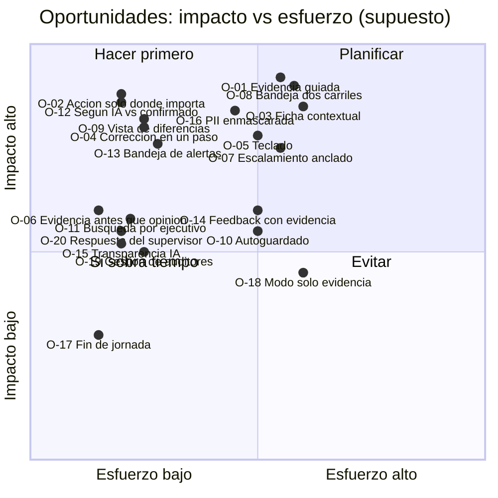
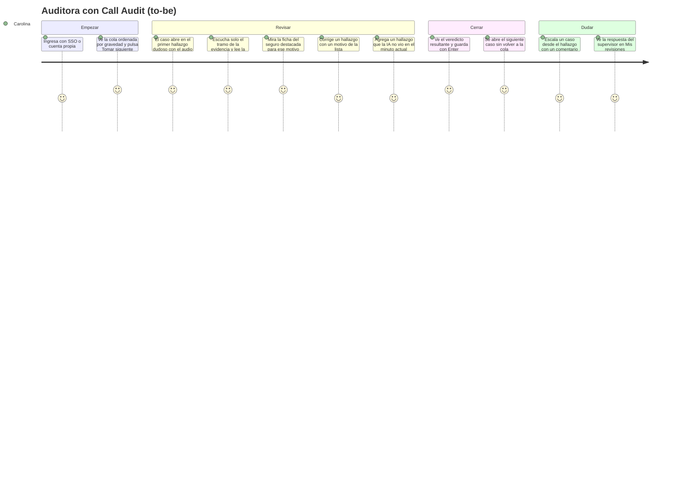
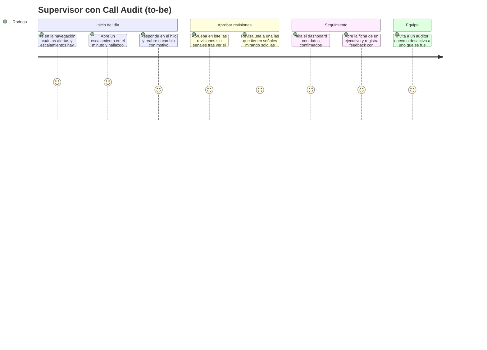

# Fase 2 · Ideación · Front de Call Audit (auditor y supervisor)

> Estado: **entregada para aprobación** (2026-10-14). Parte de las dolencias P-01 a P-19 y de los CUJ-1 a CUJ-7 de `01-investigacion.md`.
> El prototipo v2 del zip se usa como **referencia a contrastar**, no como solución dada. Las ideas que no salen de la evidencia del proyecto se marcan **[SUPUESTO]**.

---

## 1. How Might We (¿Cómo podríamos…?)

| Dolencia | ¿Cómo podríamos…? |
|---|---|
| P-01 Escuchar la llamada completa | …hacer que la auditora decida sin escuchar los ~10 min, yendo directo a los momentos que importan? |
| P-02 Solo se audita una muestra | …mostrar que el 100 % fue evaluado por la IA y que lo que no llega a revisión tiene un control (la muestra de "cumple")? |
| P-03 Anotar y volver a ubicar el minuto | …que cada hallazgo traiga su minuto y que agregar uno nuevo tome el minuto actual del audio? |
| P-04 Condiciones de 66 seguros | …tener la ficha del seguro de la llamada a la vista, mostrando primero lo que el motivo en revisión necesita? |
| P-05 Errores de transcripción | …que la auditora detecte rápido que el texto no coincide con el audio y lo registre como causa? |
| P-06 Criterios ambiguos | …dar una salida clara cuando la pauta no alcanza, sin bloquear el resto del caso? |
| P-07 Cansancio y confirmar por inercia | …mantener la atención en lo dudoso y lo crítico sin hacer el trabajo más lento? |
| P-08 Registro por excepción sin evidencia | …dejar constancia de lo verificado sin pedir un clic por cada ítem que cumple? |
| P-09 No saber si su criterio coincide | …devolverle a la auditora lo que el supervisor aprobó, reabrió o cambió, con la razón? |
| P-10 Desconfianza o miedo frente a la IA | …dejar claro que la IA propone y la persona decide, y que contradecirla es parte del trabajo? |
| P-11 Exposición a PII | …mostrar solo los datos necesarios para auditar, con la PII enmascarada por defecto? |
| P-12 Encontrar las llamadas de un ejecutivo | …buscar y filtrar por ejecutivo en segundos, dejando registro (D-13)? |
| P-13 Choques entre auditores y pérdida de avance | …evitar que dos personas trabajen el mismo caso y que nadie pierda lo avanzado? |
| P-14 Dudas por canales informales | …que toda duda o caso grave llegue al supervisor con la llamada en el minuto exacto? |
| P-15 Sin control de la calidad de las revisiones | …que el supervisor vea primero las revisiones con señales de riesgo? |
| P-16 La decisión original se pierde | …conservar y mostrar lado a lado las decisiones de la IA, del auditor y del supervisor? |
| P-17 Feedback armado a mano | …que el feedback a un ejecutivo salga de hallazgos confirmados y quede con su seguimiento? |
| P-18 Mezclar "según IA" con lo confirmado | …que ningún indicador del supervisor mezcle hallazgos no revisados con los confirmados? |
| P-19 Los críticos se conocen tarde | …que un incumplimiento crítico confirmado llegue al supervisor el mismo día? |
| D-15 Aprobar todas las revisiones | …que aprobar 100 revisiones le tome al supervisor una fracción del tiempo que le tomó al equipo revisarlas, sin que se vuelva un trámite? |

---

## 2. What if (¿Y si…?) · divergencia

Ideas sin filtrar, incluidas las radicales. La convergencia está en la sección 3.

| # | ¿Y si…? | Ataca |
|---|---|---|
| W-01 | …el caso abriera directamente en el primer hallazgo dudoso o que no cumple, con el audio ya posicionado 5 s antes de la cita? | P-01, P-03 |
| W-02 | …el audio tuviera un modo **"solo evidencia"** que reproduce en cadena los tramos de cada hallazgo y salta el resto? | P-01, P-07 |
| W-03 | …los ítems que **cumplen** se dieran por revisados al guardar, salvo que la auditora los abra, y solo lo `non_compliant` y `uncertain` exigiera una acción? | P-08, H-24 |
| W-04 | …la ficha del seguro fuera **contextual**: al mirar el motivo 28 se destaca la regla de devolución, al mirar el motivo 17 la categoría, y al mirar el 2 o el 6 las coberturas? | P-04 |
| W-05 | …cada palabra de la transcripción se pudiera marcar como "mal transcrita", y eso precargara el motivo de corrección "Error de transcripción"? | P-05 |
| W-06 | …en un ítem dudoso la evidencia se mostrara **antes** que la opinión de la IA, para no anclar a la auditora? | P-07, P-10 |
| W-07 | …se intercalaran **casos de control** (la muestra de "cumple" y, más adelante, casos del golden set) sin que la auditora sepa cuáles son? | P-07, P-02 |
| W-08 | …la pantalla de fin de jornada mostrara cuánto tiempo ahorró la auditora frente a escuchar todo? | P-10 |
| W-09 | …el escalamiento fuera un comentario anclado al minuto y al hallazgo, como un hilo, y el supervisor respondiera ahí mismo? | P-14, P-09 |
| W-10 | …la bandeja de aprobación del supervisor separara en dos carriles lo que **coincide con la IA y no tiene señales**, aprobable en lote, de lo que **tiene señales**, para revisar uno a uno? | D-15, P-15 |
| W-11 | …el supervisor viera por cada revisión solo la **diferencia**: qué cambió el auditor respecto de la IA y por qué? | P-15, P-16 |
| W-12 | …el feedback se armara arrastrando hallazgos confirmados a una "carpeta de feedback" del ejecutivo? | P-17 |
| W-13 | …el supervisor recibiera un resumen diario por correo? (es `Post`) | P-19 |
| W-14 | *Radical:* …no hubiera cola, y la IA asignara a cada auditora el caso siguiente según su especialidad y su cansancio? | P-07 |
| W-15 | *Radical:* …el auditor no viera el veredicto de la IA hasta dar el suyo (revisión a ciegas)? | P-07, P-10 |
| W-16 | *Radical:* …el ejecutivo pudiera ver y comentar sus propios hallazgos confirmados? | L-06, L-21 |
| W-17 | *Radical:* …el sistema propusiera automáticamente un plan de capacitación por ejecutivo? | P-17 |
| W-18 | …toda la revisión se pudiera hacer con el teclado, con una barra de comandos (Ctrl+K) para lo poco frecuente? | P-07, D-15 |
| W-19 | …el estado de la revisión se guardara solo en cada cambio (autoguardado) y se pudiera retomar desde "Mis revisiones"? | P-13 |
| W-20 | …la búsqueda por ejecutivo mostrara un aviso discreto de que queda registrada? | P-12, L-18 |

### Convergencia: qué pasa y qué se descarta

| Idea | Decisión | Razón |
|---|---|---|
| W-01, W-02, W-03, W-04, W-06, W-09, W-10, W-11, W-18, W-19, W-20 | **Pasan** como oportunidades | Atacan los CUJ directamente, son explicables y factibles para un dev |
| W-05 | **Pasa, simplificada** | Marcar un tramo como "mal transcrito" a nivel de turno, no de palabra |
| W-07 | **Pasa solo con la muestra de "cumple"** (HU-AUD-07) | Los casos del golden set ocultos quedan para después (Post, calibración) |
| W-08 | **Pasa, reformulada** | Mostrar el tiempo de revisión frente a la duración de las llamadas, sin gamificar ni comparar con otros |
| W-12 | **Pasa como asociar llamadas al feedback** (HU-SUP-04) | Arrastrar no aporta y es peor para la accesibilidad |
| W-13 | **Post** | Ya está así en las HU |
| W-14 | **Descartada** | Asignar por cansancio implica inferir el estado de una trabajadora: riesgo de control laboral (L-22) y opacidad. "Tomar siguiente" por gravedad basta |
| W-15 | **Descartada para el MVP** | Duplica el tiempo de revisión y anula el ahorro. Se puede retomar en la calibración (HU-SUP-09, Post) |
| W-16 | **Descartada para el MVP** | Los ejecutivos no son usuarios (H-05). Atender su derecho de acceso queda como proceso (L-08, L-21) |
| W-17 | **Descartada** | La IA propondría consecuencias sobre una persona: va contra la regla 5 y L-07 |

---

## 3. Oportunidades (`O-xx`)

Impacto: **A** alto · **M** medio · **B** bajo. Esfuerzo de implementación para un dev con Claude Code: **A** alto · **M** medio · **B** bajo. **[SUPUESTO sobre el esfuerzo]**

| ID | Oportunidad | Dolencias | Idea | Impacto | Esfuerzo | Prioridad | ¿Está en el prototipo v2? |
|---|---|---|---|---|---|---|---|
| O-01 | **Revisión guiada por evidencia**: el caso abre en el primer hallazgo `non_compliant`/`uncertain`; clic en la evidencia salta el audio a la cita (con 3–5 s de margen) y la resalta dentro del turno | P-01, P-03 | W-01 | A | M | **1** | En parte (salto a la evidencia; no abre en el primer hallazgo) |
| O-02 | **Acción explícita solo donde importa**: `non_compliant` y `uncertain` exigen confirmar o corregir; los `compliant` quedan como "revisados sin cambios" al guardar, salvo que la auditora los cambie | P-08, P-07, H-24 | W-03 | A | B | **1** | No: el v2 tiene "Confirmar pendientes" |
| O-03 | **Ficha del seguro contextual** junto al checklist: datos de la llamada siempre visibles; la ficha completa por secciones; se destaca la sección relevante para el motivo en foco | P-04 | W-04 | A | M | **1** | No (D-02) |
| O-04 | **Corrección estructurada en un paso**: motivo de corrección de lista cerrada; comentario obligatorio solo con "Otro"; "Error de transcripción" sugerido si el tramo se marcó como mal transcrito | P-05, P-08 | W-05 | A | B | **1** | En parte |
| O-05 | **Revisión completa por teclado**, con ayuda de atajos (?) y atajos desactivables (WCAG 2.1.4) | P-07, D-15 | W-18 | A | M | **1** | En parte (sin poder desactivarlos) |
| O-06 | **Evidencia antes que opinión en lo dudoso**: en `uncertain`, la cita y el tramo van arriba y el comentario de la IA abajo, plegado | P-07, P-10 | W-06 | M | B | 2 | No |
| O-07 | **Escalamiento anclado** al hallazgo y al minuto, con el comentario como hilo entre auditor y supervisor | P-14, P-09 | W-09 | A | M | **1** | En parte (escalar con motivo; sin hilo) |
| O-08 | **Bandeja de aprobación en dos carriles**: "sin señales" (coincide con la IA, sin correcciones ni escalamiento, tiempo normal), aprobable en lote con un resumen previo; y "con señales", para revisar uno a uno | D-15, P-15, L-25 | W-10 | A | M | **1** | No |
| O-09 | **Vista de diferencias** para el supervisor: por ítem, IA → auditor, con motivo y comentario; decisión original siempre visible | P-15, P-16, L-23 | W-11 | A | B | **1** | Sí (decisión lado a lado) |
| O-10 | **Autoguardado y bloqueo visible del caso**: "en revisión por otra persona"; retomar desde "Mis revisiones" | P-13 | W-19 | M | M | 2 | En parte (bloqueo) |
| O-11 | **Búsqueda y filtro por ejecutivo con autocompletado**; "Tomar siguiente" respeta el filtro; chip de filtro activo siempre visible; aviso de registro | P-12, L-18 | W-20 | M | B | 2 | En parte (filtro sin búsqueda) |
| O-12 | **"Según IA" vs "Confirmado"** como distinción visual y textual en todos los indicadores del supervisor; los KPI de ejecutivos solo cuentan lo confirmado | P-18, L-07 | — | A | B | **1** | Sí |
| O-13 | **Bandeja única de alertas y escalamientos** con estados nueva / vista / gestionada y un contador en la navegación | P-14, P-19 | — | A | B | **1** | Sí |
| O-14 | **Feedback con evidencia**: desde la ficha del ejecutivo, asociar llamadas y motivos confirmados, compromiso y fecha de seguimiento; aviso de no escribir datos sensibles | P-17, L-21 | W-12 | M | M | 2 | Sí (sin el aviso) |
| O-15 | **Transparencia de la IA**: banner fijo de hallazgos, panel de capas y regla aplicada, cita no validada marcada | P-10, L-07 | — | M | B | 2 | Sí |
| O-16 | **PII enmascarada por defecto** también en la transcripción y los títulos; ver sin enmascarar solo con permiso y log | P-11, L-03, L-04 | — | A | M | **1** | No (la muestra en claro) |
| O-17 | **Fin de jornada útil**: casos revisados, corregidos y tiempo de revisión frente a la duración de las llamadas; sin rankings | P-10, P-09 | W-08 | B | B | 3 | En parte |
| O-18 | **Modo "solo evidencia"** del reproductor: reproduce en cadena los tramos de los hallazgos | P-01, P-07 | W-02 | M | M | 3 | No |
| O-19 | **Gestión de auditores para el supervisor**: invitar, desactivar y reactivar, con el estado de la cuenta | D-12, L-17 | — | M | B | 2 | No |
| O-20 | **Respuesta del supervisor visible para la auditora** en "Mis revisiones" (reabierto arriba, cambiado lado a lado) | P-09 | — | M | B | 2 | Sí |

### Matriz impacto vs. esfuerzo

**Lectura:**
- **Prioridad 1** (O-01, 02, 03, 04, 05, 07, 08, 09, 12, 13, 16) es el núcleo del MVP. Todas son de impacto alto. Las de esfuerzo medio (O-01, O-03, O-05, O-07, O-08, O-16) concentran el riesgo de plazo.
- **Prioridad 2** también entra al MVP: son baratas o las exigen las HU.
- **Prioridad 3** (O-17, O-18) entra solo si sobra tiempo. O-17 en su forma mínima ya está en HU-AUD-04.

---

## 4. Journey map futuro (to-be)

### 4.1 Carolina, auditora, con Call Audit

| Etapa | Antes (estado actual) | Después (to-be) | Oportunidades |
|---|---|---|---|
| Elegir | Recibe la muestra y abre la llamada | "Tomar siguiente" por gravedad; filtro por ejecutivo si lo necesita | O-11 |
| Escuchar | Escucha el audio completo (~10 min de mediana) | Escucha solo los tramos de evidencia | O-01, O-18 |
| Evaluar | Contrasta de memoria con 33 motivos y el Excel de apoyo | La IA propone; ficha contextual al lado; acción solo en lo dudoso y lo que no cumple | O-02, O-03, O-06 |
| Registrar | Anota a mano el minuto de cada incumplimiento | Minuto y cita ya vienen; la corrección se hace en un paso con motivo cerrado | O-04, O-05 |
| Dudar | Chat o pasillo con el supervisor | Escalamiento anclado; respuesta visible y trazable | O-07, O-20 |

### 4.2 Rodrigo, supervisor, con Call Audit

| Etapa | Antes | Después | Oportunidades |
|---|---|---|---|
| Dudas y graves | Chat informal, decisión sin registro | Bandeja única, hilo anclado, decisión trazable | O-07, O-13 |
| Control de revisiones | Revisa algunas al azar | Aprueba todas (D-15): en lote lo que no tiene señales y una a una lo que sí, con vista de diferencias | O-08, O-09 |
| Indicadores | Planillas que mezclan fuentes | Dashboard que separa "según IA" de "confirmado" | O-12 |
| Feedback | Evidencia juntada a mano, notas propias | Feedback desde la ficha con llamadas asociadas y seguimiento | O-14 |
| Equipo | Pide altas por fuera | Invita y desactiva auditores en la app | O-19 |

---

## 5. Narrativa (storyboard en texto)

### Carolina, un martes

1. Son las 9:00. Carolina entra con el SSO de su empresa. Tiene 42 casos pendientes; arriba, los que tienen algo que "no cumple".
2. Pulsa **Tomar siguiente**. La llamada dura 11 minutos, pero el caso abre directo en el motivo 28, "devolución de primas", marcado como no cumple. El audio está detenido en el minuto 7:42, unos segundos antes de la cita.
3. Escucha 20 segundos. A la derecha, la ficha del seguro de la llamada (un seguro de desempleo de prima mensual) destaca la línea de devolución: "mensual: requerimiento al 600…". El ejecutivo no lo informó. Carolina **confirma** con la tecla C.
4. El siguiente hallazgo es dudoso: la IA no está segura de si el cliente aceptó la retención. La cita aparece arriba; el comentario de la IA, plegado abajo. Escucha y se da cuenta de que la transcripción dice "no" donde el cliente dijo "ya". Marca el turno como mal transcrito, cambia el veredicto a **cumple** y el motivo "Error de transcripción" ya viene sugerido.
5. Los otros 31 motivos cumplen; no tiene que tocarlos. Ve el veredicto resultante, **no cumple**, y pulsa Enter. Se abre el siguiente caso.
6. A media mañana encuentra un caso en que la pauta no dice qué hacer con una renuncia que en realidad fue una consulta. Pulsa **E**, elige "duda de criterio", escribe dos líneas y sigue con otro caso.
7. A las 17:30 la cola está vacía. La pantalla de fin de jornada le muestra 58 casos revisados, 9 corregidos y que su tiempo de revisión fue de un tercio de la duración de las llamadas. En "Mis revisiones" ya está la respuesta del supervisor a su duda. *(Cifras ilustrativas.)*

### Rodrigo, el mismo día

1. A las 9:15, la navegación le muestra 2 alertas nuevas y 1 escalamiento. Abre el escalamiento: la llamada está en el minuto y hallazgo que marcó la auditora. Responde en el hilo con el criterio y reabre el caso para que ella lo cierre.
2. A las 12:00 abre la bandeja de revisiones. Hay 140 revisiones de ayer; 118 están en el carril "sin señales". Ve el resumen (todas coinciden con la IA, ninguna tiene correcciones ni es demasiado rápida) y las aprueba en lote. Las 22 con señales las revisa una a una, mirando solo la diferencia IA → auditor. Reabre una.
3. El jueves prepara una conversación con un ejecutivo: en su ficha ve que el motivo 28 se repite en 4 llamadas confirmadas. Asocia dos llamadas, escribe el compromiso y fija el seguimiento para dentro de dos semanas.
4. El viernes se incorpora una auditora. Rodrigo la invita con su correo corporativo; ella entra el lunes con el SSO.

---

## 6. Revisión legal de las ideas

| Idea / oportunidad | Riesgo | Ajuste | Ref. |
|---|---|---|---|
| O-02 · los "cumple" quedan revisados sin acción | Que se interprete como revisión humana de algo que nadie miró | El registro distingue "revisado con acción" de "aceptado sin cambios"; el caso entero sí tiene una decisión humana explícita (guardar) | L-07, L-16 |
| O-08 · aprobación en lote | La aprobación se vuelve un trámite; deja de ser revisión humana real | El lote solo admite el carril sin señales, muestra un resumen, tiene un tope por lote **[SUPUESTO: 50]** y queda marcado como "aprobado en lote" | L-25, L-07 |
| O-11 · búsqueda por ejecutivo | Focalización del control sobre una persona | Log de acceso (D-13); aviso discreto; el orden por defecto sigue siendo la gravedad | L-18 |
| O-14 · feedback | Uso como registro disciplinario; datos sensibles en texto libre | Sin campos de sanción; aviso en el formulario; retención por definir | L-06, L-21 |
| O-16 · ver PII sin enmascarar | Exposición innecesaria | Solo con permiso por rol, motivo y log; desactivado por defecto | L-03, L-04 |
| O-17 · fin de jornada | Gamificación o comparación entre auditoras = control laboral | Solo datos propios, sin rankings | L-22 |
| O-19 · gestión de auditores | Cuentas huérfanas; escalada de permisos | Desactivar en vez de borrar; el supervisor no crea supervisores | L-17 |
| W-14, W-17 (descartadas) | Inferir el estado de una trabajadora; la IA propondría consecuencias | Descartadas | L-22, L-07 |
| W-16 (descartada) | Exponer evaluaciones al ejecutivo sin un proceso definido | Descartada para el MVP; el derecho de acceso se atiende como proceso | L-08, L-21 |
