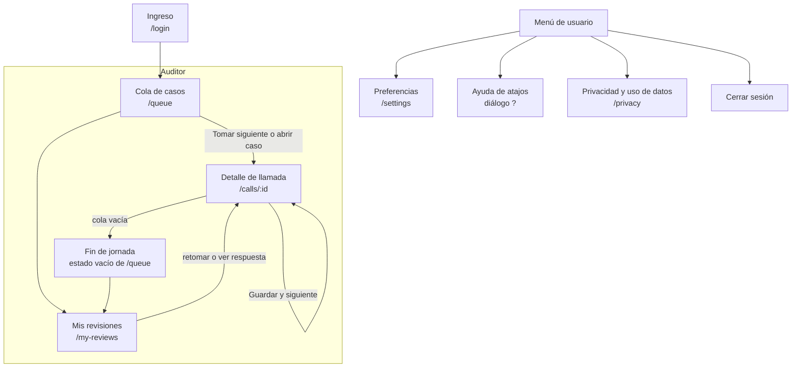
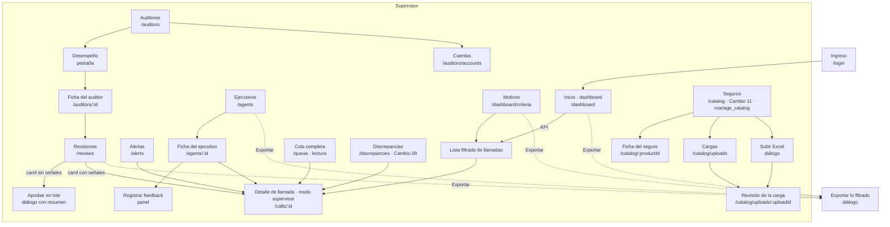

# Fase 3 · Arquitectura de información · Front de Call Audit

> Estado: **entregada para aprobación** (2026-10-15). Roles del MVP: **auditor** y **supervisor** (todas sus HU MVP más la gestión de auditores). Fuera del MVP: admin de calidad, operación Qubico y las HU `Post`.
> Base: el mapa de vistas de `docs/user-stories-auditor-supervisor.md`, el prototipo v2 (como referencia), las oportunidades aprobadas de `02-ideacion.md` y las decisiones D-01 a D-19.

---

## 1. Inventario de contenido y funcionalidades

**Leyenda.** Existe: **P** = está en el prototipo v2 · **HU** = solo en las historias · **Nuevo** = sale de las fases 1–2. Rol: **A** = auditor · **S** = supervisor.

### 1.1 Acceso y cuenta

| Contenido / función | Rol | Existe | Requisito / trazabilidad |
|---|---|---|---|
| Login con "Ingresar con SSO" (proveedor genérico) | A, S | Nuevo | D-05, D-17, #25 |
| Login con cuenta propia (correo + contraseña, MFA `TBD`) | A, S | P (sin MFA) | D-05, L-11, L-17 |
| Aceptar invitación y crear contraseña (primer ingreso) | A, S | Nuevo | D-12, O-19 |
| Recuperar contraseña | A, S | Nuevo | L-11 |
| Sin auto-registro ni selector de rol (el rol viene de la cuenta) | A, S | Nuevo (el v2 tiene selector) | D-05, L-11 |
| Cierre de sesión por inactividad, con aviso | A, S | Nuevo | L-11 |
| Menú de usuario: nombre, rol, preferencias, ayuda de atajos, privacidad, cerrar sesión | A, S | P (en parte) | O-05, L-12 |
| Preferencias: activar o desactivar atajos de una sola tecla; velocidad de audio por defecto | A, S | Nuevo | L-12 (WCAG 2.1.4), O-05 |

### 1.2 Auditor

| Contenido / función | Existe | Requisito |
|---|---|---|
| Cola: lista de casos (fecha, ID, **ejecutivo**, seguros, decisión del motor, N° no cumple / dudosos, duración, tiempo en cola) | P | HU-AUD-01, D-07 |
| Cola: orden por gravedad y luego antigüedad; reordenar por columna | P | HU-AUD-01 |
| Cola: filtros (decisión, motivo, bloque, seguro, ejecutivo, fechas) + **búsqueda por ejecutivo con autocompletado** + chip de filtro activo | P (sin búsqueda) | O-11, D-07, D-13 |
| Cola: "Tomar siguiente" (respeta el filtro activo) | P | HU-AUD-01, O-11 |
| Cola: contadores (pendientes, revisados hoy) | P | HU-AUD-01 |
| Cola: etiqueta "Muestra cumple" | P | HU-AUD-07 |
| Cola: casos bloqueados "en revisión por otra persona" | P (en parte) | O-10, P-13 |
| Fin de jornada (estado vacío de la cola): revisados, corregidos, tiempo de revisión frente a la duración; ir a Mis revisiones | P | HU-AUD-04, O-17 |
| Mis revisiones: lista con estado; reabiertos arriba; decisión propia vs. supervisor; editar mientras no esté cerrado | P | HU-AUD-06, O-20 |
| Mis revisiones: respuesta del supervisor en el hilo del escalamiento | Nuevo | O-07 |

### 1.3 Detalle de llamada (componente compartido; modos: auditor, supervisor, lectura)

| Contenido / función | Existe | Requisito |
|---|---|---|
| Encabezado: ID de llamada, fecha, ejecutivo, seguros, decisión del motor, estado del caso | P | HU-AUD-02 |
| Banner fijo: "Hallazgos generados por IA, pendientes de revisión humana" | P | L-07, O-15 |
| Reproductor: play/pausa, ±5 s, velocidad 1x–2x, forma de onda con marcas de hallazgos | P | HU-AUD-02 |
| Transcripción por hablante (Ejecutivo / Cliente / Otro), turno activo resaltado, clic salta el audio, búsqueda en el texto, PII enmascarada | P (con PII en claro) | HU-AUD-02, O-16, H-13 |
| Marcar un turno como "mal transcrito" | Nuevo | O-04 |
| Checklist por los 5 bloques; foco inicial en el primer `non_compliant`/`uncertain` | P (sin foco inicial) | O-01, H-31 |
| Ítem: motivo, veredicto, confianza, cita, comentario de la IA (plegado en `uncertain`), aviso de cita no validada, crítico | P | HU-AUD-02, O-06 |
| Ítem: acciones Confirmar / Cambiar veredicto (Cumple, Incumple) + motivo de corrección. Sin "No aplica" (D-20) | P | HU-AUD-03, O-04, D-20 |
| Ítems `compliant` sin acción → "aceptado sin cambios" al guardar | Nuevo | **D-18**, O-02 |
| Agregar hallazgo que la IA no detectó (en el minuto actual) | P | HU-AUD-03 |
| **Ficha del seguro** por cada seguro de la llamada: datos de la llamada (N° de seguro y póliza enmascarados, vigencia, medio de pago en texto), categoría y su regla, tipo de prima, devolución, retracto; secciones plegables (coberturas, asistencias, primas, siniestros, observaciones); sección destacada según el motivo en foco | Nuevo | D-02, O-03, H-15, H-32, L-20 |
| Tipificación del ejecutivo vs. lo detectado (motivos 18–25) | P | HU-AUD-02 |
| Panel "Capas y motor de decisión": veredicto, versión, latencia y costo por capa, regla aplicada, versiones de rúbrica y prompt | P | HU-AUD-02, regla 3 |
| Veredicto resultante en vivo + progreso (pendientes por resolver) | P | HU-AUD-03 |
| Barra de acciones: Escalar (E), Guardar y siguiente (Enter) | P | HU-AUD-04/05 |
| Escalar: motivo, comentario, anclado al hallazgo y al minuto | P (sin anclaje) | HU-AUD-05, O-07 |
| Modo supervisor: columna IA → auditor por ítem (vista de diferencias), historial del caso, Aprobar / Reabrir / Cambiar | P | HU-SUP-06/07, O-09 |
| Modo supervisor: estado de seguimiento del ejecutivo (Pendiente → Con feedback → Gestionada), registrar feedback | P | HU-SUP-03/04 |
| Ver PII sin enmascarar (con permiso y motivo; queda en el log) | HU | L-04 |
| Estados del sistema: cargando, audio no disponible, audio eliminado por retención, transcripción no disponible, error de red, sin permiso | Nuevo | L-09 |

### 1.4 Supervisor

| Contenido / función | Existe | Requisito |
|---|---|---|
| Dashboard: KPIs (procesadas, decisión del motor, cumplimiento final, pendientes y antigüedad, críticos confirmados), tendencia, filtros globales, "según IA" vs. "confirmado", KPI enlazado a su lista | P | HU-SUP-01, O-12 |
| Alertas y escalamientos: bandeja única, tipo, estado (nueva / vista / gestionada), comentario de gestión, contador en la navegación, hilo del escalamiento | P (sin hilo) | HU-SUP-05, O-13, O-07 |
| Revisiones: **dos carriles** ("Sin señales" → aprobar en lote con resumen y tope de 50; "Con señales" → una a una), filtros (auditor, fechas, estado, motivo, corrigió a la IA, contradijo en crítico, revisión rápida) | P (sin carriles) | HU-SUP-06/07, D-15, **D-19**, O-08, L-25 |
| Ejecutivos: lista (auditadas, cumplimiento final, top 3 motivos, tendencia, seguimiento pendiente) + búsqueda (queda en el log) | P | HU-SUP-03, L-18 |
| Ficha del ejecutivo: evolución, motivos incumplidos, llamadas confirmadas, "según IA" aparte, historial de feedback, registrar feedback | P | HU-SUP-03/04, O-14, L-21 |
| Motivos de no calidad: ranking por motivo y bloque, comparación con el periodo anterior, heatmap motivo × ejecutivo, clic → llamadas | P | HU-SUP-02 |
| Auditores · desempeño: por auditor vs. media del equipo; enlace a sus revisiones | P | HU-SUP-08, L-22 |
| Auditores · cuentas: invitar, desactivar, reactivar; estado (invitado / activo / desactivado); quién y cuándo | Nuevo | D-12, O-19, L-17 |
| Exportar lo filtrado (CSV/Excel), sin PII por defecto; PII con permiso y log | P | HU-SUP-12, L-04 |
| Cola completa (todos los auditores) | HU | HU de mapa de vistas; **[SUPUESTO: solo lectura en el MVP; reasignar es `Post`]** (H-33) |

### 1.5 Fuera del MVP (no se diseña ahora)

Mi desempeño (HU-AUD-08), calibración (HU-SUP-09), asignación de cola (HU-SUP-10), precisión de la IA (HU-SUP-11), envío a sistema QA (#24), correo de alertas, % de muestreo configurable de aprobaciones (D-15), admin de calidad, operación Qubico, alta de supervisores (script de Qubico, H-27).

---

## 2. Card sorting

### 2.1 Propuesta (para cuando haya acceso a usuarios o proxies; D-16, H-29)

- **Tipo:** **cerrado híbrido**. Las categorías vienen dadas (la navegación propuesta abajo) y se permite crear una categoría nueva. Se valida si las etiquetas se entienden, no se inventa una estructura desde cero, porque las HU ya la definen.
- **Participantes:** 5–8 por rol (supervisores; los auditores tienen solo 2 secciones y no lo necesitan). Si no hay usuarios reales, proxies con experiencia en QA de contact center (H-29).
- **Herramienta:** cualquier herramienta online de card sorting, o tarjetas en papel. **[SUPUESTO: se elige en la Fase 7]**
- **Tarjetas** (30, para el supervisor):
  - Llamadas procesadas hoy · % cumplimiento final · Tendencia semanal · Casos pendientes en cola
  - Escalamiento de un auditor · Incumplimiento crítico confirmado · Marcar alerta como gestionada
  - Aprobar revisiones sin señales · Revisión con correcciones a la IA · Reabrir un caso a un auditor · Cambiar la decisión de un auditor · Historial de un caso
  - Lista de ejecutivos · Llamadas confirmadas de un ejecutivo · Registrar feedback · Compromiso y seguimiento · Llamadas "según IA" sin revisar
  - Motivo más incumplido · Incumplimientos por bloque · Motivo × ejecutivo
  - Tiempo medio por caso de un auditor · % de reaperturas de un auditor · Invitar a un auditor · Desactivar una cuenta
  - Exportar a Excel · Incluir datos personales en la exportación
  - Cola completa de casos · Detalle de una llamada · Atajos de teclado · Cerrar sesión
- **Métricas:** % de acuerdo por tarjeta y categoría; tarjetas "huérfanas"; categorías nuevas creadas.

### 2.2 Agrupación preliminar (del diseñador, sin validar)

| Grupo (etiqueta de navegación) | Tarjetas |
|---|---|
| **Inicio** (dashboard) | Llamadas procesadas, % cumplimiento final, tendencia, pendientes en cola |
| **Alertas** | Escalamientos, críticos confirmados, marcar gestionada |
| **Revisiones** | Aprobar sin señales, con correcciones, reabrir, cambiar, historial del caso |
| **Ejecutivos** | Lista, llamadas confirmadas, feedback, compromiso, "según IA" |
| **Motivos** | Motivo más incumplido, por bloque, motivo × ejecutivo |
| **Auditores** | Desempeño (tiempo medio, reaperturas) y Cuentas (invitar, desactivar) |
| **Cola** | Cola completa (lectura) |
| *(acción en cada vista)* | Exportar, incluir PII |
| *(menú de usuario)* | Atajos, cerrar sesión |

**Riesgos de la agrupación que vale la pena probar:**
- "Alertas" vs. "Revisiones": ¿un escalamiento se busca en Alertas o en Revisiones? Decisión: en **Alertas**, porque es lo que pide acción el mismo día, con un enlace cruzado desde la revisión.
- "Auditores" junta desempeño y cuentas: ¿se espera la gestión de cuentas en un menú de "Configuración"? Decisión: dentro de **Auditores**, en una pestaña "Cuentas", porque es el único objeto que el supervisor administra.

---

## 3. Sitemap / mapa de la aplicación

### 3.1 Auditor

### 3.2 Supervisor

### 3.3 Jerarquía y rutas

| Nivel 1 (navegación) | Nivel 2 | Nivel 3 / diálogos | Ruta propuesta | Rol |
|---|---|---|---|---|
| Cola | — | Fin de jornada (estado vacío) | `/queue` | A (propios), S (todos, lectura) |
| Mis revisiones | — | — | `/my-reviews` | A |
| *(sin entrada en la navegación)* Detalle de llamada | Ficha del seguro, capas, historial (paneles) | Escalar, corregir, agregar hallazgo, ver PII | `/calls/[id]` | A, S |
| Inicio | Lista de llamadas de un KPI | Exportar | `/dashboard` | S |
| Alertas | — | Gestionar alerta | `/alerts` | S |
| Revisiones | Carriles "Sin señales" / "Con señales" | Aprobar en lote | `/reviews` | S |
| Ejecutivos | Ficha del ejecutivo | Registrar feedback | `/agents`, `/agents/[id]` | S |
| Motivos | Llamadas de un motivo | Exportar | `/dashboard/criteria` | S |
| Auditores | Desempeño · Ficha del auditor · Cuentas | Invitar, desactivar | `/auditors`, `/auditors/[id]`, `/auditors/accounts` | S |
| Discrepancias *(Cambio 09)* | — | Clasificar, marcar presentado | `/discrepancies` | S |
| Seguros *(Cambio 11)* | Pestañas Seguros · Cargas · Ficha del seguro (Ficha · Identificación · Historial) · Revisión de la carga | Subir Excel, editar, archivar / reactivar, restaurar versión, actualizar / descartar seguros de una carga | `/catalog`, `/catalog/[productId]`, `/catalog/[productId]/edit`, `/catalog/uploads`, `/catalog/uploads/[uploadId]`, `/catalog/uploads/[uploadId]/[itemId]` | S con `manage_catalog` |
| Menú de usuario | Preferencias, Privacidad | Ayuda de atajos | `/settings`, `/privacy` | A, S |
| Acceso | Invitación, recuperar contraseña | — | `/login`, `/invite/[token]`, `/reset` | Todos |

**Reglas de la AI:**
- **Los identificadores en las URLs son IDs internos, nunca PII.** El ID de llamada es un ID del sistema; el RUT, el nombre del cliente y el del ejecutivo no van en la URL. Para filtrar por ejecutivo se usa su ID interno (L-03, L-18).
- El detalle de llamada no está en la navegación: se llega desde la cola, Mis revisiones, Alertas, Revisiones, Ejecutivos o Motivos, y "Volver" regresa al origen.
- El nombre de la ruta `/agents` es técnico (inglés); en la UI la sección se llama **"Ejecutivos"** (nunca "Agentes").

---

## 4. Taxonomía y nomenclatura

### 4.1 Etiquetas de navegación

| Rol | Etiquetas (en orden) |
|---|---|
| Auditor | **Cola** · **Mis revisiones** |
| Supervisor | **Inicio** · **Alertas** · **Revisiones** · **Ejecutivos** · **Motivos** · **Auditores** · **Cola** · **Discrepancias** *(Cambio 09)* · **Seguros** *(Cambio 11; solo con `manage_catalog`)* |

### 4.2 Glosario

Término de UI ↔ identificador en el código (`.claude/rules/frontend.md`: identificadores en inglés, textos en español).

| Término en la UI | Definición | Código | Evitar |
|---|---|---|---|
| **Llamada** | Grabación de una conversación de retención con sus metadatos | `call` | "audio", "grabación" como sustantivo principal |
| **Caso** | Llamada derivada a revisión humana | `case` | "ticket", "tarea" |
| **Pauta** | Los 33 motivos de no calidad de BancoEstado, en 5 bloques | `rubric` | "protocolo", "scorecard", "puntaje" |
| **Motivo** | Un criterio de la pauta (ej. "Motivo 28 · Devolución de primas") | `criterion` | "regla", "ítem" (en la UI) |
| **Bloque** | Grupo de motivos (Acreditación y cierre, Conocimiento del producto, Gestión de la retención, Trato, Tipificación) | `block` | "categoría" |
| **Hallazgo** | Resultado de un motivo en una llamada, propuesto por la IA o agregado por el auditor | `finding` | "falta", "sanción", "infracción" |
| **Evidencia** | Cita textual con minuto que respalda un hallazgo | `evidence` | — |
| **Cita no validada** | La cita de la IA no aparece en la transcripción | `quote_validated = false` | "alucinación" |
| **Cumple / No cumple / Dudosa** | Veredicto de la **llamada** (decisión del motor y veredicto final) | `compliant` / `non_compliant` / `uncertain` | "aprobado / reprobado", "OK / falla" |
| **Cumple / Incumple / Dudoso** | Resultado de un **motivo** en una llamada (D-20, 2026-10-16). Si la situación del motivo no se dio en la llamada, el motivo **Cumple** | `compliant` / `non_compliant` / `uncertain` (`not_applicable` se muestra como Cumple) | "No aplica", "No cumple" (a nivel de motivo), "Incumplimiento detectado" |
| ~~No aplica~~ | **Eliminado de la UI (D-20)**: todo motivo aplica; si la situación no se dio, Cumple | `not_applicable` → se muestra como Cumple (pendiente técnico, H-48) | "No aplica" |
| **Decisión del motor** | Veredicto calculado por el motor sin intervención humana | `engine_verdict` | "veredicto IA" (el motor no es IA) |
| **Según IA** | Dato aún sin revisión humana | `source = ai` | — |
| **Confirmado** | Dato revisado por una persona | `source = human` | "real", "oficial" |
| **Muestra cumple** | Llamada "cumple" incluida al azar en la cola como control | `sample_compliant` | "auditoría aleatoria" |
| **Aceptado sin cambios** | Hallazgo "cumple" que el auditor no modificó al guardar (D-18) | `review_action = accepted_unchanged` | "confirmado" (se reserva para la acción explícita) |
| **Confirmar** / **Corregir** | Acción explícita del auditor sobre un hallazgo | `review_action = confirmed / corrected` | "validar", "rechazar" |
| **Motivo de corrección** | Razón de lista cerrada al corregir | `correction_reason` | "justificación" |
| **Escalar** | Derivar un caso al supervisor con un motivo y un comentario | `escalate` | "denunciar", "reportar" |
| **Esperando aprobación** | Revisión del auditor pendiente de que la apruebe el supervisor (D-15) | `awaiting_approval` **[nuevo estado, H-34]** | — |
| **Aprobar** / **Reabrir** / **Cambiar decisión** | Acciones del supervisor sobre una revisión | `approve` / `reopen` / `override` | "rechazar" |
| **Aprobado en lote** | Aprobación hecha desde el carril "Sin señales" (D-19) | `approved_in_batch = true` | — |
| **Señales** | Indicadores de que una revisión requiere mirarse uno a uno (corrigió a la IA, contradijo en crítico, revisión rápida, escalamiento) | `review_flags` | "alertas" (se reserva para la bandeja) |
| **Alerta** | Incumplimiento crítico confirmado o caso escalado que espera gestión | `alert` | — |
| **Gestionada** | Alerta o llamada con seguimiento cerrado por el supervisor | `handled` | "resuelta" |
| **Ejecutivo** | Persona del contact center que atendió la llamada | `agent` | "agente" (en la UI), "operador" |
| **Auditor** / **Supervisor** | Roles de la app | `auditor` / `supervisor` | "revisor", "jefe" |
| **Seguro** | Producto contratado que aparece en la llamada | `product` | "póliza" como sinónimo (la póliza es un dato del seguro) |
| **Ficha del seguro** | Condiciones del seguro según el catálogo | `product_sheet` | "ficha técnica" |
| **Seguros** (sección, Cambio 11) | Catálogo de fichas que la IA usa para validar | `catalog` | "Pautas" (la pauta son los 33 motivos), "Productos" |
| **Versión de la ficha** | Cada guardado crea una versión; cada validación guarda cuál usó (D-29) | `sheet_version` | "revisión" |
| **Excel de seguros** / **Carga** | Archivo del cliente con condiciones de seguros / una subida y su revisión | `catalog_upload` / `upload` | "pauta", "plantilla", "importación" |
| **Nombre en sistema** | Cómo aparece el seguro en los sistemas del cliente (lo que trae la llamada) | `system_names` | "alias" |
| **Descripción para identificarlo** | Texto libre que ayuda a la IA a reconocer el seguro | `identification_notes` | "prompt" |
| **Nuevo** / **Ya existe** | Estado de un seguro en una carga según la clave nombre + aseguradora (D-27) | `new` / `exists` | "repetido", "conflicto" |
| **Posible duplicado** | Advertencia (no estado): comparte póliza o nombre en sistema con otro seguro | `warning = possible_duplicate` | "duplicado" |
| **Archivar** / **Reactivar** | Dejar de usar / volver a usar una ficha, sin borrarla | `archive` / `restore` | "eliminar", "borrar" |
| **Feedback** | Registro del supervisor de una conversación con un ejecutivo | `feedback` | "amonestación", "sanción" |
| **Capas** | Módulos de análisis (reglas, LLM) | `layers` | — |
| **Regla aplicada** | Regla del motor que produjo la decisión | `applied_rule` | — |

### 4.3 Estados del caso en la UI

| Código | Auditor ve | Supervisor ve |
|---|---|---|
| `pending` | Pendiente | Pendiente |
| `in_review` | En revisión (por ti / por otra persona) | En revisión · {auditor} |
| `awaiting_approval` (confirmado o corregido, sin aprobar) | Enviado · esperando aprobación | Por aprobar |
| `escalated` | Escalado | Escalado (en Alertas) |
| `reopened` | Reabierto por el supervisor | Reabierto |
| `overridden` → `closed` | Cambiado por el supervisor | Cambiado y cerrado |
| `closed` | Cerrado | Cerrado |

> HU-AUD-03 dice que al guardar el caso pasa a `confirmed` o `corrected`. Con D-15 (el supervisor aprueba todo), esos dos quedan como **tipo de revisión** (con o sin correcciones) y el estado del caso es `awaiting_approval`. Hay que validarlo con `pipeline-architect` (H-34).

---

## 5. Ubicación de contenidos legales

| Contenido | Dónde | Cómo | Ref. |
|---|---|---|---|
| **Aviso de privacidad para usuarios** (auditores y supervisores: qué datos de su cuenta y actividad se tratan, log de acceso, finalidad, retención, derechos) | Pie del login + Menú de usuario → "Privacidad y uso de datos" (`/privacy`) | Resumen en lenguaje claro + enlace al texto completo (lo valida un abogado) | L-24, L-01 |
| **Términos de uso** (uso permitido, confidencialidad de las llamadas, prohibición de extraer datos) | Pie del login; aceptación en el primer ingreso (casilla no marcada) | Primer ingreso por invitación o SSO | L-01, L-13 |
| **Cookies** | Pie del login | Solo cookies técnicas de sesión **[SUPUESTO]** → aviso informativo sin banner de consentimiento. Si se agrega analítica, banner con "Rechazar" igual de visible que "Aceptar" | L-01 |
| **Banner de IA** "Hallazgos generados por IA, pendientes de revisión humana" | Fijo en el detalle de llamada | Siempre visible; no se puede cerrar | L-07, L-15 |
| **Aviso de registro de búsquedas por ejecutivo** | Junto al buscador y filtro de ejecutivo (cola, ejecutivos) | Texto auxiliar discreto: "Las búsquedas por ejecutivo quedan registradas." | L-18, D-13 |
| **Ver PII sin enmascarar** | Detalle de llamada (si el rol lo permite) | Diálogo con motivo obligatorio; aviso del log | L-04 |
| **Exportar con PII** | Diálogo de exportación | Casilla no marcada, permiso explícito, aviso del log | L-04 |
| **Aviso en el formulario de feedback** | Panel "Registrar feedback" | "Es un registro del supervisor; no propone ni registra sanciones. No incluyas datos de clientes ni datos de salud." | L-06, L-21 |
| **Aviso en la gestión de cuentas** | Auditores → Cuentas | Desactivar conserva las revisiones; queda registro de quién lo hizo | L-17 |
| **Aviso en la aprobación en lote** | Diálogo de aprobación en lote | Resumen del lote; "Quedarán marcadas como aprobadas en lote con tu nombre." | L-25 |
| **Derechos de los titulares** (clientes y ejecutivos) | Fuera de la app en el MVP: proceso del responsable (cliente) con Qubico | Se documenta el procedimiento; sin pantalla | L-08 |

---

## 6. Supuestos de esta fase

- **H-33**: en el MVP el supervisor ve la cola completa en **solo lectura**; reasignar o liberar casos es `Post` (HU-SUP-10).
- **H-34**: nuevo estado `awaiting_approval` para las revisiones enviadas que esperan la aprobación del supervisor.
- **H-35**: solo hay cookies técnicas; no hace falta banner de consentimiento en el MVP.

---

> **Adición 2026-10-19 (Cambio 09):** rol **Calidad de la IA**, sección **Discrepancias** (`/discrepancies`), panel "Prompt y respuesta del modelo" que reemplaza "Capas y motor", notas por caso y por motivo, y términos nuevos del glosario (veredicto del cliente, ramas, clasificación). Ver `09-cambio-auditoria-ia.md` §2 y §4.
