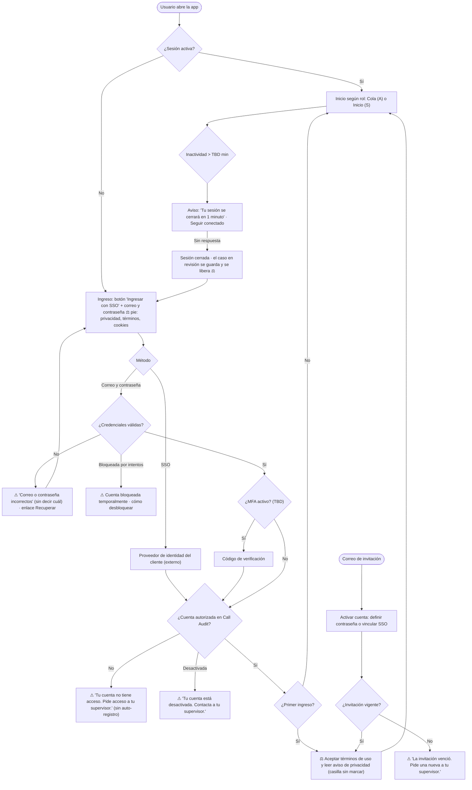
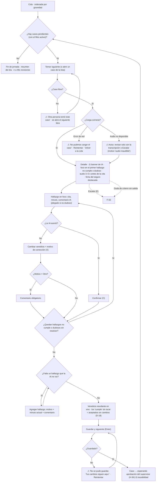
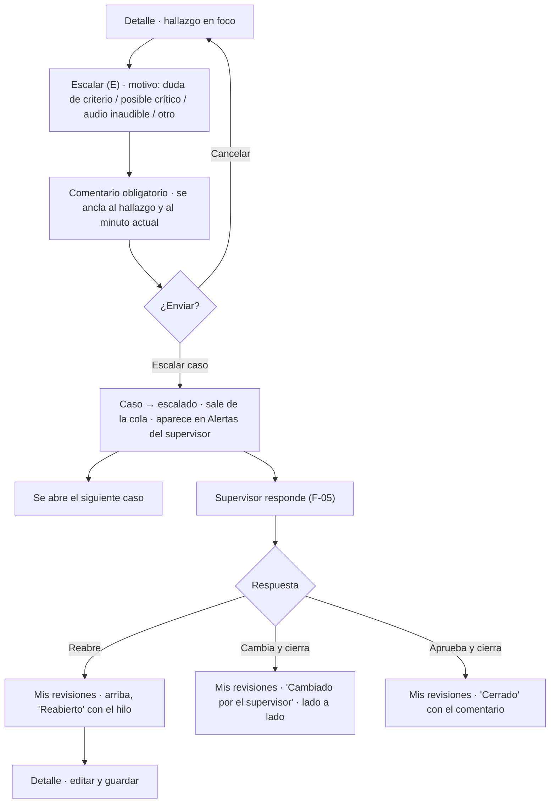
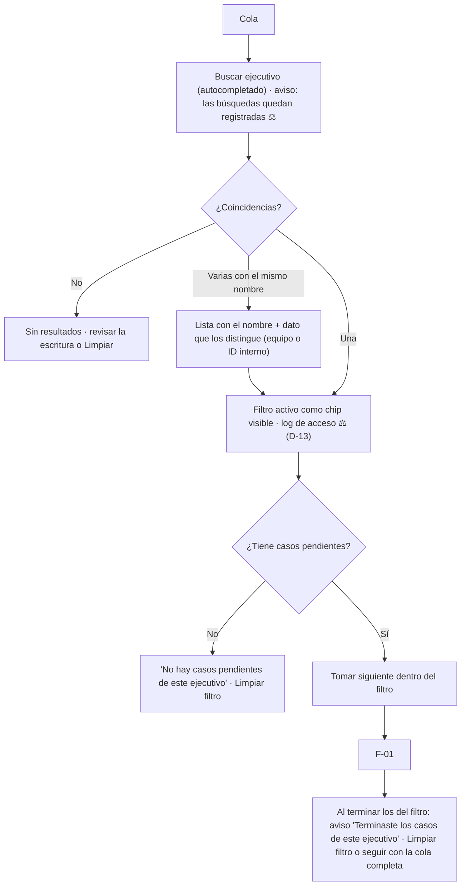
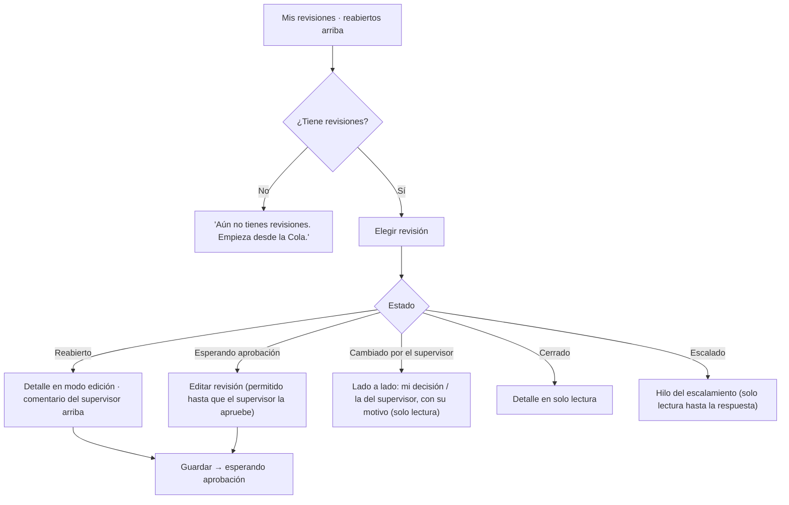
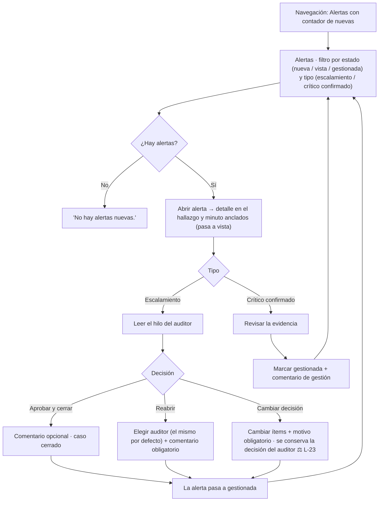
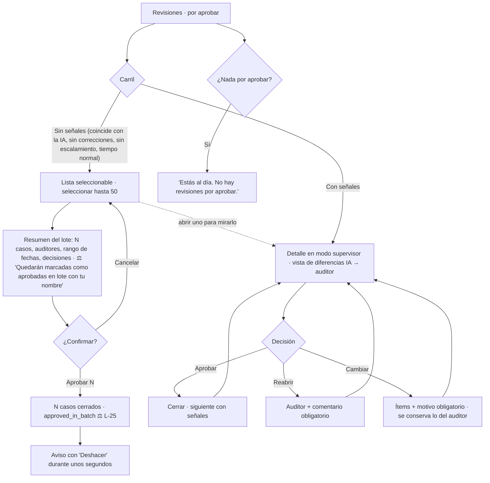
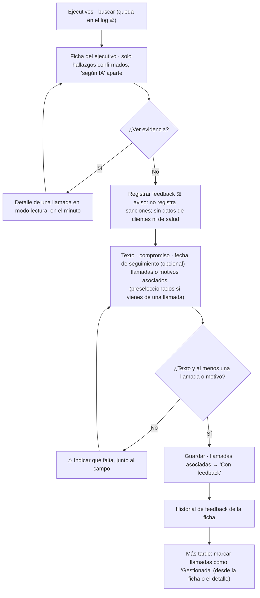
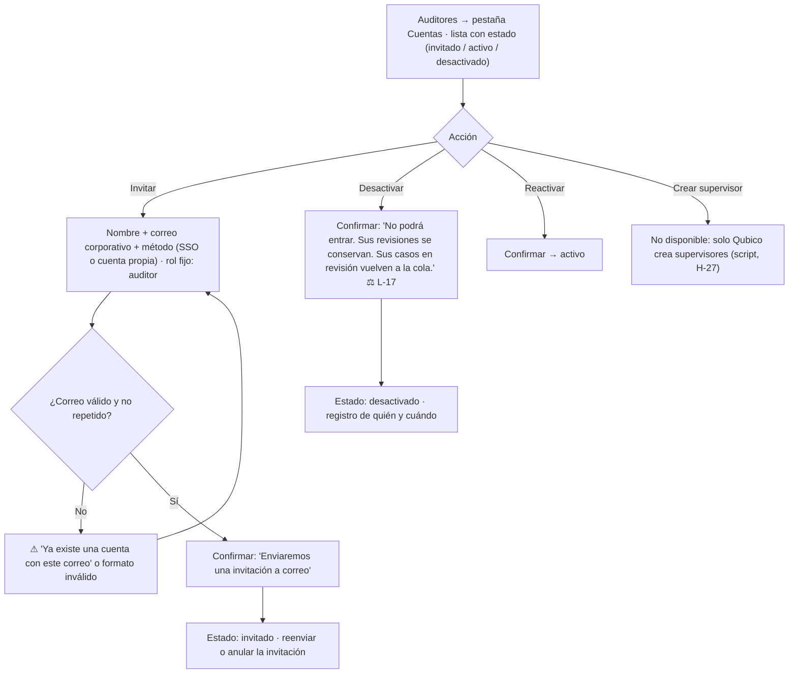
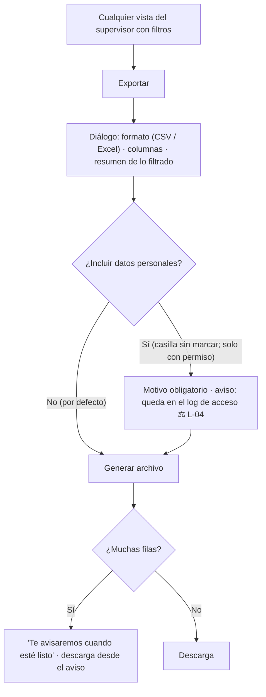

# Fase 4 · User flows · Front de Call Audit

> Estado: **entregada para aprobación** (2026-10-15). Base: CUJ-1 a CUJ-7 (`01-investigacion.md`), oportunidades aprobadas (`02-ideacion.md`), AI aprobada (`03-arquitectura-informacion.md`) y decisiones D-01 a D-19.
> Convención de los diagramas: rectángulo = pantalla o panel · rombo = decisión · `⚖` = punto legal · `⚠` = error o estado de excepción.
> Estado `awaiting_approval` ("esperando aprobación") usado según H-34, **pendiente de validar con `pipeline-architect`**.

## Índice de flujos

| ID | Flujo | Rol | CUJ / HU |
|---|---|---|---|
| F-00 | Acceso: login, invitación, recuperación, sesión | A, S | D-05, D-12, D-17 |
| F-01 | Revisar un caso (Tomar siguiente → Guardar y siguiente) | A | CUJ-1 · HU-AUD-01..04, 07 |
| F-02 | Escalar un caso y ver la respuesta | A | CUJ-2 · HU-AUD-05/06 |
| F-03 | Buscar y revisar los casos de un ejecutivo | A | CUJ-3 · HU-AUD-01 |
| F-04 | Mis revisiones: retomar, editar, reabierto | A | HU-AUD-06 |
| F-05 | Atender alertas y escalamientos | S | CUJ-4 · HU-SUP-05/07 |
| F-06 | Aprobar revisiones (lote y una a una) | S | CUJ-5 · HU-SUP-06/07 · D-15, D-19 |
| F-07 | Preparar y registrar feedback a un ejecutivo | S | CUJ-6 · HU-SUP-03/04 |
| F-08 | Gestionar cuentas de auditores | S | CUJ-7 · D-12 |
| F-09 | Exportar lo filtrado | S | HU-SUP-12 |

---

## F-00 · Acceso

**Notas**
- Mismo mensaje para "correo no existe" y "contraseña incorrecta", para no revelar qué cuentas existen (L-11).
- Al cerrarse la sesión, el avance del caso abierto queda guardado (autoguardado, O-10) y el bloqueo `in_review` se libera.
- El tiempo de inactividad queda `TBD` **[SUPUESTO: 30 min]**; el mismo valor sirve para liberar casos `in_review` (HU-AUD-01).

---

## F-01 · Revisar un caso (CUJ-1)

### Flujo optimizado

**Reglas de negocio**
- Mientras quede un ítem `uncertain` sin resolver, Guardar está deshabilitado. El progreso explica por qué: "Te queda 1 hallazgo dudoso por resolver" (HU-AUD-03).
- Los `compliant` no exigen acción. Si la auditora abre uno y lo cambia, cuenta como corrección (D-18).
- Un caso "Muestra cumple" sigue el mismo flujo. Si la auditora agrega un hallazgo, se registra como falso negativo (HU-AUD-07).
- El autoguardado guarda cada acción, así que cerrar la pestaña no pierde avance (O-10).
- Los atajos no se activan mientras se escribe en un campo y se pueden desactivar en Preferencias (L-12).

### Auditoría del flujo (contra el prototipo v2)

| Tipo | Hallazgo en el v2 o en el flujo base | Cambio | Ref. |
|---|---|---|---|
| Paso de más | El caso abre arriba del todo; hay que buscar el primer hallazgo relevante | Se abre en el primer `non_compliant`/`uncertain`, con el audio posicionado | O-01 |
| Paso de más | "Confirmar pendientes" obliga a confirmar también los que cumplen | Los `compliant` quedan como aceptados sin cambios | O-02, D-18 |
| Paso de más | Hay que salir del detalle para consultar la ficha del seguro (Excel de apoyo) | Ficha contextual en un panel del detalle | O-03 |
| Cuello de botella | Corrección con motivo + comentario siempre | Comentario obligatorio solo con "Otro" | O-04 |
| Cuello de botella | Sin aviso cuando otra persona toma el caso | Aviso y salto automático al siguiente libre | O-10 |
| Redundancia | Volver a la cola después de guardar para tomar el siguiente | "Guardar y siguiente" abre el siguiente | HU-AUD-04 |
| Callejón sin salida | Audio no disponible o con error: no hay salida | Revisar con la transcripción, o escalar con "audio inaudible" | — |
| Callejón sin salida | Falla al guardar: se pierde el trabajo | Los cambios se mantienen y se puede reintentar | — |
| Callejón sin salida | Criterio ambiguo sin salida | Escalar desde el hallazgo (F-02) | O-07 |

**Conteo de acciones** para un caso típico (2 hallazgos que requieren acción, 1 de ellos corregido, 31 que cumplen; caso tomado desde la cola) **[SUPUESTO]**:

| Paso | v2 (mouse) | Optimizado (mouse) | Optimizado (teclado) |
|---|---|---|---|
| Abrir caso | 1 | 1 | 1 (atajo) |
| Llegar al primer hallazgo relevante | 2 (scroll + clic) | 0 | 0 |
| Saltar a la evidencia | 1 | 0 (ya posicionado) | 0 |
| Confirmar hallazgo 1 | 1 | 1 | 1 (C) |
| Ir al hallazgo 2 | 1 | 1 | 1 (K) |
| Corregir: veredicto + motivo + comentario | 4 | 2 | 3 (X, flechas, Enter) |
| Confirmar los que cumplen | 1 | 0 | 0 |
| Consultar la ficha del seguro | 3+ (fuera de la app) | 0–1 | 0–1 |
| Guardar y abrir el siguiente | 2 | 1 | 1 (Enter) |
| **Total** | **~16** | **~6–7** | **~7–8 teclas, sin mouse** |

---

## F-02 · Escalar y ver la respuesta (CUJ-2)

| Tipo | Hallazgo | Cambio |
|---|---|---|
| Cuello de botella | El supervisor no tenía interfaz | Resuelto: supervisor en el MVP (D-08, D-10) |
| Redundancia | Escribir el minuto y el motivo a mano en el comentario | Se ancla automáticamente al hallazgo y al minuto |
| Callejón sin salida | Escalamiento sin respuesta | Contador en Alertas del supervisor; el caso escalado más antiguo se ve en su Inicio |
| Conteo | v2: 4 acciones (botón, motivo, comentario, enviar) | Igual, con 1 tecla para abrir; sin escribir el contexto |

---

## F-03 · Casos de un ejecutivo (CUJ-3)

| Tipo | Hallazgo | Cambio |
|---|---|---|
| Cuello de botella | El filtro del v2 es un desplegable sin búsqueda | Autocompletado |
| Callejón sin salida | El filtro se "pega" y la auditora deja de ver el resto de la cola | Chip visible + aviso al terminar los casos del filtro |
| Redundancia | — | — |
| Conteo | v2: 3 (abrir filtro, buscar en la lista, elegir) | 2 (escribir, elegir) |

---

## F-04 · Mis revisiones

- Cada edición queda en el historial del caso (HU-AUD-06).
- La ventana de edición es "hasta que el supervisor apruebe", porque con D-15 toda revisión pasa por él (antes era `TBD`).

---

## F-05 · Alertas y escalamientos (CUJ-4)

| Tipo | Hallazgo | Cambio |
|---|---|---|
| Redundancia | v2: el escalamiento aparece en Alertas y también en Revisiones, con acciones en ambos | La acción vive en Alertas; en Revisiones el caso escalado aparece marcado, con un enlace a la alerta |
| Paso de más | Marcar "gestionada" aparte, después de decidir el escalamiento | Al decidir un escalamiento, la alerta pasa sola a gestionada |
| Callejón sin salida | Reabrir a un auditor desactivado | La lista solo muestra auditores activos |
| Conteo | v2: 5 (abrir, decidir, comentar, confirmar, marcar gestionada) | 4 |

---

## F-06 · Aprobar revisiones (CUJ-5, D-15, D-19)

**Reglas**
- Un caso entra al carril "Sin señales" solo si no tiene correcciones, no fue escalado, no contradice a la IA en un crítico y su tiempo de revisión no es sospechosamente corto (umbral `TBD`, **[SUPUESTO: 60 s]** como en el v2).
- El tope de 50 por lote es un límite de selección; "Seleccionar todo" selecciona los primeros 50 (D-19).
- Si un caso cambia mientras se arma el lote (por ejemplo, porque lo reabrieron), sale del lote y se avisa antes de confirmar.
- "Deshacer" revierte el lote completo durante un tiempo corto **[SUPUESTO: 10 s]**; después solo se puede reabrir caso a caso.

| Tipo | Hallazgo | Cambio |
|---|---|---|
| Cuello de botella | v2: abrir cada revisión para aprobarla (con D-15 serían cientos al día) | Carril sin señales con aprobación en lote |
| Paso de más | Comparar a ojo la decisión de la IA con la del auditor | Vista de diferencias: solo lo que cambió |
| Callejón sin salida | Aprobar por error un lote | Resumen previo + Deshacer |
| Conteo | 100 revisiones sin señales: v2 ≈ 300 acciones (abrir, aprobar, volver × 100) | 2 lotes × 3 acciones (seleccionar, revisar el resumen, confirmar) = **6** |

---

## F-07 · Feedback a un ejecutivo (CUJ-6)

| Tipo | Hallazgo | Cambio |
|---|---|---|
| Redundancia | Elegir de nuevo las llamadas cuando se llega desde una llamada | Se preseleccionan |
| Paso de más | Marcar "Con feedback" a mano | Automático al guardar el feedback |
| Riesgo | Mezclar "según IA" en la ficha | Sección separada, fuera de los indicadores (L-07) |
| Conteo | v2: 6 | 4–5 |

---

## F-08 · Cuentas de auditores (CUJ-7)

- No existe "borrar": solo desactivar, para conservar la trazabilidad (L-17).
- El supervisor solo ve y gestiona auditores de su empresa.

---

## F-09 · Exportar lo filtrado

---

## Puntos legales en los flujos

| Punto | Flujo | Requisito |
|---|---|---|
| Aviso de privacidad, términos y cookies en el pie del login; aceptación de términos en el primer ingreso (casilla sin marcar) | F-00 | L-01, L-27 |
| Sin auto-registro; mensajes que no revelan qué cuentas existen; MFA `TBD` | F-00 | L-11, L-17 |
| Al cerrarse la sesión se guarda el avance y se libera el bloqueo | F-00, F-01 | L-11 |
| Banner de IA fijo en el detalle | F-01, F-05, F-06 | L-07, L-15 |
| "Aceptado sin cambios" distinto de "confirmado" | F-01 | L-26 |
| Trazabilidad: autor, fecha, versiones y decisión original en cada guardado | F-01, F-05, F-06 | Regla 3, L-23 |
| Log de búsquedas por ejecutivo, con aviso | F-03, F-07 | L-18, D-13 |
| Aprobación en lote: resumen, tope, marca y deshacer | F-06 | L-25 |
| Aviso de no sanción y de datos sensibles en el feedback | F-07 | L-06, L-21 |
| Desactivar en vez de borrar; registro de quién gestionó cada cuenta | F-08 | L-17, L-24 |
| Exportar sin PII por defecto; con PII, motivo y log | F-09 | L-04 |
| Ver PII sin enmascarar desde el detalle (si el rol lo permite) | F-01, F-05 | L-04 |
| No aplica a este producto: retracto, información precontractual o confirmación de compra (es una herramienta interna B2B, no hay transacciones con consumidores) | — | — |

---

## Supuestos de esta fase

| ID | Supuesto |
|---|---|
| H-36 | 30 min de inactividad para cerrar sesión y liberar casos `in_review` |
| H-37 | El umbral de "revisión sospechosamente rápida" es 60 s (como en el v2) mientras el cliente no lo defina |
| H-38 | "Deshacer" en la aprobación en lote dura 10 s; después solo se reabre caso a caso |
| H-39 | La edición de una revisión propia está permitida hasta que el supervisor la apruebe |
| H-34 | Estado `awaiting_approval`: pendiente de validar con `pipeline-architect` |
