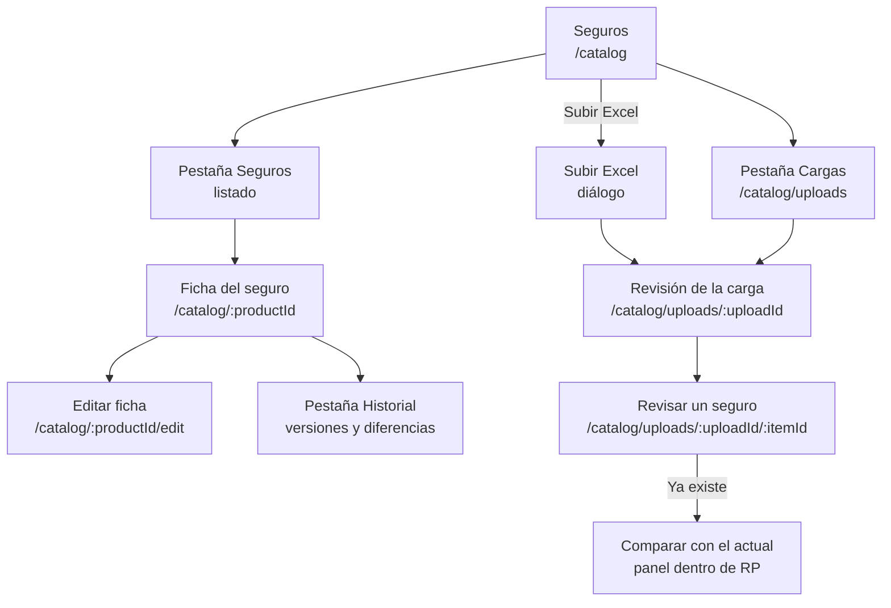
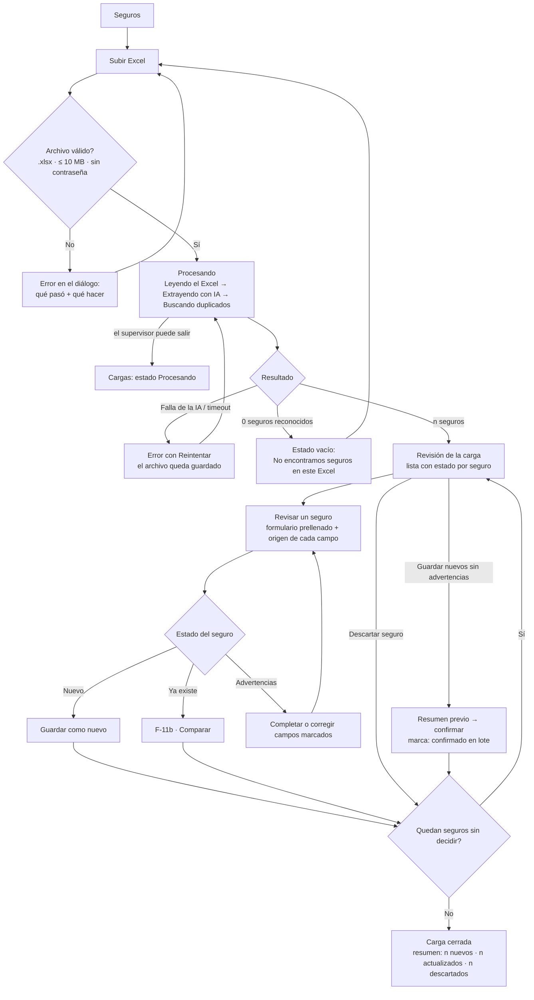
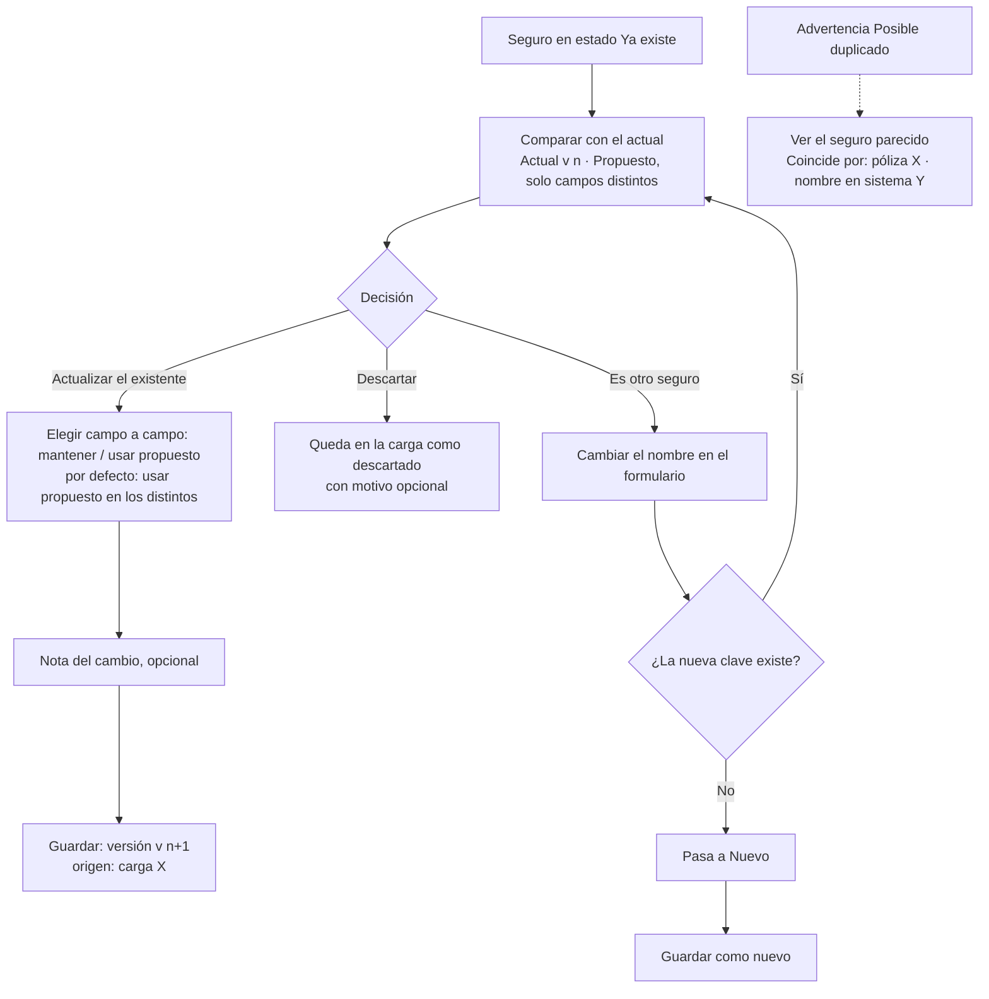
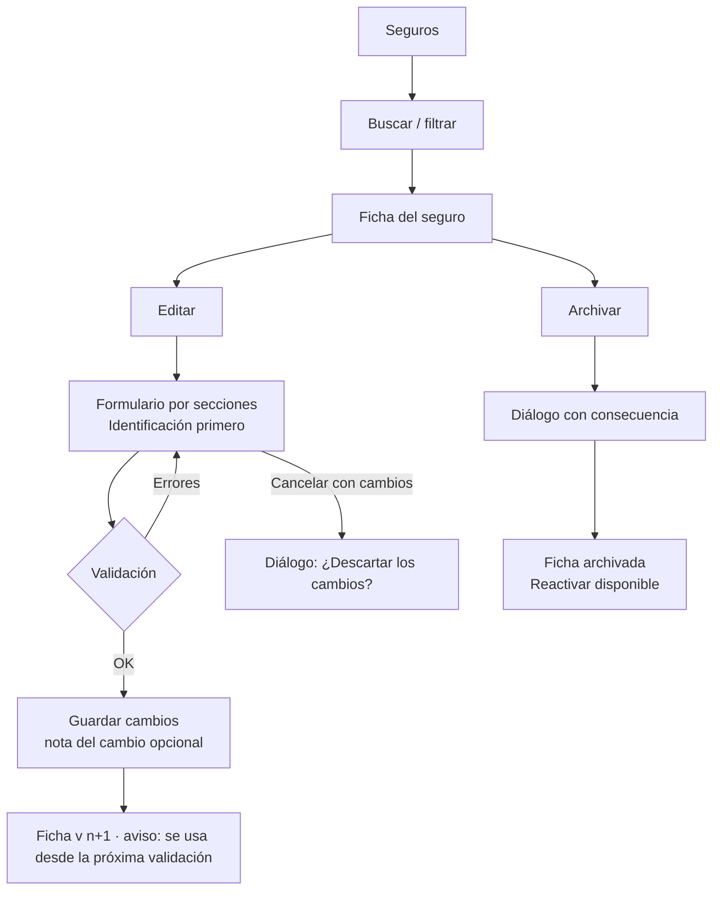

# Cambio 11 · Catálogo de seguros: carga de Excel con IA, listado y edición (supervisor)

> Revisión rápida sobre el diseño aprobado (fases 0–8, cambios 09 y 10). Fecha: 2026-10-22.
> **Origen:** pedido de Johannes (Lead Developer), 2026-10-22: el supervisor sube Excel con la información de los seguros, una llamada a la IA la pasa al formato JSON del catálogo, el supervisor ve el listado de seguros y edita sus descripciones, y el sistema detecta si un n° de póliza ya está ingresado.
> **Alcance de la revisión:** trazabilidad, patrones y navegación, WCAG 2.2 AA, microcopy y glosario, dark patterns y Registro Legal.
> **Toca la AI** (sección nueva del supervisor), **un CUJ nuevo de configuración** y **puntos legales** (L-35 a L-39). Se actualizan `registro-legal.md`, `hipotesis.md` y `estado.md`. `03-arquitectura-informacion.md` se actualiza al aprobarse este cambio. No se reabren las demás fases.
> **Front y datos revisados:** `frontend/src/components/shell/sidebar-nav.tsx`, `frontend/src/lib/api/client.ts`, `frontend/src/lib/api/types.ts` (`ProductSheet`), `frontend/src/components/call/product-sheet.tsx`, `scripts/prompt_bench/extract_catalog.py`, `scripts/prompt_bench/catalog_match.py`, `data/catalog/products.json` (solo estructura y conteos; L-19).
> **Estado:** **aprobado** por Johannes (2026-10-22) con las decisiones D-26 a D-31 de §0, que prevalecen sobre el resto del documento.

---

## 0. Cierre del cambio (2026-10-22) · prevalece sobre el resto del documento

| # | Decisión | Efecto |
|---|---|---|
| D-26 (P1) | **Formato variable, varios seguros por archivo.** El flujo sirve para el Excel estandarizado, para un seguro por archivo y para el formato de cada aseguradora. No se sabe cuál es el más común | La extracción se prueba con los tres tipos. §4.1 sin cambios |
| D-27 (P2) | **Clave única de un seguro: nombre del seguro normalizado + aseguradora.** Normalizado = sin tildes, en mayúsculas y con espacios colapsados (misma función `normalize` de `catalog_match.py`). Sin aseguradora cuenta como un valor más ("Sin aseguradora"). El nombre solo no basta porque se repite entre aseguradoras (Incendio Hogar: Sura y HDI; Protección Global MyPE: Cardif y HDI) | §4.2 queda reescrito. La póliza y los nombres en sistema **dejan de ser clave**: si coinciden con otro seguro de distinto nombre o aseguradora, solo muestran la advertencia **"Posible duplicado"**, que no bloquea. "Es otro seguro" ya no guarda un duplicado: si la clave coincide, es el mismo seguro; si el supervisor cree que es otro, la acción lo lleva a cambiarle el nombre (ej. "… Plan 2") y la carga lo vuelve a evaluar |
| D-28 (P3) | **Permiso `manage_catalog`**, que Qubico activa por cuenta (como `view_model_io`). Sin el permiso no se ve "Seguros" en el menú y la API responde 403 | No hay rol nuevo (D-23 se mantiene) |
| D-29 (P4) | **Una ficha nueva o editada aplica solo a validaciones futuras.** Cada validación guarda `productId` + versión de la ficha. Re-validar llamadas queda fuera (D7). *Johannes no respondió explícitamente; se aplica la recomendación* | R-11.1, L-39 |
| D-30 (P5) | **Toda la ficha es editable**, con la sección Identificación primero; cada guardado crea una versión | §4.3 sin cambios |
| D-31 | **Defaults D1–D8 aprobados sin objeciones.** Backend: los 66 productos actuales se cargan como **versión 1** (origen "Carga inicial"); el worker lee el catálogo desde la base, no desde `products.json` | En el historial, la v1 muestra el origen "Carga inicial del catálogo" |

**Unicidad también al editar o restaurar una versión:** si el supervisor cambia el nombre o la aseguradora y la nueva clave ya existe (incluidos los archivados), no se puede guardar: "Ya existe un seguro llamado «{nombre}» en {aseguradora}. · Ver ese seguro".
**Dentro de una misma carga:** si el Excel trae dos seguros con la misma clave, ambos llevan la advertencia "Este Excel trae dos veces «{nombre}» de {aseguradora}. Guarda uno y descarta el otro." y quedan fuera del guardado en lote.

---

## 1. Lo que encontré en los datos (cambia el diseño)

| # | Hallazgo (en `products.json`, 66 productos) | Efecto en el diseño |
|---|---|---|
| H1 | **32 de 66 productos no tienen n° de póliza** (ej. "Renta diaria TLMK", "Desempleo ITT Cre. Consumo"). | La póliza **no puede ser la clave** para detectar duplicados. Resuelto por D-27: la clave es nombre + aseguradora. |
| H2 | **14 números de póliza aparecen en 2 productos distintos** (ej. AP Pescador Plan 1 y Plan 2 comparten las 9 pólizas; AP Individual medio de pago y AP Plan Individual comparten 491000167). | "Esta póliza ya existe" **no significa** "es el mismo seguro". Con D-27 queda como advertencia "Posible duplicado", que no bloquea. |
| H3 | El campo `policies` es **texto libre**: varios números separados por "/" o ",", y notas ("así en el original", "también tablas para…"). | La IA debe devolver las pólizas como **lista de números normalizados** más una nota aparte. El listado y la búsqueda trabajan sobre la lista. |
| H4 | 9 productos no tienen aseguradora; las categorías reales son 6 (`RETENIBLE`, `NO_RETENIBLE` y 4 `NO_RENUNCIABLE_*`), pero `ProductSheet.category` en el front tiene 3 (`RETENIBLE`, `NO RETENIBLE`, `IRRENUNCIABLE`). | El formulario acepta "Sin aseguradora" y valida contra las 6 categorías. Hay que alinear el tipo del front (handoff, §9). |
| H5 | El Excel actual es **uno solo con muchos seguros**, repartidos en hojas relacionadas por "ID" (Productos, Coberturas, Asistencias, Primas, Siniestros, …) más hojas de referencia (Medios_Pago, Procedimientos). | Una carga puede traer **N seguros**. La revisión humana es **por seguro**, dentro de una carga (§4). Si el Excel trae otra cosa (un seguro por archivo, formato de la aseguradora), el mismo flujo sirve: la IA normaliza. Se confirma en §10, P1. |
| H6 | El match con la llamada es **por nombre en sistema** primero (`catalog_match.py`), luego por similitud con nombre/aseguradora. La póliza casi no participa. | Lo que más ayuda a "que la IA identifique mejor el seguro" es mantener bien los **nombres en sistema** y una **descripción para identificarlo**. Por eso la sección "Identificación" va primero en la ficha editable (§3.3). |
| H7 | Hoy el pipeline lee `products.json` en cada corrida: **la ficha usada en una validación no queda versionada**. | Requisito nuevo R-11.1: cada validación guarda `productId` + `versión de la ficha`. Sin esto, editar el catálogo rompe la trazabilidad (regla 3 del proyecto). |
| H8 | "Pauta" en este proyecto ya significa **la pauta de 33 motivos** (rúbrica). Johannes dice "Excel con las pautas del seguro". | En la UI **no se usa "pauta"** para esto. Se habla de **"seguros"**, **"ficha del seguro"** y **"Excel de seguros"** (glosario, §7.1). |

---

## 2. Trazabilidad del cambio

| ID | Tipo | Descripción |
|---|---|---|
| P-11.1 | Dolencia | Hoy el catálogo solo se actualiza con un script de Qubico; si el cliente cambia condiciones o agrega un seguro, la IA valida con una ficha vieja o sin ficha **[SUPUESTO: frecuencia de cambios desconocida, H-59]**. |
| P-11.2 | Dolencia | Llamadas que quedan "sin ficha" porque el nombre del sistema no calza con el catálogo (H6). |
| O-11.1 | Oportunidad | El supervisor mantiene el catálogo sin depender de Qubico; la IA hace el trabajo pesado de pasar el Excel al formato; el supervisor confirma. |
| R-11.1 | Requisito | Cada validación registra la ficha usada (`productId` + versión). Las ediciones crean versión nueva; nunca se sobrescribe. |
| R-11.2 | Requisito | La IA **propone**, el supervisor **confirma**: nada extraído llega al catálogo sin una acción explícita de guardar. |
| R-11.3 | Requisito | Clave única: nombre normalizado + aseguradora (D-27). Pólizas o nombres en sistema compartidos solo generan la advertencia "Posible duplicado". La decisión final es del supervisor. |
| R-11.4 | Requisito | Los seguros no se borran: se **archivan** (dejan de usarse en validaciones nuevas, siguen visibles en las anteriores). |
| R-11.5 | Requisito | La IA no inventa datos: lo que no está en el Excel queda vacío ("No viene en el Excel"), y cada campo extraído guarda de dónde salió (hoja y fila). |

---

## 3. Delta de arquitectura de información y navegación

### 3.1 Navegación del supervisor

| Rol | Navegación |
|---|---|
| Auditor | Cola · Mis revisiones *(sin cambios; no ve la sección Seguros, ver §10 defaults)* |
| Supervisor | Inicio · Alertas · Revisiones · Ejecutivos · Motivos · Auditores · Cola · Discrepancias · **Seguros** |

- **Seguros** va al final: es configuración, no trabajo diario. Ícono Lucide `BookOpen` (no `FileSpreadsheet`: la sección es el catálogo, no los archivos).
- El ítem se ve solo con el permiso `manage_catalog` (D-28). Sin el permiso, no aparece (no se muestra deshabilitado).

### 3.2 Sitemap del delta



| Nivel 1 | Nivel 2 | Acciones | Ruta |
|---|---|---|---|
| Seguros | Pestañas **Seguros** · **Cargas** | Subir Excel | `/catalog`, `/catalog/uploads` |
| | Ficha del seguro (pestañas **Ficha** · **Identificación** · **Historial**) | Editar · Archivar / Reactivar | `/catalog/[productId]` |
| | Revisión de una carga → revisar cada seguro | Guardar como nuevo · Actualizar el existente · Descartar | `/catalog/uploads/[uploadId]`, `/catalog/uploads/[uploadId]/[itemId]` |

- Las rutas usan IDs internos (`P01`, `upl_…`); nunca el n° de póliza ni el nombre del archivo (L-03: nada de datos de negocio en URLs ni en títulos de pestaña).

### 3.3 Inventario nuevo

| Contenido / función | Rol | Trazabilidad |
|---|---|---|
| Listado de seguros con búsqueda (nombre, nombre en sistema, n° de póliza) y filtros (aseguradora, categoría, estado, "Incompleto") | S | O-11.1 |
| Ficha del seguro: misma presentación que ve el auditor en el detalle (reusa `ProductSheetContent`) + metadatos (versión, actualizado por, fecha, origen) | S | D-02, R-11.1 |
| Pestaña **Identificación**: nombres en sistema, n° de póliza (lista), aseguradora, **Descripción para identificarlo** (texto libre que recibe la IA y el buscador) | S | P-11.2, H6 |
| Editar ficha (formulario por secciones) con nota del cambio opcional | S | R-11.1 |
| Historial de versiones con diferencias campo a campo, autor, fecha, origen (carga X / edición manual) | S | R-11.1, L-39 |
| Archivar / Reactivar | S | R-11.4 |
| Subir Excel → procesamiento con IA → revisión por seguro → guardar | S | O-11.1, R-11.2, R-11.5 |
| Detección y resolución de duplicados | S | R-11.3 |
| Pestaña Cargas: historial de cargas (archivo, quién, cuándo, estado, resultado: n nuevos / n actualizados / n descartados) | S | L-39 |
| En el detalle de llamada, bajo cada ficha: "Ficha v{n} · usada en esta validación" | A, S | R-11.1 |

---

## 4. User flows

### 4.1 F-11a · Subir Excel y revisar la propuesta de la IA (CUJ-11)

**Disparador:** el cliente entrega un Excel con seguros nuevos o con condiciones actualizadas.
**Objetivo:** que el catálogo quede al día sin errores, y que la IA use la ficha correcta en las próximas validaciones.
**Criterio de éxito:** cada seguro del Excel queda guardado como nuevo, como versión nueva de uno existente o descartado, con una decisión explícita del supervisor.
**Métricas:** % de campos que el supervisor corrige frente a lo propuesto por la IA (calidad de la extracción); tiempo de revisión por seguro; % de llamadas "sin ficha" antes y después.



**Reglas:**
- La carga es un **borrador persistente**: se guarda sola en cada cambio (la sesión se cierra a los 30 min de inactividad, H-36; no se puede perder el trabajo). Se puede retomar desde **Cargas**. Un borrador sin actividad por 30 días se cierra como "Vencida" y no toca el catálogo **[SUPUESTO, H-63]**.
- **Nada llega al catálogo hasta guardar.** "Guardar" es por seguro; la carga queda "Parcial" mientras haya seguros sin decidir.
- **Guardar en lote** (patrón D-19): solo seguros en estado **Nuevo sin advertencias**, con resumen previo (lista de nombres) y marca "confirmado en lote" en el historial. Los que "Ya existen" o tienen advertencias (incluida "Posible duplicado") se deciden uno a uno.
- **Origen de cada campo:** junto a cada campo, "Hoja Coberturas · fila 14" (texto, no tooltip). Si la IA no encontró el dato: campo vacío con "No viene en el Excel"; nunca un valor inventado (R-11.5).
- **Advertencias** (no bloquean salvo las obligatorias): falta nombre, categoría o aseguradora; categoría fuera de las 6 válidas; sin nombre en sistema ni póliza (la IA no podrá encontrarlo en las llamadas); posible dato personal detectado (RUT, correo, teléfono móvil) en un texto (L-35).
- **Campos obligatorios para guardar:** nombre, categoría y al menos uno entre nombre en sistema o n° de póliza. Aseguradora puede ser "Sin aseguradora" (H4).
- Hojas que la IA no usó (ej. Medios_Pago, Procedimientos) se informan: "No usamos las hojas: Medios_Pago, Procedimientos." (fuera del alcance de este cambio, §10 defaults).

### 4.2 F-11b · Seguro que ya existe (duplicados) · según D-27

**Clave única:** nombre del seguro normalizado + aseguradora. La detección la hace el backend con reglas, sin IA.

| Señal | Estado que ve el supervisor | Bloquea | Acción por defecto |
|---|---|---|---|
| La clave coincide con un seguro activo y todos los campos son iguales | **Ya existe · sin cambios** | — | Descartar (visible; se confirma junto con el resto) |
| La clave coincide con un seguro activo y hay campos distintos | **Ya existe · con cambios** ({n} campos) | Sí: hay que decidir | **Ninguna preseleccionada** |
| La clave coincide con un seguro **archivado** | **Ya existe · archivado** | Sí: hay que decidir | Ninguna preseleccionada; "Actualizar" lo reactiva |
| La clave no coincide | **Nuevo** | — | Guardar como nuevo |
| *Además, en cualquier estado:* una póliza o un nombre en sistema coincide con otro seguro de distinto nombre o aseguradora | Advertencia **"Posible duplicado"** | **No** | Ninguna: es informativa. El seguro queda fuera del guardado en lote (D4) |
| *Además:* la misma clave aparece dos veces en el Excel | Advertencia "Repetido en este Excel" | Sí: guardar uno y descartar el otro | — |

- Sin preselección en "con cambios" y "archivado": evita que el supervisor sobrescriba una ficha por inercia (H-16) y que una opción "pre-marcada" decida por él.
- La advertencia "Posible duplicado" sirve para casos como AP Pescador Plan 1 y Plan 2, que comparten pólizas y **son** seguros distintos: el supervisor lo nota y revisa los nombres en sistema para que la IA los distinga, pero puede guardar.



- **Comparar**: dos columnas "Actual (v{n})" y "Propuesto", **solo los campos distintos** por defecto, con interruptor "Mostrar todos los campos". Listas (coberturas, asistencias, primas) se comparan por nombre del ítem: "Agregada", "Quitada", "Cambiada".
- **Por qué coincide** siempre visible: "Mismo nombre y aseguradora" (clave) o, en la advertencia, "Comparte la póliza 491000167 con «{nombre}»" / "Comparte el nombre en sistema «{x}» con «{nombre}»".
- En "Actualizar", los campos que vienen vacíos en el Excel **no borran** lo que hay (por defecto "mantener"); para vaciar un campo hay que hacerlo a mano en la edición.
- Los nombres en sistema y las pólizas de un "Actualizar" se **unen** a los existentes por defecto (no se reemplazan), porque son las llaves con que la IA encuentra el seguro en las llamadas; el supervisor puede quitar alguno a mano.

### 4.3 F-11c · Editar una ficha a mano



- **Cuándo aplica una versión nueva:** desde la próxima validación. Las llamadas ya validadas mantienen la versión con que se validaron (R-11.1). Re-validar llamadas pendientes con la ficha nueva queda fuera de este cambio (§10, P4).
- **Concurrencia:** si otro supervisor guardó una versión mientras editabas: "Otra persona guardó una versión nueva de esta ficha mientras editabas. Revisa sus cambios antes de guardar los tuyos." con la comparación; no se sobrescribe en silencio.

### 4.4 Auditoría del flujo

| Tipo | Hallazgo | Ajuste |
|---|---|---|
| Paso de más | Mostrar el JSON crudo como paso de revisión | El supervisor revisa un **formulario**; el JSON queda en "Ver JSON" (solo lectura) para Qubico |
| Paso de más | Confirmar uno a uno 40 seguros nuevos sin problemas | Guardar en lote solo para "Nuevo sin advertencias", con resumen (patrón D-19) |
| Cuello de botella | Extracción con IA de un Excel grande (segundos a minutos) | Procesamiento en segundo plano; el supervisor puede salir; estado en Cargas; aviso al terminar (toast si sigue en la app) |
| Cuello de botella | Dudar si un seguro parecido es el mismo | Clave única simple (nombre + aseguradora, D-27); pólizas o nombres en sistema compartidos solo advierten, con "Comparte…" visible |
| Redundancia | Pedir de nuevo aseguradora o categoría que la IA ya leyó | Todo viene prellenado; solo se pide lo que falta (WCAG 3.3.7) |
| Callejón sin salida | IA falla o el Excel no trae seguros | Reintentar sin volver a subir; estado vacío con causa probable y "Subir otro Excel" |
| Callejón sin salida | Sesión expira durante una revisión larga | Borrador con autoguardado; al volver, "Retomamos tu carga donde quedó" |
| Error sin recuperación | Actualizar sobrescribe una ficha por error | Versión nueva, nunca sobrescritura; "Restaurar esta versión" en el historial |

**Conteo de pasos (seguro nuevo sin advertencias):** antes (hoy): pedir a Qubico → script → revisar JSON a mano, fuera de la app. Después: Seguros → Subir Excel → elegir archivo → (espera) → Revisar carga → Guardar nuevos en lote → Confirmar = **6 acciones** para N seguros. **Seguro con cambios:** abrir seguro → Comparar → Actualizar → (elegir campos) → Guardar = **4–5 acciones** por seguro.

---

## 5. Pantallas (estructura; sin alta fidelidad nueva)

Se usan los componentes y tokens aprobados en la Fase 8 (`08-tokens.css`, shadcn/ui, TanStack Table). No hay componentes nuevos salvo **zona de subida** y **vista de comparación**.

### 5.1 Seguros · listado (`/catalog`)
- Encabezado: "Seguros" + ayuda "Fichas que usa la IA para validar las llamadas." + botón primario **Subir Excel**.
- Pestañas: **Seguros ({n})** · **Cargas**. Si hay una carga en revisión, banda informativa: "Tienes una carga con {n} seguros por revisar. · Continuar revisión".
- Búsqueda: "Busca por nombre, nombre en sistema o n° de póliza".
- Filtros: Aseguradora · Categoría · Estado (Activos por defecto / Archivados / Todos) · "Incompletos" (sin nombre en sistema ni póliza, o sin categoría).
- Tabla: **Seguro** (nombre + aseguradora debajo) · **Categoría** (badge con texto) · **Pólizas** (primeras 2 + "+{n}") · **Nombres en sistema** (primero + "+{n}") · **Versión** · **Actualizado** (fecha · quién) · **Estado**. Fila completa navegable con teclado; orden por nombre.
- Estados: cargando (skeleton de filas), vacío ("Aún no hay seguros en el catálogo. Sube el Excel del cliente para empezar. · Subir Excel"), sin resultados ("No hay seguros con estos filtros. · Limpiar filtros"), error ("No pudimos cargar los seguros. · Reintentar").

### 5.2 Ficha del seguro (`/catalog/[productId]`)
- Encabezado: nombre · aseguradora · badge de categoría · "Versión {n} · actualizada el {fecha} por {nombre}" · botones **Editar**, menú "Más" → Archivar.
- Pestañas: **Ficha** (lo mismo que ve el auditor, `ProductSheetContent` en modo completo, todas las secciones abiertas) · **Identificación** (nombres en sistema, pólizas, descripción para identificarlo, aseguradora) · **Historial**.
- Historial: lista de versiones (v{n}, fecha, autor, origen "Carga {fecha} · {archivo}" o "Edición manual", nota) → al abrir una, diferencias con la anterior; acción "Restaurar esta versión" (crea v{n+1}, no borra).
- Si está archivada: banda "Este seguro está archivado: la IA no lo usa en validaciones nuevas. · Reactivar".

### 5.3 Subir Excel (diálogo)
- Zona de subida con **botón "Elegir archivo"** visible (arrastrar es opcional; WCAG 2.5.7) + texto "o arrástralo aquí".
- Restricciones visibles antes de elegir: "Excel .xlsx de hasta 10 MB."
- Aviso fijo (L-35): "Sube solo condiciones de seguros. No incluyas datos de clientes ni de ejecutivos."
- Tras elegir: nombre del archivo, tamaño, "Cambiar archivo", botón **Procesar con IA**.
- Progreso en el mismo diálogo y en la carga: "Leyendo el Excel" → "Extrayendo los seguros con IA" → "Buscando seguros que ya existen" → "Listo para revisar" (pasos con estado en texto, `aria-live="polite"`). Botón "Seguir en segundo plano".

### 5.4 Revisión de la carga (`/catalog/uploads/[uploadId]`)
- Encabezado: archivo · subido por · fecha · "Modelo {x} · Prompt de extracción v{y}" (trazabilidad, como en el detalle de llamada).
- Resumen en chips con número y texto: **Nuevos {n}** · **Ya existen con cambios {n}** · **Ya existen sin cambios {n}** · **Con advertencias {n}** (incluye posibles duplicados) · **Decididos {n} de {N}**.
- Tabla: Seguro propuesto · Estado (badge con ícono + texto) · Coincide con (link a la ficha actual) · Advertencias · Decisión (Pendiente / Guardado como nuevo / Actualizado / Descartado).
- Acciones: **Guardar {n} seguros nuevos** (solo los sin advertencias, abre resumen) · "Descartar la carga" (diálogo).
- Barra de acciones fija abajo: no tapa el foco (WCAG 2.4.11: `scroll-padding-bottom` igual a la altura de la barra).

### 5.5 Revisar un seguro de la carga
- Layout de dos columnas a ≥1280 px: **formulario** (secciones: Identificación · Condiciones · Coberturas · Asistencias · Primas · Siniestros · Observaciones) | **panel "Del Excel"** con el origen del campo enfocado (hoja, fila y valor original). Bajo 1280 px, el panel se abre debajo del campo.
- Cada campo: valor propuesto, origen ("Hoja Productos · fila 8") y, si aplica, marca "Revisar" con el motivo en texto ("Categoría no reconocida: «Retenible MP»").
- Si es "Ya existe": banda arriba "Ya existe «{nombre}» de {aseguradora} (v{n}). · Comparar". Si tiene la advertencia "Posible duplicado": aviso informativo con "Comparte…" y link al seguro parecido; no bloquea.
- Pie: **Guardar como nuevo** / **Actualizar el existente** (según el estado) · Descartar · "Siguiente seguro" (J/K como en el detalle, opcional).

### 5.6 Detalle de llamada (auditor y supervisor), cambio mínimo
- Bajo el nombre de cada ficha: "Ficha v{n}" (texto secundario). Si existe una versión más nueva: "Hay una versión más nueva de esta ficha (v{m}). Esta llamada se validó con la v{n}." Solo el supervisor ve el link "Ver cambios".

---

## 6. Patrones y accesibilidad (WCAG 2.2 AA)

| Patrón | Dónde | Por qué |
|---|---|---|
| Tabla con búsqueda y filtros (TanStack, ya aprobada) | Listado, cargas, revisión | Coherente con Cola y Revisiones |
| Proceso en segundo plano + estado persistente | Extracción | La IA puede tardar; no bloquear al supervisor |
| Formulario prellenado con origen del dato | Revisar un seguro | Patrón "IA propone, humano confirma" con evidencia, igual que los hallazgos con cita |
| Comparación lado a lado, solo diferencias | Duplicados, historial | Reduce la carga de lectura; evita sobrescrituras ciegas |
| Versionado con restaurar | Ficha | Recuperación de errores sin borrar (R-11.4) |
| Lote con resumen y tope | Guardar nuevos | Mismo control que D-19 |

| Criterio | Aplicación |
|---|---|
| 1.4.1 Uso del color | Estados (Nuevo, Ya existe, Posible duplicado, Advertencia) con ícono + texto; diferencias con etiquetas "Antes" / "Propuesto" y marcas "Agregada / Quitada / Cambiada", no solo verde/rojo |
| 1.4.3 Contraste | Tokens de la Fase 8 sin cambios |
| 2.1.1 Teclado | Subida, tabla, comparación y elección campo a campo operables con teclado |
| 2.4.11 Foco no oculto | Barra de acciones fija con `scroll-padding-bottom` |
| 2.5.7 Movimientos de arrastre | Botón "Elegir archivo" siempre visible |
| 2.5.8 Tamaño del objetivo | Controles ≥ 24 × 24 px (los de la Fase 8 ya cumplen) |
| 3.3.1 / 3.3.3 Errores | Mensaje junto al campo + resumen arriba con links a cada campo |
| 3.3.4 Prevención de errores | Actualizar y archivar son reversibles (versión, reactivar); descartar la carga pide confirmación |
| 3.3.7 Entrada redundante | Datos prellenados; no se pide de nuevo lo que vino en el Excel |
| 4.1.3 Mensajes de estado | Progreso de la extracción y guardados con `aria-live="polite"`; errores con `role="alert"` |

**Dark patterns revisados:** sin decisiones preseleccionadas en duplicados con cambios; "Descartar" con el mismo peso visual que "Actualizar" (sin confirmshaming); el lote no incluye nada que requiera juicio.

---

## 7. UX writing (español chileno, trato de "tú", H-44)

### 7.1 Glosario (se agrega a `03-arquitectura-informacion.md` §4.2)

| Término | Definición | Código | No usar |
|---|---|---|---|
| **Seguros** (sección) | Catálogo de fichas que la IA usa para validar | `catalog` | "Pautas", "Productos" |
| **Ficha del seguro** | Condiciones del seguro según el catálogo *(sin cambios)* | `product_sheet` | "ficha técnica" |
| **Versión de la ficha** | Cada guardado crea una versión; las validaciones guardan cuál usaron | `sheet_version` | "revisión" (ya es otra cosa) |
| **Excel de seguros** | Archivo del cliente con las condiciones de los seguros | `catalog_upload` | "pauta", "plantilla" |
| **Carga** | Una subida de Excel y su revisión | `upload` | "importación" |
| **Nombre en sistema** | Cómo aparece el seguro en los sistemas del cliente (lo que trae la llamada) | `system_names` | "alias" |
| **Descripción para identificarlo** | Texto libre que ayuda a la IA a reconocer el seguro | `identification_notes` | "prompt" |
| **Nuevo** / **Ya existe** | Estado de un seguro en una carga según la clave nombre + aseguradora (D-27) | `new` / `exists` (`unchanged`, `changed`, `archived`) | "repetido", "conflicto" |
| **Posible duplicado** | Advertencia, no estado: comparte póliza o nombre en sistema con otro seguro | `warning = possible_duplicate` | "duplicado" (afirma algo que no se sabe) |
| **Archivar** / **Reactivar** | Dejar de usar / volver a usar una ficha, sin borrarla | `archive` / `restore` | "eliminar", "borrar" |

### 7.2 Textos listos para usar

| Lugar | Texto |
|---|---|
| Nav | Seguros |
| Ayuda del título | Fichas que usa la IA para validar las llamadas. |
| Botón principal | Subir Excel |
| Diálogo · título | Subir Excel de seguros |
| Diálogo · restricciones | Excel .xlsx de hasta 10 MB. |
| Diálogo · aviso (L-35) | Sube solo condiciones de seguros. No incluyas datos de clientes ni de ejecutivos. |
| Diálogo · aviso IA (L-36) | La IA lee el archivo y propone las fichas. Nada se guarda en el catálogo hasta que lo revises. |
| Botón | Procesar con IA |
| Progreso | Leyendo el Excel · Extrayendo los seguros con IA · Buscando seguros que ya existen · Listo para revisar |
| Segundo plano | Seguir en segundo plano · Te avisamos aquí cuando esté lista. Si sales, la encuentras en Seguros › Cargas. |
| Toast | La carga «{archivo}» está lista para revisar. · Revisar |
| Error · formato | Este archivo no es un Excel .xlsx. Guárdalo como .xlsx e intenta de nuevo. |
| Error · tamaño | El archivo pesa {x} MB y el máximo es 10 MB. Quita hojas que no tengan seguros o divídelo en dos. |
| Error · contraseña | El Excel tiene contraseña. Quítala y vuelve a subirlo. |
| Error · IA | No pudimos extraer los seguros. El archivo quedó guardado; puedes reintentar sin volver a subirlo. · Reintentar |
| Vacío · 0 seguros | No encontramos seguros en este Excel. Revisa que tenga una hoja con un seguro por fila (nombre, aseguradora y condiciones). · Subir otro Excel |
| Hojas no usadas | No usamos las hojas: {lista}. |
| Resumen de la carga | {n} nuevos · {n} ya existen con cambios · {n} posibles duplicados · {n} sin cambios |
| Origen del campo | Hoja {hoja} · fila {fila} |
| Campo sin dato | No viene en el Excel |
| Advertencia · categoría | Categoría no reconocida: «{valor}». Elige una de la lista. |
| Advertencia · identificación | Sin nombre en sistema ni n° de póliza, la IA no podrá encontrar este seguro en las llamadas. |
| Advertencia · datos personales (L-35) | Este texto parece tener datos personales ({tipo}). Bórralos si no son parte de las condiciones del seguro. |
| Banda · ya existe | Ya existe «{nombre}» de {aseguradora} (v{n}). · Comparar |
| Advertencia · posible duplicado | Posible duplicado: comparte {la póliza {n°} / el nombre en sistema «{x}»} con «{nombre}» de {aseguradora}. Si son seguros distintos, puedes guardarlo; revisa los nombres en sistema para que la IA los distinga. · Ver ese seguro |
| Advertencia · repetido en el Excel | Este Excel trae dos veces «{nombre}» de {aseguradora}. Guarda uno y descarta el otro. |
| Error · clave existente | Ya existe un seguro llamado «{nombre}» en {aseguradora}. · Ver ese seguro |
| Es otro seguro · ayuda | Si es otro seguro, cámbiale el nombre para distinguirlo (por ejemplo, agrega el plan). |
| Comparar · columnas | Actual (v{n}) · Propuesto |
| Comparar · interruptor | Mostrar todos los campos |
| Comparar · listas | Agregada · Quitada · Cambiada |
| Acciones | Actualizar el existente · Es otro seguro · Descartar (si ya existe) · Guardar como nuevo · Descartar (si es nuevo) |
| Lote · botón | Guardar {n} seguros nuevos |
| Lote · resumen | Vas a guardar {n} seguros nuevos sin advertencias: {lista}. Quedan marcados como confirmados en lote. · Guardar {n} seguros · Cancelar |
| Éxito · guardar | Guardamos «{nombre}». La IA lo usa desde la próxima validación. |
| Éxito · actualizar | Guardamos la versión {n} de «{nombre}». Las llamadas ya validadas mantienen la versión con que se validaron. |
| Carga cerrada | Carga cerrada: {n} nuevos, {n} actualizados, {n} descartados. |
| Descartar la carga | ¿Descartar esta carga? Los seguros que ya guardaste se mantienen; el resto no se agrega al catálogo. · Descartar carga · Volver |
| Editar · nota | Nota del cambio (opcional) · Ej.: "Cliente actualizó la devolución de primas en octubre". |
| Editar · aviso | Los cambios se usan desde la próxima validación. |
| Descartar edición | ¿Descartar los cambios? Lo que editaste no se guarda. · Descartar · Seguir editando |
| Concurrencia | Otra persona guardó una versión nueva de esta ficha mientras editabas. Revisa sus cambios antes de guardar los tuyos. |
| Archivar · diálogo | ¿Archivar «{nombre}»? La IA deja de usarlo en validaciones nuevas. Las llamadas ya validadas lo siguen mostrando. Puedes reactivarlo cuando quieras. · Archivar · Cancelar |
| Archivado · banda | Este seguro está archivado: la IA no lo usa en validaciones nuevas. · Reactivar |
| Historial · restaurar | Restaurar esta versión · Se crea la versión {n+1} con estos datos. |
| Detalle de llamada | Ficha v{n} · Hay una versión más nueva de esta ficha (v{m}). Esta llamada se validó con la v{n}. |
| Vacío · catálogo | Aún no hay seguros en el catálogo. Sube el Excel del cliente para empezar. · Subir Excel |
| Error · listado | No pudimos cargar los seguros. · Reintentar |
| Error · guardar | No pudimos guardar la ficha. Tus cambios siguen aquí. · Reintentar |

---

## 8. Revisión legal

**¿El Excel trae PII de clientes?** Por la estructura de `products.json` y de `extract_catalog.py` (hojas Productos, Coberturas, Asistencias, Primas, Siniestros, Indemnizacion_IT, No_Retenibles, No_Renunciables, Medios_Pago, Procedimientos, Equivalencias, Observaciones), **el Excel actual contiene condiciones comerciales de seguros, no datos de personas.** Lo marco como **[SUPUESTO, H-60]** porque: (a) no revisé el Excel original, solo su extracción; (b) los Excel futuros pueden venir en otro formato o con hojas extra; (c) campos libres (notas, observaciones, teléfonos) podrían traer nombres o datos de contacto de personas. Hay teléfonos de asistencia, que son de empresas, no de personas naturales.

| ID | Requisito | Dónde | Riesgo | Requiere abogado |
|---|---|---|---|---|
| L-35 | **Contenido del Excel**: solo condiciones de seguros. Aviso en la subida, detector heurístico de RUT/correo/móvil en textos extraídos (advierte, no bloquea), y la IA no extrae hojas que no sean de seguros. Si un Excel trae PII, descartar la carga borra el archivo. **Tensión con `.claude/rules/privacy.md`** ("anonimizar antes de cualquier LLM externo"): pasar el Excel por el anonimizador de llamadas enmascararía también los teléfonos de asistencia, que son datos legítimos de la ficha. Propuesta: anonimizar RUT, correos y tarjetas antes de enviar; dejar teléfonos fijos de empresas; validar con `privacy-reviewer` (H-65). | Subir Excel, revisión, extracción | Bajo | No |
| L-36 | **Confidencialidad y envío al proveedor de LLM**: las condiciones son información comercial del cliente y de las aseguradoras (L-20); al extraer, el Excel sale al proveedor del modelo (posiblemente fuera de Chile). Verificar que el contrato/NDA con el cliente permite procesarla con ese proveedor y que el proveedor no la retiene ni entrena con ella. El catálogo es del cliente: no se reutiliza para otros clientes. | Extracción | Medio | **Sí** (contrato) |
| L-37 | **Exactitud de la ficha y efecto en personas**: una ficha errónea (ej. devolución de primas, retracto) hace que la IA marque incumplimientos falsos a ejecutivos (L-06, L-07) o "cumple" falsos sobre información al consumidor (L-16, Ley 19.496). Mitigación: confirmación humana por seguro, origen de cada campo, versionado, y los hallazgos siguen pasando por el auditor. | Revisión, edición | Medio | No |
| L-38 | **Seguridad de la subida**: solo `.xlsx`, ≤ 10 MB, sin macros (`.xlsm` rechazado), sin ejecutar fórmulas ni seguir vínculos externos, archivo guardado con acceso restringido a quien puede gestionar el catálogo. El contenido de las celdas es **dato, no instrucción** para la IA (inyección de prompt): la salida se valida contra el esquema JSON y nunca se guarda sin revisión. Registro de quién subió, editó, archivó o restauró (L-10, Ley 21.663). | Subida, backend | Medio | No |
| L-39 | **Trazabilidad de versiones**: cada validación guarda `productId` + versión; las fichas no se borran (archivar); historial con autor, fecha, origen y nota. Permite defender un hallazgo ante un reclamo (como L-23). Retención del Excel original: igual que el catálogo **[SUPUESTO]**. | Ficha, detalle de llamada, pipeline | Medio | No |

---

## 9. Handoff técnico (final, D-26 a D-31)

Convenciones de `frontend/src/lib/api/types.ts`: identificadores en inglés, camelCase en el front. **Todos** los métodos de catálogo exigen el permiso `manage_catalog` (403 sin él, D-28), salvo los campos de versión en `CaseDetail`, que ven auditor y supervisor.

### 9.1 Tipos

```ts
export type Permission = "view_model_io" | "manage_catalog";            // User.permissions: Permission[]

export type ProductCategory =                                            // las 6 reales (H4); reemplaza las 3 de ProductSheet
  | "RETENIBLE" | "NO_RETENIBLE"
  | "NO_RENUNCIABLE_COSTO_BANCO" | "NO_RENUNCIABLE_SUCURSAL"
  | "NO_RENUNCIABLE_SUBSIDIADO" | "NO_RENUNCIABLE_OBLIGATORIO";

export type ProductStatus = "active" | "archived";

/** La ficha: mismas claves que products.json, en camelCase. Clave única: normalize(name) + insurer (D-27). */
export interface CatalogProduct {
  name: string;
  insurer: string | null;                    // null = "Sin aseguradora" (cuenta como valor de la clave)
  category: ProductCategory;
  systemNames: string[];
  policies: string[];                        // números normalizados (H3)
  policiesNote: string | null;               // texto que acompañaba a las pólizas en el Excel
  identificationNotes: string | null;        // "Descripción para identificarlo" (nuevo)
  channels: string[];
  premiumType: string | null; premiumMode: string | null; insuredCapital: string | null;
  minEntryAge: string | null; maxEntryAge: string | null; maxStayAge: string | null;
  claimDeadlineDays: string | null; premiumRefund: string | null; withdrawal: string | null;
  coverageStart: string | null; solidaritySupport: string | null; assistancePhone: string | null;
  notes: string | null;
  coverages: { name: string; amount: string | null; detail: string | null; beneficiary: string | null }[];
  assistances: { name: string; detail: string | null; events: string | null; cap: string | null; phone: string | null }[];
  premiums: Record<string, string | null>[];          // forma según products.json; se fija en el JSON Schema
  claims: Record<string, string | null>[];
  observations: string[];
  temporaryDisabilityTable: Record<string, string | null>[] | null;
}

export interface UserRef { id: string; name: string }

export interface ProductSummary {
  id: string;                                // P01… (interno; nunca la póliza en la URL)
  name: string; insurer: string | null; category: ProductCategory;
  policies: string[]; systemNames: string[];
  status: ProductStatus;
  version: number;
  updatedAt: string; updatedBy: UserRef | null;  // null en la v1 (carga inicial)
  incomplete: boolean;                       // sin systemNames ni policies
}

export interface ProductDetail extends Omit<ProductSummary, "name" | "insurer" | "category" | "policies" | "systemNames"> {
  product: CatalogProduct;
}

export type VersionOrigin =
  | { kind: "initial_load" }                                   // los 66 actuales = v1 (D-31)
  | { kind: "upload"; uploadId: string; fileName: string; batch: boolean }
  | { kind: "manual" }
  | { kind: "restore"; fromVersion: number };

export interface ProductVersion {
  version: number; createdAt: string; author: UserRef | null;
  origin: VersionOrigin; note: string | null;
}

export interface FieldChange {
  path: string;                              // ej. "premiumRefund", "coverages[Muerte accidental].amount"
  label: string;                             // etiqueta en español para la UI
  kind: "changed" | "added" | "removed";
  before: unknown; after: unknown;
}

export interface ProductFilters {
  query?: string;                            // nombre, nombre en sistema o n° de póliza
  insurer?: string; category?: ProductCategory;
  status?: ProductStatus | "all";            // por defecto "active"
  incomplete?: boolean;
}

export type CatalogUploadStatus =
  | "processing" | "failed" | "ready" | "partial" | "closed" | "discarded" | "expired";
export type CatalogUploadStep = "reading" | "extracting" | "matching";
export type CatalogUploadError =
  | "invalid_format" | "too_large" | "password_protected" | "no_products" | "extraction_failed";

export interface CatalogUploadSummary {
  id: string; fileName: string; uploadedBy: UserRef; uploadedAt: string;
  status: CatalogUploadStatus;
  counts: { total: number; new: number; existsChanged: number; existsUnchanged: number;
            existsArchived: number; withWarnings: number; decided: number;
            created: number; updated: number; discarded: number };
}

export interface CatalogUpload extends CatalogUploadSummary {
  fileSizeBytes: number;
  step: CatalogUploadStep | null;            // mientras status = "processing"
  error: CatalogUploadError | null;
  model: string; extractionPromptVersion: string; schemaVersion: string;   // trazabilidad
  unusedSheets: string[];
  items: UploadItem[];
}

export type UploadMatch =
  | { status: "new" }
  | { status: "exists"; state: "unchanged" | "changed" | "archived";
      productId: string; version: number; changes: FieldChange[] };

export type UploadWarning =
  | { kind: "possible_duplicate"; productId: string; productName: string; insurer: string | null;
      via: "policy" | "system_name"; value: string }           // no bloquea (D-27)
  | { kind: "repeated_in_file"; otherItemId: string }           // bloquea hasta descartar uno
  | { kind: "missing_required"; field: "name" | "category" | "identifier" }
  | { kind: "invalid_category"; value: string }
  | { kind: "possible_personal_data"; field: string; dataType: "rut" | "email" | "phone" };   // L-35

export interface UploadItem {
  id: string;
  proposed: CatalogProduct;                  // editable por el supervisor (borrador)
  fieldSources: Record<string, { sheet: string; row: number; raw: string }>;   // "Hoja X · fila N" (R-11.5)
  missingFields: string[];                   // "No viene en el Excel"
  match: UploadMatch;                        // se recalcula al cambiar name o insurer
  warnings: UploadWarning[];
  decision: null | { action: "created" | "updated" | "discarded"; productId: string | null;
                     version: number | null; by: UserRef; at: string; batch: boolean; reason: string | null };
}

// Cambios a tipos existentes
// ProductSheet: + version: number; + latestVersion: number; category: ProductCategory
// CaseDetail.productSheets[]: la versión es la usada en la validación (D-29, R-11.1)
```

### 9.2 Métodos de `ApiClient`

| Método | Devuelve | Notas |
|---|---|---|
| `listProducts(filters?: ProductFilters)` | `Promise<ProductSummary[]>` | Listado §5.1 |
| `getProduct(productId: string)` | `Promise<ProductDetail>` | Versión vigente |
| `listProductVersions(productId: string)` | `Promise<ProductVersion[]>` | Historial, más nueva primero |
| `getProductVersion(productId: string, version: number)` | `Promise<{ version: ProductVersion; product: CatalogProduct; changes: FieldChange[] }>` | `changes` contra la versión anterior |
| `updateProduct(productId: string, input: { product: CatalogProduct; baseVersion: number; note?: string })` | `Promise<ProductDetail>` | Crea v{n+1}. 409 `version_conflict` (otra persona guardó) · 409 `duplicate_key` (nombre + aseguradora ya existe, incluye archivados) · 422 validación |
| `setProductStatus(productId: string, status: ProductStatus)` | `Promise<void>` | Archivar / Reactivar; queda en el historial |
| `restoreProductVersion(productId: string, version: number, note?: string)` | `Promise<ProductDetail>` | Crea v{n+1} con esos datos; puede dar 409 `duplicate_key` |
| `uploadCatalog(file: File)` | `Promise<{ uploadId: string }>` | 400 `invalid_format` · 413 `too_large` · 422 `password_protected`. Procesa en segundo plano |
| `listCatalogUploads()` | `Promise<CatalogUploadSummary[]>` | Pestaña Cargas |
| `getCatalogUpload(uploadId: string)` | `Promise<CatalogUpload>` | Se consulta cada pocos segundos mientras `status = "processing"` |
| `retryCatalogUpload(uploadId: string)` | `Promise<void>` | Solo con `status = "failed"`; reusa el archivo guardado |
| `updateUploadItem(uploadId: string, itemId: string, proposed: CatalogProduct)` | `Promise<UploadItem>` | Autoguardado del borrador; el backend recalcula `match` y `warnings` |
| `decideUploadItem(uploadId: string, itemId: string, input: { action: "create" \| "update" \| "discard"; fieldChoices?: Record<string, "keep" \| "proposed">; note?: string; reason?: string })` | `Promise<UploadItem>` | `create` solo si `match.status = "new"` y sin advertencias bloqueantes; `update` solo si `exists` (reactiva si estaba archivado); pólizas y nombres en sistema se unen por defecto |
| `createUploadItemsBatch(uploadId: string, itemIds: string[])` | `Promise<void>` | Solo `new` sin advertencias, tope 50; el backend lo vuelve a verificar; marca `batch: true` |
| `discardCatalogUpload(uploadId: string)` | `Promise<void>` | Lo guardado se mantiene; borra el archivo (L-35) |
| `getCatalogUploadFileUrl(uploadId: string)` | `Promise<string>` | URL firmada de corta duración para descargar el Excel original (D8) |

### 9.3 Backend y pipeline
- **Carga inicial (D-31):** los 66 productos de `products.json` entran como v1 con `origin.kind = "initial_load"`. Antes de cargarlos hay que verificar que no haya dos con la misma clave nombre + aseguradora; si los hay, se resuelven a mano (no se inventa un nombre).
- **Worker:** lee la versión vigente de cada ficha desde la base y guarda `productId` + `version` en cada validación (D-29, L-39). Las fichas archivadas no entran al match de llamadas nuevas.
- **Match con la llamada** (`catalog_match.py`) sigue igual: nombre en sistema primero. La clave nombre + aseguradora es solo para la unicidad del catálogo.
- **Extracción:** la IA solo extrae al JSON Schema versionado (`policies: string[]`); la detección de duplicados y de datos personales la hacen reglas. El contenido de las celdas es dato, no instrucción (L-38). Se guardan modelo, versión del prompt de extracción y versión del esquema.
- **Eventos auditables:** subir, decidir ítem, guardar en lote, editar, archivar, reactivar, restaurar y descargar el original (autor y fecha).

---

## 10. Decisiones para Johannes · **respondidas el 2026-10-22 (ver §0)**

> Se conservan las preguntas originales como registro. P2 se resolvió distinto a la recomendación: clave = nombre + aseguradora (D-27).

### Preguntas (respondidas)

| # | Pregunta | Recomendación |
|---|---|---|
| P1 | **¿Qué trae cada Excel?** (a) el Excel estandarizado completo con muchos seguros (como hoy); (b) un seguro por archivo; (c) formatos libres de cada aseguradora. | **Diseñar para N seguros por archivo y formato variable** (el flujo de §4 sirve para los tres). Confírmame cuál es el caso común para priorizar pruebas de la extracción. |
| P2 | **Clave de duplicados.** La póliza sola no sirve: 32 de 66 seguros no tienen póliza y 14 pólizas están en 2 seguros distintos (ej. AP Pescador Plan 1 y 2). ¿Aceptas detectar por **póliza + nombre en sistema + nombre/aseguradora**, con el supervisor decidiendo siempre en "con cambios" y "posible duplicado"? | **Sí**, como en §4.2. Alternativa (solo póliza) dejaría pasar duplicados y marcaría como iguales seguros distintos. |
| P3 | **¿Quién puede gestionar el catálogo?** (a) todos los supervisores; (b) solo cuentas con un permiso `manage_catalog` que activa Qubico (como `view_model_io`). | **(b)**: un cambio en una ficha afecta todas las validaciones de la IA; si los supervisores del cliente entran, conviene que solo algunos lo tengan. No crea un rol nuevo (respeta D-23). |
| P4 | **¿Desde cuándo aplica una ficha nueva o editada?** (a) solo validaciones futuras; (b) además re-validar las llamadas pendientes que usaban la versión anterior. Y para cumplir trazabilidad, **cada validación debe guardar `productId` + versión** (hoy no ocurre). | **(a) + guardar la versión**. Re-validar es un cambio de pipeline y de costo; queda para después con un botón explícito. |
| P5 | **¿Qué significa "editar descripciones"?** (a) solo la identificación (nombres en sistema, pólizas y un campo nuevo "Descripción para identificarlo"); (b) todos los campos de la ficha. | **(b), con la Identificación primero**: si una condición viene mal del Excel, el supervisor debe poder corregirla sin subir otro Excel. Todo cambio crea versión. |

### Valores por defecto (aprobados sin objeciones, D-31)

| # | Default | Hipótesis |
|---|---|---|
| D1 | Nombre de la sección: **"Seguros"**; en la UI no se usa "pauta" para esto (choca con la pauta de 33 motivos) | H-61 |
| D2 | El auditor **no** ve la sección Seguros; sigue viendo la ficha en el detalle, ahora con "Ficha v{n}" | H-62 |
| D3 | Solo `.xlsx` de hasta 10 MB; se rechazan `.xls`, `.xlsm`, `.csv` y archivos con contraseña | L-38 |
| D4 | Guardar en lote solo para "Nuevo sin advertencias", con resumen y marca "confirmado en lote" (patrón D-19) | H-64 |
| D5 | Borrador de carga con autoguardado; vence a los 30 días sin actividad sin tocar el catálogo | H-63 |
| D6 | Archivar en vez de borrar; restaurar una versión crea una versión nueva | R-11.4 |
| D7 | Fuera de este cambio: Medios_Pago, Procedimientos y Equivalencias (siguen por script); re-validación de llamadas; ver qué llamadas usaron cada ficha | — |
| D8 | El Excel original se guarda junto a la carga, descargable solo por quien gestiona el catálogo; no se exporta la ficha | L-20, L-39 |

### Riesgo que condiciona el despliegue
- **L-36 (requiere abogado):** confirmar que el contrato con el cliente permite enviar sus condiciones comerciales al proveedor del LLM. Es el mismo frente que L-01/L-02, pero aplicado a información comercial, no personal.
