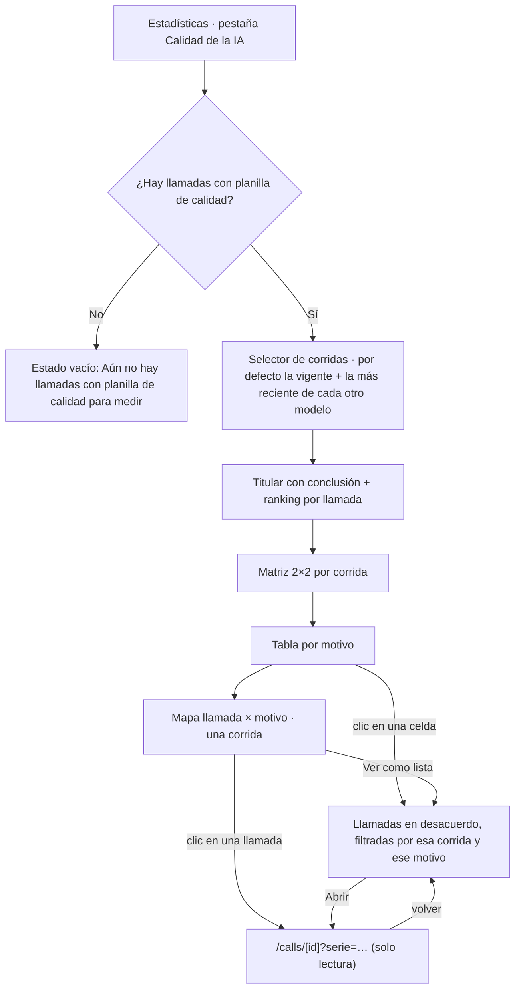

# Cambio 15 · Calce de la IA por corrida y por motivo (admin Qubico)

> Revisión rápida sobre lo aprobado (fases 0–8 y cambios 09–14). Fecha: 2026-11-02. **Estado: aprobado (2026-11-02), implementable.** Alcance D-52 a D-56; diseño §7 y Q1–Q2 aprobados (D-57, D-58). Paginador del mapa §7.10 (D-59, 2026-11-03).
> **Pedido de Johannes (textual):** "me gustaría que en la vista del admin pueda ver algo parecido al dashboard que tenemos para ver que IA funcionaba mejor y comparando con cada run del prompt. De esta forma puedo ver tambien los resultados que ha tenido la IA y comparado con el resultado que venia en la metadata por item del checkbox."
> **Respuesta de Johannes (textual):** "1. A / 2. A / 3. A / 4. A / 5. B". Sin objeción a H-87–H-95.
> **Aprobación de §7 (textual):** "Sí, las recomendadas". H-96 a H-101 sin objeción.
> **Numeración:** D-52 a D-58, supuestos H-87 a H-101. Sin ítems L nuevos (preferencia de Johannes).
> **Revisado:** `scripts/prompt_bench/dashboard.py` + `dashboard_template.html` (pestaña Dashboard), `frontend/src/app/(app)/admin/stats/page.tsx` (pestaña "Calidad de la IA"), `admin/prompts/[version]/prompt-version.tsx` (pestaña de la prueba), `src/call_audit/persistence/models.py` (`Case`, `ModelRun`, `PromptEvaluation`), `prompt_evaluation.py`, `ingestion/import_bench.py`, `api/serializers.py`, `api/routes_admin.py` (stats) y la BD local `call_audit.db`.
> **No contradice:** D-24 (el auditor nunca ve el veredicto de la corredora), Cambio 12 (el admin no ve indicadores por persona; la prueba del prompt corre solo con costo confirmado), D-46 (reimportar solo metadata, sin IA).
> **Ajuste 2026-11-05 (Cambio 17):** "cliente" ya no nombra a la corredora en la UI. La fuente del veredicto del lote es **Planilla de calidad** (corto: **la planilla**) y la contraparte es **la empresa**. Textos de este documento actualizados; detalle en `17-termino-auditoria-corredora.md`.

---

## 0. Decisiones

| # | Decisión | Origen |
|---|---|---|
| D-52 | El Cambio 15 **absorbe** el proceso "Calce IA vs humano" (`docs/ux/calce-ia-vs-humano/`, que se cierra). Sus decisiones del 2026-10-20 se reutilizan; las rechazadas dejan de ser "solo descriptivas" porque hay marca por motivo. El **dashboard local se mantiene** para exploración (Jev, Revisión, modelos fuera de la app), sin más diseño | Johannes (1A) |
| D-53 | La vista **reemplaza el contenido de la pestaña "Calidad de la IA"** de `/admin/stats` (`?tab=quality`) | Johannes (2A) |
| D-54 | Una **corrida** = modelo + versión del prompt + `run_label` de `ModelRun`, **más las pruebas del prompt terminadas**, con etiqueta de origen, en un solo selector | Johannes (3A) |
| D-55 | Se **importan las marcas de la corredora por motivo** (C01..C33, regla de `client_bad()`), reimportando solo la metadata, **sin IA ni costo**. En este cambio solo las usa el admin | Johannes (4A) |
| D-56 | Primera entrega: **ranking + matriz por corrida + tabla por motivo + mapa llamada × motivo + lista de llamadas en desacuerdo** | Johannes (5B) |
| D-57 | §7 aprobado completo. Paleta **`--series-1..6`** agregada a `08-tokens.css` y `08-tokens.json` | Johannes (Q2) |
| D-58 | Al abrir una llamada desde una corrida no vigente: **banner** con lo que marcó esa corrida; el panel sigue mostrando la vigente (sin backend extra) | Johannes (Q1 A) |

## 1. Hechos de partida

**El dashboard local ya hace lo que pide Johannes.** La pestaña Dashboard de `dashboard.html` muestra, por modelo y por versión del prompt (`--compare`):
- ranking por llamada contra `ESTADO_CALIDAD`: detección de rechazadas, falsas alarmas, calce equilibrado, metas (FP ≤ 5 %, FN ≤ 20 %) y costo por llamada;
- matriz 2×2 por modelo;
- tabla por motivo: falsas alarmas en aprobadas y, en rechazadas, **cuántas marcas NO CUMPLE de la corredora (C01..C33, las 33 columnas después de RETENIBLE) detecta cada modelo**, más las que marca de más;
- mapa llamada × motivo, glosario, consenso k de N, «Por revisar cuenta como rechazo», tarjeta Jev y la pestaña Revisión (audio + etiquetado propio).

**La app ya tiene casi todos los datos, salvo uno:**

| Dato | ¿Está en la app? | Dónde |
|---|---|---|
| Veredicto y motivos incumplidos por llamada, modelo y corrida | Sí | `ModelRun` (`model`, `run_label`, `verdict`, `findings`). En la BD local: 100 llamadas × 4 modelos × corridas `v2.7`, `v2.7 corrida 2`, `v2.8` y `v2.10` (solo Gemini) = 1.300 corridas |
| Resultados de las pruebas del prompt desde la app | Sí | `PromptEvaluation.results` (`verdict`, `failCriteria` por llamada) |
| Veredicto de la corredora por llamada | Sí | `Case.external_verdict` (local: 51 Cumple / 49 No cumple) |
| **Marca de la planilla por motivo (C01..C33)** | **No** | `import_bench.py` no la lee; `externalItemVerdicts` sale siempre `None` (`serializers.py:226`) |
| Costo y latencia por corrida | Sí | `ModelRun.cost_usd`, `latency_ms` |

**Lo que hoy muestra el admin es mucho menos que el dashboard:**
- "Calidad de la IA" (`/admin/stats`) agrupa por **versión del prompt + modelo**, así que mezcla `v2.7` con `v2.7 corrida 2`. Muestra una sola "Coincidencia" (no separa detección de falsos positivos), sin conteos *k de n*, sin metas visibles por fila y **sin nada por motivo**. Además tiene un texto provisorio: "más de TBD puntos".
- La prueba de una versión (`/admin/prompts/[version]`) compara solo **vigente vs probada** y por motivo solo cuenta cuántas veces se marcó, sin contrastar con la corredora.

## 2. Problema y objetivo

- **P-15.1** Para elegir modelo o versión del prompt, Johannes tiene que salir de la app y regenerar el dashboard local con scripts. Lo que ve en la app no le alcanza para decidir.
- **P-15.2** La app no distingue corridas repetidas (misma versión y modelo), así que no se ve la variación entre corridas.
- **P-15.3** No hay contraste **por motivo** contra lo que marcó el auditor de la corredora: no se sabe en qué motivos acierta, omite o marca de más cada modelo.

**Objetivo:** que el admin Qubico, dentro de la app, compare **corridas** (modelo × versión del prompt × corrida) contra la corredora, por llamada y por motivo. Con eso debe poder responder en menos de 2 minutos **[SUPUESTO]**: qué corrida calza mejor, en qué motivos falla cada una y en qué llamadas concretas.

**Requisitos propuestos:**
- **R-15.1** Selector de corridas a comparar (de 1 a 6 a la vez), con nombre real del modelo y color fijo por modelo.
- **R-15.2** Ranking por llamada: detección de rechazadas, falsos positivos, falsos negativos, metas, conteos *k de n* y costo por llamada.
- **R-15.3** Tabla por motivo: falsos positivos en aprobadas y detección de las marcas NO CUMPLE de la corredora en rechazadas, con las marcas de más ("+n").
- **R-15.4** Llegar desde el agregado a la llamada: lista de llamadas con desacuerdo, filtrable por motivo, que abre `/calls/[id]`.
- **R-15.5** Aviso de lo que no se mide (la marca de la corredora se toma como verdad) y de los motivos con trato especial: motivo 1 (lo calcula el código), motivos 19–25 (no se evalúan sin tipificación) y motivos leves.

**Fuera de alcance (siguen en el dashboard local):** Jev, la pestaña Revisión con etiquetado propio ("Mi revisión"), consenso k de N y modelos que no están importados en la app (OpenRouter, DeepSeek). Tampoco se corre IA nueva: todo sale de corridas ya guardadas.

## 3. Backend que hace falta (no es UI; lo diseña `pipeline-architect`)

1. **Guardar la marca de la corredora por motivo:** misma regla que `client_bad()` del dashboard (las 33 columnas después de RETENIBLE, en orden, valor "NO CUMPLE"). Se guarda en `Case`, por ejemplo `external_item_fails: list[int] | null`; `null` si el Excel no trae esas columnas.
2. **Reimportar solo la metadata** de las llamadas actuales, **sin IA y sin costo**, como en D-46.
3. **Endpoint de calce por corrida.** Las series se arman con `ModelRun` agrupado por `model` + `run_label`, más las `PromptEvaluation` terminadas. Por cada llamada devuelve: veredicto de la corredora, marcas de la corredora, veredicto de la IA y motivos incumplidos. Es solo para `qubico_admin`.
4. Las métricas se pueden calcular en el servidor o en el front. Con ~100 llamadas y hasta 6 series, el volumen es chico **[SUPUESTO]**.

## 4. Preguntas y decisiones para Johannes (respondidas: ver §0)

**P1 · ¿Qué pasa con el proceso abierto "Calce IA vs humano" (dashboard local, Fase 0 sin respuesta desde el 2026-10-20) y con el dashboard local?**
- **A (recomendada):** este cambio lo **absorbe**. Ese proceso se cierra como "absorbido por el Cambio 15" y sus decisiones del 2026-10-20 se reutilizan aquí (ranking por llamada, nombres reales y color fijo por modelo, aviso de lo que no se mide, reemplazar en vez de duplicar). Una de ellas cambia: como ahora existe la marca por motivo, las rechazadas dejan de ser "solo descriptivas". El dashboard local queda como está, para exploración (Jev, Revisión, modelos fuera de la app), sin más diseño.
- B: son independientes y ese proceso sigue su Fase 0.
- C: el Cambio 15 reemplaza el dashboard local, que se deja de mantener.

**P2 · ¿Dónde vive en el admin?**
- **A (recomendada):** reemplaza el contenido de la pestaña **"Calidad de la IA"** en `/admin/stats` (misma URL, con `?tab=quality`). Esa pestaña hoy responde la misma pregunta peor, así que no se duplica.
- B: sección nueva en la navegación del admin, por ejemplo "Calce de la IA" (`/admin/quality`), y "Calidad de la IA" se elimina.
- C: dentro de `/admin/prompts/[version]`. La descarto: allí solo se compara una versión contra la vigente, no modelos entre sí.

**P3 · ¿Qué cuenta como "corrida" comparable?**
- **A (recomendada):** cada combinación **modelo + versión del prompt + corrida** (`run_label`) de las corridas guardadas (bench importado y producción), **más las pruebas del prompt** hechas desde la app, con una etiqueta de origen ("Prueba desde la app"). Todas van en el mismo selector.
- B: solo las corridas guardadas, sin las pruebas.
- C: agrupar por versión + modelo, como hoy, y promediar las corridas repetidas. Pierde la variación entre corridas (P-15.2).

**P4 · ¿Se importan las marcas de la corredora por motivo (C01..C33) y quién las ve?**
- **A (recomendada):** se importan (§3.1–3.2, sin costo) y en este cambio **solo las usa el admin**, en esta vista. Si el Excel de una llamada no las trae, esa llamada cuenta para el calce por llamada pero no para el calce por motivo, y la vista lo dice ("Sin marca por motivo en {k} llamadas").
- B: además se muestran al supervisor en el detalle de la llamada y en Discrepancias (`externalItemVerdicts`, previsto en D-25). Es otro cambio sobre el supervisor; hoy no lo recomiendo.
- C: no se importan y por motivo solo se cuenta lo que marca la IA. No cumple lo que pidió Johannes.

**P5 · ¿Qué tan profunda es la primera entrega?**
- **A (recomendada):** ranking + matriz por corrida + tabla por motivo + **lista de llamadas en desacuerdo** (filtrable por corrida, por motivo y por tipo: "Solo la IA detectó" / "Omitidos por la IA"). La lista abre `/calls/[id]`, que ya tiene audio, transcripción y panel del modelo.
- B: A + **mapa llamada × motivo** como en el dashboard local (más denso; exige un patrón accesible que no dependa solo del color).
- C: A + **comparar corridas lado a lado en el detalle de la llamada** (hoy `/calls/[id]` muestra solo la corrida vigente: "comparar modelos queda para después").

## 5. Supuestos (van a `hipotesis.md`; sin objeción el 2026-11-02)

| ID | Supuesto |
|---|---|
| H-87 | Una llamada **Dudosa** de la IA cuenta como rechazo, igual que en el dashboard local: en operación igual llega a un auditor. Se indica en la vista, sin interruptor |
| H-88 | Vocabulario de la app (Cambio 09): "Solo la IA detectó" = falso positivo, "Omitidos por la IA" = falso negativo, "motivo" en vez de "criterio". Métricas: Detección de rechazadas, Falsos positivos (meta ≤ 5 %), Falsos negativos (meta ≤ 20 %). Se elimina "más de TBD puntos" |
| H-89 | Cada porcentaje va con su conteo ("12 de 49"). Si una corrida tiene llamadas sin resultado, se avisa, porque su *n* es distinto |
| H-90 | Solo `qubico_admin` ve esta vista (403 para otros roles). Los nombres de ejecutivos no aparecen en los agregados (Cambio 12: sin indicadores por persona) |
| H-91 | Escritorio (≥ 1280 px). En pantallas angostas, las tablas de 6 corridas hacen scroll horizontal dentro de su tarjeta |
| H-92 | Sin librería de gráficos nueva: barras horizontales y tablas con tokens existentes (`08-tokens.css`), como el dashboard local |
| H-93 | Por defecto se seleccionan la corrida vigente y la corrida más reciente de cada otro modelo, hasta 6 |
| H-94 | La marca de la corredora se toma como verdad; si el auditor de la corredora pasó por alto un incumplimiento, la IA aparece con un falso positivo que en realidad es acierto. La vista lo declara y la lista de llamadas permite revisarlo |
| H-95 | Consenso k de N, Jev y "Mi revisión" no entran (siguen en el dashboard local) |

## 6. Proceso propuesto

Es una funcionalidad nueva sobre el admin aprobado, con usuario único y conocido. Propongo el mismo formato que los Cambios 12–14: **un solo documento y un solo gate**.
- **Este gate:** P1–P5.
- **Siguiente entrega (§7 de este documento):** flujo (agregado → motivo → llamada), estructura de la pestaña, wireframe en texto o HTML con datos sintéticos, textos y glosario, accesibilidad (no depender solo del color en tablas con tonos, foco y teclado en el selector), estados (sin datos, sin marcas por motivo, una sola corrida, corrida con errores) e impacto en `admin-types.ts` / `ApiClient`.
- Sin alta fidelidad nueva: se reutilizan `.tbl`, `.vt`, el control de pestañas y los tokens.

---

## 7. Diseño de la vista (aprobado 2026-11-02)

> Datos de los ejemplos: **sintéticos**. Los modelos y versiones son reales; los conteos están inventados.

### 7.1 Flujo



- **Pasos:** dos clics del agregado a la llamada (celda de la tabla → «Abrir»). Hoy ese camino no existe: hay que regenerar el dashboard local.
- **Sin callejones:** al volver desde `/calls/[id]` se conservan la selección, los filtros y el scroll. El estado vive en la URL: `?tab=quality&series=…&map=…&mapPage=…&list=…&reason=…&kind=…&page=…` (`mapPage` desde §7.10). Así un enlace compartido muestra lo mismo **[SUPUESTO, H-96]**.

### 7.2 Estructura de la pestaña (de arriba hacia abajo)

| # | Bloque | Responde | Requisito |
|---|---|---|---|
| 1 | Barra de corridas (selector) | ¿Qué estoy comparando? | R-15.1 |
| 2 | Titular con conclusión | ¿Cuál calza mejor y cumple las metas? | R-15.2 |
| 3 | Ranking por llamada (barras) + control de métrica | ¿Cómo se ordenan? | R-15.2 |
| 4 | Matriz 2×2 por corrida | ¿Dónde está cada error a nivel de llamada? | R-15.2 |
| 5 | Tabla por motivo | ¿En qué motivos falla cada corrida? | R-15.3 |
| 6 | Mapa llamada × motivo (una corrida) | ¿Los errores se concentran en algunas llamadas? | D-56 |
| 7 | Llamadas en desacuerdo | ¿Cuáles reviso? | R-15.4 |
| 8 | Cómo leer las métricas (plegable) + lo que no se mide | ¿Cómo interpreto esto? | R-15.5 |

**Qué pasa con la tabla actual** de "Calidad de la IA" (Prompt · Modelo · Referencia · n · Coincidencia · Dudosas · Citas no validadas · Distribución):
- "Dudosas" y "Citas no validadas" pasan a la matriz de cada corrida, como líneas secundarias.
- La distribución se elimina.
- La referencia "auditores de la app" queda solo en la prueba de `/admin/prompts/[version]` **[SUPUESTO, H-97]**.

### 7.3 Wireframe (texto, datos sintéticos)

```
Estadísticas
[ Operación ] [ Calidad de la IA ] [ Costo ]
───────────────────────────────────────────────────────────────────────────────────────────
Corridas  [● Gemini 3.8 Flash · v2.10 · Vigente ×] [● GPT-6 Luna · v2.8 ×] [● Sonnet 5.5 · v2.8 ×]
          [● Haiku 5.5 · v2.8 ×] [+ Agregar corrida ▾]                          4 de 6 posibles
          Referencia: planilla de calidad · 100 llamadas (51 Cumple · 49 No cumple)
          Marca por motivo: 96 de 100 llamadas · 4 sin marca, solo cuentan por llamada

┌ Titular ──────────────────────────────────────────────────────────────────────────────────┐
│ Gemini 3.8 Flash · v2.10 es la que mejor calza: detecta 44 de 49 llamadas No cumple y da   │
│ 2 falsos positivos en 51 Cumple. Cumple las dos metas.                                     │
│ Con 100 llamadas, diferencias de 1 a 3 llamadas entre corridas no son concluyentes.        │
└───────────────────────────────────────────────────────────────────────────────────────────┘

┌ ¿Qué corrida calza mejor con la planilla? ────────────────────────────────────────────────┐
│ Métrica ( Calce equilibrado ) ( Detección ) ( Falsos positivos ) ( Coincidencia )          │
│ ● Gemini 3.8 Flash · v2.10  ███████████████████▌ 93 % · 44 de 49 · 2 FP · 0,004 USD/llamada │
│ ● Sonnet 5.5 · v2.8         ██████████████████   89 % · 43 de 49 · 4 FP · 0,031 USD/llamada │
│ ● GPT-6 Luna · v2.8         ████████████████▌    84 % · 40 de 49 · 5 FP · 0,012 USD/llamada │
│ ● Haiku 5.5 · v2.8          ███████████████      79 % · 41 de 49 · 11 FP · 0,009 USD/llamada│
│ Dudosa cuenta como No cumple: en operación igual llega a un auditor.                       │
└───────────────────────────────────────────────────────────────────────────────────────────┘

┌ ¿Acierta el veredicto de la llamada? ─────────────────────────────────────────────────────┐
│ ● Gemini 3.8 Flash · v2.10            ● Sonnet 5.5 · v2.8         … (una por corrida)       │
│                      IA No cumple   IA Cumple                                              │
│ Planilla: No cumple     44 ✓        5 ✗ omitidas                                           │
│ Planilla: Cumple         2 !       49 ✓                                                    │
│ ✓ Falsos negativos 10 % (meta ≤ 20 %)   ✓ Falsos positivos 4 % (meta ≤ 5 %)                │
│ 3 dudosas contadas como No cumple · Citas no validadas 1,2 % · 0 sin resultado             │
└───────────────────────────────────────────────────────────────────────────────────────────┘

┌ ¿En qué motivos se equivoca cada corrida? ────────────────────────────────────────────────┐
│                          │ Cumple: solo la IA (de 51) │ │ No cumple: detecta lo de la planilla │
│ Motivo                   │ Gem  GPT  Son  Hai         │ │ Planilla Gem   GPT  Son   Hai     │
│ 14. No intenta retener   │  0    1    0    3         │ │   18     17+1  15   16+2  14      │
│ 28. Información errónea  │ [0]   2    1    4         │ │    9      6    7    [8]   5+3     │
│  1. Espera > 30 s código │  1    1    1    1         │ │    4      4    4     4    4       │
│ 21. … parcial            │  0    0    1    0  (de 38)│ │    3      2    1     3    2       │
│ Total                    │  2    5    4   11         │ │   61     52   48    55   47       │
│ [n] = mejor de la fila · +n = la IA lo marca en una No cumple y la planilla no             │
│ Ninguna corrida ni la planilla marcaron los motivos 5, 10, 19, 24 y 26.                    │
└───────────────────────────────────────────────────────────────────────────────────────────┘

┌ Mapa llamada por llamada ─────────────────────────────────────────────────────────────────┐
│ Corrida (● Gemini · v2.10) ( GPT ) ( Sonnet ) ( Haiku )                    [Ver como lista]│
│          Cumple según la planilla (51)            │ No cumple según la planilla (49)       │
│ Llamada  ■■■■■■■■■■■■■■■■■■■■■■■■■■■■■■■■■■■■■■■  │ ■■■■□■■■■■■■■■□■■■■■■■■■■■■■■■■■■■■   │
│ M01      ·····························■··········  │ ··■··········■················■····   │
│ M02 …    (33 filas)                                │                                       │
│ ■ Coincide con la planilla ■ Solo la IA (relleno ámbar)  □ Omitido por la IA (borde rojo)  │
└───────────────────────────────────────────────────────────────────────────────────────────┘

┌ Llamadas en desacuerdo ───────────────────────────────────────────────────────────────────┐
│ Corrida [Gemini 3.8 Flash · v2.10 ▾]  Tipo ( Todas ) ( Solo la IA detectó ) ( Omitidos )   │
│ Motivo [Todos ▾]                                                           7 llamadas      │
│ Llamada  Fecha       Planilla   IA         Solo la IA   Omitidos por la IA                 │
│ 10482    14-10-2026  Cumple     No cumple  28           —                 [Abrir]          │
│ 10517    15-10-2026  No cumple  Cumple     —            14, 3             [Abrir]          │
│ 10533    15-10-2026  No cumple  No cumple  9            14                [Abrir]          │
└───────────────────────────────────────────────────────────────────────────────────────────┘

▸ Cómo leer las métricas y lo que no se mide
```

**Reglas de comportamiento:**
- **Selector de corridas:**
  - Popover con búsqueda, agrupado por modelo, con las versiones de la más nueva a la más antigua.
  - Cada opción muestra: modelo · versión · corrida (`v2.7 · corrida 2`), la etiqueta "Vigente" o "Prueba desde la app · {fecha}" y *n* llamadas.
  - Máximo 6: la séptima opción queda deshabilitada con "Puedes comparar hasta 6 corridas". Mínimo 1: la última no se puede quitar.
- **Color fijo por modelo:** el color identifica al modelo, no a la corrida. Dos corridas del mismo modelo se distinguen por el nombre y por un relleno rayado en la segunda barra **[SUPUESTO, H-98]**.
- **Titular:**
  - Se calcula con el calce equilibrado.
  - Con 1 corrida: "{corrida} detecta {k} de {n}…", sin "la que mejor calza".
  - Si dos corridas quedan a ±1 llamada: "{A} y {B} calzan casi igual: …".
- **Ranking:**
  - Ordena por la métrica elegida.
  - La línea de meta se muestra solo en Detección (≥ 80 %, H-101) y en Falsos positivos (≤ 5 %).
  - Siempre muestra *k de n*, los FP y el costo por llamada. El costo sale de `ModelRun.cost_usd` o del costo real de la prueba, nunca de precios escritos en el front.
- **Tabla por motivo:**
  - Una fila por cada motivo que alguna corrida o la corredora marcó, en el orden de la pauta.
  - Etiquetas por motivo: `código` (motivo 1), `leve` y `parcial` (19–25, que no se evalúan sin tipificación).
  - El denominador va en la cabecera de cada lado. Si cambia en un motivo `parcial`, va entre paréntesis en esa fila.
  - Clic en una celda → filtra la lista de desacuerdos por esa corrida, ese motivo y el tipo (lado izquierdo = Solo la IA; lado derecho = Omitidos) y baja hasta la lista.
- **Mapa:**
  - Una corrida a la vez; por defecto, la del titular.
  - Columnas = llamadas: Cumple a la izquierda y No cumple a la derecha, ordenadas por ID. Filas = veredicto + 33 motivos.
  - Clic en una columna → `/calls/[id]?serie={id}`.
  - En las llamadas sin marca por motivo, las celdas de motivo van con borde punteado (sin referencia).
- **Lista de desacuerdos:**
  - Muestra una corrida a la vez.
  - Desacuerdo = veredicto distinto **o** al menos un motivo distinto.
  - Columnas sin nombre del ejecutivo (H-90).
  - Orden: primero los veredictos distintos y luego las que solo difieren en motivos. Páginas de 25.
- **`/calls/[id]?serie=…`:** banner sobre el panel del modelo (§7.5 y Q1).

### 7.4 Estados

| Estado | Qué se ve |
|---|---|
| Cargando | Esqueleto de `AsyncView` |
| Error al cargar | "No pudimos cargar la calidad de la IA. Intenta de nuevo." + Reintentar |
| Sin llamadas con veredicto de la corredora | "Aún no hay llamadas con planilla de calidad para medir." (texto actual) |
| Ninguna llamada con marca por motivo | Tabla por motivo solo con el lado izquierdo y mapa en tono neutro ("La IA lo marca"). Aviso: "La planilla de estas llamadas no trae la marca por motivo: por motivo solo se ven los falsos positivos en llamadas Cumple." |
| Marca por motivo parcial | Bajo el selector: "Marca por motivo: {k} de {n} llamadas · {n−k} sin marca, solo cuentan por llamada" |
| Una sola corrida | Ranking con una barra, sin "la que mejor calza"; sin "mejor de la fila" |
| Corrida con llamadas sin resultado | Matriz: "{k} sin resultado, fuera del cálculo"; el ranking usa su propio *n* |
| Prueba del prompt en curso | No aparece en el selector. Línea: "Prueba de v{X} en curso ({k} de {n}) · Ver avance" → `/admin/prompts/[version]` |
| Sin desacuerdos | "{corrida} coincide con la planilla en todas las llamadas." |
| Filtro sin resultados | "Ninguna llamada en desacuerdo con estos filtros." + Quitar filtros |
| Rol distinto de `qubico_admin` | 403; la pestaña no existe para otros roles (H-90) |

### 7.5 Textos y glosario

**Títulos de los bloques:**
1. ¿Qué corrida calza mejor con la corredora?
2. ¿Acierta el veredicto de la llamada?
3. ¿En qué motivos se equivoca cada corrida?
4. Mapa llamada por llamada
5. Llamadas en desacuerdo
6. Cómo leer las métricas

**Glosario** (se suma a `06-ux-writing.md`; convive con **pasada** del Cambio 14 y **prueba** del Cambio 12):

| Término | Definición en la UI | Nota |
|---|---|---|
| **Corrida** | Un modelo con una versión del prompt aplicado a un conjunto de llamadas. Repetir una corrida muestra cuánto varía el resultado | No es la **pasada** (ciclo del worker) |
| **Prueba desde la app** | Corrida lanzada desde Prompt, con costo confirmado | Origen de la serie |
| **Vigente** | La corrida que hoy define el veredicto del motor | `is_current` |
| **Marca de la planilla por motivo** | Motivos marcados NO CUMPLE en la planilla de calidad | C01..C33 |
| **Detección** | De las llamadas que la planilla marcó No cumple, cuántas marca también la IA. Meta ≥ 80 % | = 1 − falsos negativos |
| **Falsos positivos · Solo la IA detectó** | Llamadas Cumple según la planilla que la IA marca No cumple. Meta ≤ 5 %. Por motivo: la IA marca un motivo que la planilla no marcó | Vocabulario de Discrepancias (Cambio 09) |
| **Falsos negativos · Omitidos por la IA** | Llamadas No cumple según la planilla que la IA deja en Cumple. Meta ≤ 20 %. Por motivo: la planilla lo marcó y la IA no | |
| **Calce equilibrado** | Promedio entre la detección y (1 − falsos positivos). Una IA que marca todo No cumple saca 50 % | |
| **Coincidencia** | Porcentaje de llamadas donde la IA dijo lo mismo que la planilla | Única métrica de la pestaña anterior |
| **Desacuerdo** | La IA y la planilla difieren en el veredicto o en al menos un motivo | |

**Lo que no se mide** (dentro del plegable): "La planilla se toma como verdad. Si quien la llenó pasó por alto un incumplimiento, aquí la IA aparece con un falso positivo que en realidad es un acierto; para revisarlo, abre la llamada desde la lista. El motivo 1 lo calcula el código desde las esperas, así que es igual en todas las corridas."

**Banner en `/calls/[id]?serie=…`** (según Q1): "Llegaste desde Calidad de la IA · {corrida}: marcó {No cumple} (motivos 28 y 14). El panel del modelo muestra {la corrida vigente | esta corrida}."

### 7.6 Accesibilidad (WCAG 2.2 AA)

**Paleta de modelos.** Tokens nuevos `--series-1..6`, con su contraste contra blanco / `--neutral-100` (1.4.11 pide ≥ 3:1):

| Token | Color | Contraste |
|---|---|---|
| `--series-1` | azul `#2a78d6` | 4,42 / 4,04 |
| `--series-2` | óxido `#c4501f` | 4,65 / 4,26 |
| `--series-3` | verde `#0f8a5f` | 4,36 / 3,99 |
| `--series-4` | ocre `#a86f00` | 4,25 / 3,89 |
| `--series-5` | frambuesa `#c2477a` | 4,69 / 4,29 |
| `--series-6` | violeta `#7a4fc4` | 5,61 / 5,13 |

- Ajusta la paleta del dashboard local, cuyos amarillo, rosado y verde claro quedaban bajo 3:1.
- El color nunca va solo: siempre acompaña al nombre de la corrida.

**Mapa:**
- Estado por **forma + color**: coincide = relleno `--teal-600`; solo la IA = relleno `--amber-600` (3,05:1); omitido = **cuadro hueco con borde de 2 px** `--red-700`; nada = `--neutral-100`. Leyenda visible.
- `role="img"` con un resumen en `aria-label`, por ejemplo: "Gemini 3.8 Flash · v2.10: 2 llamadas con solo la IA y 5 omitidas, en 100 llamadas".
- El equivalente con teclado es la lista de desacuerdos ("Ver como lista"). Así el mapa no suma 3.400 paradas de tabulación.

**Tablas:**
- Cada celda tiene el número en texto; el tono de fondo es redundante.
- Tonos `--teal-100/200` con texto `--ink-900`, y `--teal-600` con texto blanco (5,47:1).
- "Mejor de la fila" = borde de 2 px + texto oculto "mejor".
- Los denominadores van en la cabecera: la información no depende de un tooltip.

**Controles:**
- Selector de corridas: popover de Radix con casillas (flechas, espacio, Esc). Cada chip tiene un "×" con `aria-label="Quitar {corrida}"`.
- Métrica: `radiogroup`.
- Objetivos de al menos 24 × 24 px (2.5.8).
- Una región `aria-live="polite"` anuncia "Comparando {k} corridas".

**Foco:** el clic en una celda de la tabla por motivo mueve el foco al título de "Llamadas en desacuerdo".

### 7.7 Impacto en `admin-types.ts` y `ApiClient` (no es código)

- **Nuevo** `getAiQuality(): Promise<AiQuality>` → `GET /api/admin/quality`. Solo `qubico_admin`; 403 para el resto.
- **Se elimina** `AdminStats.aiQuality` y su cálculo en `routes_admin.py` cuando la pestaña nueva esté lista.
- **Forma propuesta.** El front calcula las métricas, como el dashboard local; el payload es chico (~100 llamadas × ≤ 20 corridas) **[SUPUESTO, H-99]**.
  - `series[]`: `id`, `model`, `modelLabel`, `promptVersion`, `runLabel`, `source: "run" | "prompt_test"`, `isCurrent`, `ranAt`, `calls`, `costPerCallUsd`, `unvalidatedQuoteRate`.
  - `calls[]`: `caseId`, `callId`, `callDate`, `clientVerdict`, `clientFails: number[] | null` (D-55), `unevaluable: number[]`, `results: Record<seriesId, { verdict: CallVerdict; failCriteria: number[] } | null>`.
  - `criteria[]`: `id`, `name`, `minor`, `byCode`, `partial`.
  - `goals`: `{ falsePositivePct: 5, falseNegativePct: 20 }`.
  - `promptTestRunning`: `{ version, done, total } | null`.
- **Etiquetas y orden de color de los modelos:** los entrega el backend desde `models.toml`, no el front **[SUPUESTO, H-100]**.
- **Backend (§3):** `Case.external_item_fails`, reimportación de la metadata sin IA y el endpoint. Lo diseña `pipeline-architect`.
- **Mock API:** datos sintéticos con 4 modelos, dos corridas de un mismo modelo, una prueba desde la app y 4 llamadas sin marca por motivo, para cubrir los estados de §7.4.

### 7.8 Supuestos nuevos

| ID | Supuesto |
|---|---|
| H-96 | El estado de la vista (corridas, filtros, corrida del mapa) va en la URL, no en `localStorage` |
| H-97 | La referencia "auditores de la app" sale de esta pestaña y queda solo en la prueba del prompt |
| H-98 | El color identifica al modelo; dos corridas del mismo modelo se distinguen por el nombre y por un relleno rayado |
| H-99 | El front calcula las métricas desde los datos por llamada |
| H-100 | Etiquetas y orden de color de los modelos salen de `models.toml` vía backend |
| H-101 | Meta de detección = 80 % (equivale a FN ≤ 20 %) |

### 7.9 Preguntas que quedan

**Q1 · Al abrir una llamada desde una corrida que no es la vigente, ¿qué muestra el detalle?** Hoy `/calls/[id]` muestra solo la corrida vigente. Si no cambia nada, Johannes verá hallazgos de una corrida distinta a la que estaba mirando.
- **A (recomendada):** banner (§7.5) con lo que marcó esa corrida (veredicto y motivos), aclarando que el panel muestra la vigente. Sin backend extra.
- B: el panel del modelo y el checklist muestran **esa** corrida (`?run={modelRunId}`), en solo lectura y con el mismo banner. Es más útil porque se ve la evidencia, pero solo sirve para corridas guardadas: las pruebas desde la app guardan solo los motivos, sin hallazgos ni evidencia. No es la comparación lado a lado de P5-C; solo cambia qué corrida se muestra.

**Q2 · ¿Se aprueba la paleta `--series-1..6` (§7.6) como tokens nuevos en `08-tokens.css`?** Recomiendo sí. Es la única adición al design system.

### 7.10 Paginador del mapa llamada por llamada (revisión rápida, 2026-11-03; ajuste de reparto el mismo día)

Pedidos de Johannes:
1. "en el mapa de llamada por llamada, pon un paginador, para cargar solo de 100 en 100, ver todas es demasiado".
2. Después de verlo en producción: "en las 100, quiero que se alternen cumple y no cumple, la idea es que se vea lo más lleno posible". Con 566 llamadas (282 Cumple, 284 No cumple), la página 6 mostraba solo No cumple, con 66 columnas.

Es un cambio menor sobre el bloque 6 de §7.2 (D-56); no cambia el flujo, la AI ni los CUJ. Decisión **D-59**, ajustada el 2026-11-03; supuesto **H-102**.

**1. Reparto por página (reemplaza la versión contigua).** Cada página muestra hasta **50 llamadas Cumple y hasta 50 No cumple**, las siguientes de cada grupo por `callId` numérico. Si un grupo se agota, el otro rellena hasta 100.
- Total de páginas: `ceil(n / 100)`. Solo la última puede tener menos de 100 columnas.
- Fórmula (sin estado; `n = nC + nN`, `MAP_PAGE = 100`, `HALF = 50`). Llamadas tomadas de cada grupo después de `k` páginas:
  - `t(k) = min(100·k, n)`
  - `c(k) = min(nC, max(50·k, t(k) − nN))`
  - `m(k) = t(k) − c(k)`
- La página `p` (base 0) muestra `cumple.slice(c(p), c(p+1))` y `noCumple.slice(m(p), m(p+1))`.
- Ejemplo con 282 / 284: las páginas 1 a 5 muestran 50 + 50; la página 6 muestra 32 + 34.
- Siguen los **dos bloques lado a lado** con sus encabezados. No se intercala columna a columna, para no perder el corte Cumple | No cumple que da sentido a la fila de veredicto.
- El encabezado de cada bloque muestra **siempre el total del grupo**: "Cumple según la planilla (282)".
- Un grupo sin llamadas en la página (solo pasa cuando se agotó) no se dibuja. La grilla usa `repeat(<grupos visibles>, auto)`.
- **Se elimina el atajo "Ir a {grupo}"**: ya no hay páginas con un solo grupo mientras queden llamadas de ambos.

**2. Ubicación y forma.** Debajo del mapa, antes de la leyenda. Es el mismo paginador de "Llamadas en desacuerdo": `Button size="sm"` Anterior · "k de n" · Siguiente, alineado a la derecha.
- A la izquierda de la misma fila va el rango, con clase `help tabular`: **"Cumple 51–100 · No cumple 51–100"**.
  - No repite "Página k de n" (ya está en el paginador) ni los totales (ya están en los encabezados).
  - Si un grupo no tiene llamadas en la página, se omite su tramo, por ejemplo "No cumple 251–284".
  - Si el tramo es de una sola llamada: "Cumple 282".
- Con 100 llamadas o menos no se muestran ni el paginador ni el rango.
- El rango va en `aria-live="polite"`.
- Si el botón que tenía el foco queda deshabilitado, el foco pasa al otro botón.

**3. URL.** Parámetro propio **`mapPage`**, base 0, que se omite cuando vale 0.
- Se conserva al volver desde `/calls/[id]` (H-96).
- No se resetea al cambiar la corrida del mapa ni las corridas elegidas (H-102). El reparto depende solo de `data.calls`, así que las mismas columnas se comparan entre corridas.
- Si queda fuera de rango, se ajusta con `Math.min(mapPage, pages − 1)`.
- `mapPage` y `page` son independientes.
- Los parámetros quedan así: `?tab=quality&series=…&map=…&mapPage=…&list=…&reason=…&kind=…&page=…`.

**4. Conteos y accesibilidad.**
- `aiOnly`, `missed` y los totales de grupo se calculan sobre **todas** las llamadas.
- Con más de una página, el `aria-label` del `role="img"` suma una oración con el tramo visible: "Gemini 3.8 Flash · v2.10: 12 llamadas con solo la IA y 31 omitidas, en 566 llamadas. Se muestran Cumple 51 a 100 y No cumple 51 a 100." Si falta un grupo, la oración nombra solo el otro.
- "Ver como lista" no cambia.

**Estados (se suman a §7.4):**

| Estado | Qué se ve |
|---|---|
| ≤ 100 llamadas | Igual que antes del paginador |
| Página normal | Hasta 50 Cumple + 50 No cumple, lado a lado |
| Un grupo agotado | Solo el otro bloque, que rellena hasta 100; el rango nombra solo ese grupo |
| `mapPage` fuera de rango | Última página |

**Revisión rápida:** trazabilidad D-56/D-59 · sin callejones · WCAG 2.2 AA: 2.4.3, 2.5.8 y 4.1.3 · microcopy coherente con la lista · sin dark patterns · sin ítems legales nuevos.
