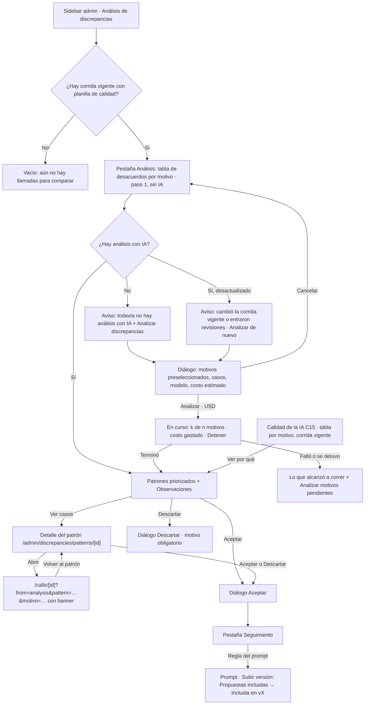

# Cambio 16 · IA de discrepancias en el perfil admin

> Revisión rápida sobre lo aprobado (fases 0–8 y cambios 09–15). Fecha: 2026-11-04. **Estado: aprobado (2026-11-04), implementable.** Alcance D-61 a D-65; §7 y Q1–Q5 aprobados (D-66 a D-70).
> **Pedido de Johannes (textual):** "la IA de discrepancias la idea es que sea una vista en el perfil de admin que entregue esta información."
> **Aprobación del alcance (textual, tras ver P1–P5 y H-106 a H-114):** "apruebo". Se registra como P1 A, P2 A, P3 A, P4 A, P5 A, sin objeción a H-106–H-114.
> **Origen:** acuerdo Agustín–Johannes del 2026-11-04, `docs/plan-ia-discrepancias.md` (sección "Salida: vista en el perfil admin").
> **Numeración:** P-16.x, R-16.x; decisiones desde D-61; supuestos H-106 a H-114. Sin ítems L nuevos (preferencia de Johannes).
> **Revisado:** `docs/plan-ia-discrepancias.md`, `src/call_audit/discrepancies.py`, `../transcripts/discrepancies/prod-2026-11-04/summary.md`, `15-calce-ia-por-corrida.md`, `12-cambio-admin-qubico.md` (§2.2 subir versión, §2.3 prueba con costo), `09-cambio-auditoria-ia.md` (Discrepancias del supervisor), `14-estado-worker.md`, `frontend/src/components/shell/sidebar-nav.tsx`.
> **No contradice:** regla no negociable 5 y el plan ("no modifica criterios automáticamente"), D-35 (lo que gasta IA muestra *n* y costo y solo corre si el admin confirma), D-24 (el auditor nunca ve el veredicto de la corredora), D-53 (Calidad de la IA sigue en `/admin/stats?tab=quality`).
> **Ajuste 2026-11-05 (Cambio 17):** "cliente" ya no nombra a la corredora en la UI. La fuente del veredicto del lote es **Planilla de calidad** (corto: **la planilla**) y la contraparte es **la empresa**. Textos de este documento actualizados; detalle en `17-termino-auditoria-corredora.md`.

---

## 0. Decisiones

| # | Decisión | Origen |
|---|---|---|
| D-61 | Sección nueva en la sidebar del admin, **"Análisis de discrepancias"** (`/admin/discrepancies`), entre Estadísticas y Prompt | Johannes (P1 A) |
| D-62 | Convive con Calidad de la IA sin duplicarla: la vista nueva parte con la tabla del paso 1 (corrida vigente, con revisión manual, dudosas y por evaluador) y debajo los patrones. Enlaces cruzados "Ver por qué" (desde C15, solo en la corrida vigente) y "Ver en Calidad de la IA" | Johannes (P2 A) |
| D-63 | Se analiza siempre la **corrida vigente**. El admin elige los motivos (preseleccionados los de 3 o más desacuerdos) y confirma con costo estimado | Johannes (P3 A) |
| D-64 | Aceptar **no toca el prompt**: la propuesta pasa a seguimiento según su tipo (regla del prompt → "Incluida en v{X}" al subir versión; pregunta a la corredora → "Preguntada"; calibrar → "Calibrada"). Descartar exige motivo y lo descartado se le pasa a la siguiente corrida de análisis | Johannes (P4 A) |
| D-65 | Casos de un patrón con las tres miradas por fila; "Abrir" va a `/calls/[id]` con banner (patrón D-58) y volver conserva el patrón | Johannes (P5 A) |
| D-66 | El admin elige el modelo de la IA de análisis en el diálogo (selector con modelo por defecto de la configuración); el costo se recalcula al cambiarlo | Johannes (Q1 A) |
| D-67 | Al aceptar, el texto de la propuesta es editable; se guardan original y editado ("Editado", original plegable) | Johannes (Q2 A) |
| D-68 | "Incluida en v{X}" al guardar la versión (borrador) con la propuesta marcada; se muestra el estado de la versión; si se retira sin activarse, vuelve a "Aceptada" | Johannes (Q3 A) |
| D-69 | Detalle del patrón en página propia, `/admin/discrepancies/patterns/[id]` | Johannes (Q4 A) |
| D-70 | Las preguntas a la corredora aceptadas quedan solo en Seguimiento (Copiar / Copiar todas, "Preguntada" a mano); no pasan a "Por presentar" del supervisor | Johannes (Q5 A) |

Nota: la columna "Revisión manual" = 1 en todos los motivos de producción **no es un bug**: hay una sola revisión de la app (llamada 233422) y cubre los 33 motivos. H-113 se mantiene.

## 1. Hechos de partida

- **Paso 1 existe y es determinístico** (`discrepancies.py`): por llamada × motivo cruza la corrida vigente con el Excel (veredicto, comentario, C01..C33) y con la revisión manual Qubico. Tipos `fp`, `fn`, `ai_uncertain`, `match_fail`. Resúmenes por motivo, por veredicto de llamada y por evaluador de la corredora. Hoy sale como Markdown/JSONL fuera de la app.
- **Producción (2026-11-04):** 493 llamadas, calce de llamada 58 %. Los desacuerdos se concentran: motivo 25 (97 fp, dato faltante: tipificación), 18 (36 fp / 69 fn), 1 (51 fp, lo calcula el código), 6, 32, 2. 73 llamadas sin corrida vigente quedan fuera.
- **Dos vacíos de datos que afectan el diseño:**
  - Revisión manual por motivo: **1 caso por motivo** en todo el corte. Casi ningún patrón tendrá "el porqué" humano; la causa `evaluator` va a depender casi solo del Excel.
  - `EVALUADOR_CALIDAD` no viene en el Excel de estas 493 llamadas. El resumen por evaluador estará vacío hasta reimportar el Excel nuevo de S4P.
- **Paso 2 no existe.** Salida JSON por motivo (patrones con dirección, casos, causa, evidencia, propuesta, confianza) + síntesis priorizada por impacto.
- **El prompt no se edita en la app.** Una versión nueva se sube como `prompt.yaml` o `system.txt` (Cambio 12 §2.2). Por eso "aceptar una propuesta" no puede ser "aplicar": como mucho deja la propuesta lista para la próxima versión.
- **Vistas vecinas:**

| Vista | Rol | Pregunta que responde | Relación con el Cambio 16 |
|---|---|---|---|
| Calidad de la IA (C15, `/admin/stats?tab=quality`) | Admin | ¿Qué corrida calza mejor con la corredora, y en qué motivos y llamadas falla? | Mismos números fp/fn por motivo para la corrida vigente. Responde **dónde** falla; no **por qué** |
| Discrepancias (C09, árbol) | Supervisor | ¿La IA acertó o se equivocó en esta llamada? Seguimiento "Por presentar" | Es **fuente** del paso 1 (`discrepancy_classifications`, notas). Se llama igual: hay que evitar el choque de nombre |
| Prompt (C12, `/admin/prompts`) | Admin | Versiones, prueba con costo, activar | **Destino** de las propuestas `prompt_rule` aceptadas |
| Procesamiento (C14) | Admin | ¿Qué está corriendo? | Una corrida de análisis en curso aparece como línea con enlace, igual que la prueba del prompt (D-48) |

## 2. Problema, objetivo y requisitos

- **P-16.1** Calidad de la IA dice en qué motivos hay desacuerdo, pero no **por qué**. Hoy el porqué se arma a mano (análisis v2.6) leyendo llamada por llamada.
- **P-16.2** Un desacuerdo no siempre es culpa del prompt: puede ser el evaluador de la corredora, la transcripción o un dato que la IA no tiene (motivo 25). Sin separar eso, se corrige el prompt donde no corresponde.
- **P-16.3** Las conclusiones se pierden: no hay registro de qué se propuso, qué se aceptó y en qué versión entró.

**Objetivo:** que el admin Qubico, en la app, lance el análisis con costo conocido, lea los patrones priorizados por impacto con su causa y evidencia, revise los casos de cada patrón y **acepte o descarte** cada propuesta, dejando rastro hasta la versión del prompt (o la pregunta a la corredora) donde terminó.

**Requisitos propuestos:**
- **R-16.1** Lanzar una corrida de análisis desde la vista con *n* de casos, motivos, modelo y costo estimado; solo corre si el admin confirma (D-35).
- **R-16.2** Ver la tabla del paso 1 (dónde duele) con las tres miradas (IA, Excel, revisión manual) y el resumen por evaluador de la corredora.
- **R-16.3** Ver los patrones priorizados: resumen, dirección (de más / se le pasa), causa, evidencia, confianza, casos y propuesta. Los de menos de 3 casos se muestran como **observación**, sin botón de aceptar.
- **R-16.4** Desde un patrón, ver sus casos y abrir la llamada en `/calls/[id]` con el contexto del motivo.
- **R-16.5** Aceptar o descartar cada propuesta, con registro de quién, cuándo y qué pasó después (incluida en versión X, preguntada a la corredora, calibrada).
- **R-16.6** Historial de corridas de análisis (fecha, corrida de capa 2 analizada, modelo, versión del prompt de análisis, costo) y aviso cuando el análisis quedó viejo (cambió la corrida vigente o entraron revisiones nuevas).

**Fuera de alcance:** que la IA escriba el `prompt.yaml` o active versiones; mostrar esto al supervisor o al auditor; correr el análisis automático por calendario; analizar corridas que no sean la vigente (ver P3).

## 3. Backend que hace falta (no es UI; lo diseña `pipeline-architect` con `llm-engineer`)

1. Tablas `DiscrepancyAnalysis` (corrida: estado, modelo, versión del prompt de análisis, corrida de capa 2 analizada, motivos, *n*, costo estimado y real, quién la lanzó) y `DiscrepancyPattern` (por motivo, con el JSON del paso 2 + estado de la propuesta).
2. El paso 1 como endpoint (hoy CLI). Mismo cálculo que `discrepancies.py`, sin IA.
3. Endpoint de estimación de costo y de lanzamiento, en el mismo worker que la prueba del prompt; avance por motivo ("k de n") para Procesamiento.
4. Decisión sobre la propuesta: `pending | accepted | discarded`, con motivo, autor, fecha y destino (`included_in_version`, `asked_client`, `calibrated`).
5. Cita validada contra la transcripción (regla 4 del proyecto) también para la evidencia del paso 2.

## 4. Preguntas y decisiones para Johannes (respondidas: ver §0)

**P1 · ¿Dónde vive en el admin y cómo se llama?**
- **A (recomendada):** sección nueva en la sidebar del admin, **"Análisis de discrepancias"** (`/admin/discrepancies`), entre Estadísticas y Prompt. Es un flujo de trabajo (lanzar, revisar, aceptar), no una estadística, y el nombre largo evita confundirla con "Discrepancias" del supervisor.
- B: pestaña nueva en Estadísticas (`/admin/stats?tab=analysis`), al lado de Calidad de la IA.
- C: bloque dentro de Calidad de la IA (C15). La descarto: esa pestaña ya es larga y compara varias corridas; el análisis es de una sola.

**P2 · ¿Cómo convive con Calidad de la IA (Cambio 15)?**
- **A (recomendada):** cada una responde una pregunta. Calidad de la IA sigue igual (dónde falla, varias corridas). La vista nueva parte con la tabla del paso 1 (corrida vigente, con columnas de revisión manual, dudosas y por evaluador, que C15 no tiene) y debajo los patrones. Enlaces cruzados: en la tabla por motivo de C15, la corrida vigente lleva "Ver por qué" que abre el motivo en la vista nueva; y desde la vista nueva, "Ver en Calidad de la IA".
- B: la tabla del paso 1 se agrega a Calidad de la IA (columnas nuevas) y la vista nueva muestra solo patrones y propuestas.
- C: sin enlaces; vistas independientes.

**P3 · ¿Qué analiza cada corrida y quién elige?**
- **A (recomendada):** siempre la **corrida vigente** de capa 2 (como el paso 1). El admin elige los motivos: vienen marcados los que tienen 3 o más desacuerdos (fp + fn), ordenados por cantidad; puede desmarcar. El diálogo muestra motivos, casos, modelo y costo estimado antes de confirmar.
- B: A + elegir cualquier corrida del selector del Cambio 15 (incluidas las pruebas del prompt). Más flexible, pero el paso 1 y la revisión manual hoy solo existen para la vigente.
- C: siempre todos los motivos, sin elegir.

**P4 · ¿Qué significa "aceptar" una propuesta?**
- **A (recomendada):** aceptar **no toca el prompt**. La propuesta pasa a una lista de pendientes según su tipo:
  - *Regla del prompt:* "Aceptada · falta incluirla en una versión". Al subir una versión nueva en Prompt (C12 §2.2), el admin marca cuáles incluye y quedan como "Incluida en v2.11"; su texto se precarga en "Por qué".
  - *Pregunta a la empresa:* lista "Preguntas a la empresa" con botón Copiar; se marca "Preguntada" a mano.
  - *Calibrar con el auditor:* lista con sus casos, para la reunión de calibración; se marca "Calibrada" a mano.
  - Descartar pide un motivo corto (obligatorio) y la próxima corrida de análisis recibe lo descartado para no repetirlo.
- B: como A, pero sin seguimiento: solo aceptar/descartar y un export.
- C: aceptar genera un borrador de `prompt.yaml` con la regla redactada por la IA, para revisar y subir. Más rápido, pero más backend y roza el "no modifica criterios automáticamente".

**P5 · ¿Cómo se revisan los casos de un patrón?**
- **A (recomendada):** al abrir un patrón, lista de sus casos con las tres miradas por fila (IA / Excel / revisión manual), cita de la IA y comentario de la corredora. "Abrir" va a `/calls/[id]?motivo=…` con un banner (mismo patrón que D-58) que dice qué marcó cada uno en ese motivo; volver conserva el patrón abierto.
- B: A + panel lateral con el tramo de transcripción (± 30 s) para leer sin salir de la vista.
- C: solo la lista de IDs; abrir la llamada para ver el resto.

## 5. Supuestos (van a `hipotesis.md`; sin objeción el 2026-11-04)

| ID | Supuesto |
|---|---|
| H-106 | Solo `qubico_admin` ve la vista (403 para otros roles), escritorio ≥ 1280 px, como C15 (H-90, H-91) |
| H-107 | El resumen por evaluador de la corredora muestra el nombre tal cual viene en `EVALUADOR_CALIDAD`. Es una excepción acotada a "sin indicadores por persona" del Cambio 12, que apuntaba a ejecutivos; los ejecutivos siguen sin aparecer |
| H-108 | Orden de los patrones = impacto de la síntesis (casos afectados × peso en el veredicto de llamada); los de menos de 3 casos van al final como "Observaciones" |
| H-109 | Causas en la UI: Criterio del prompt · Evaluador de la planilla · Transcripción · Dato faltante. El motivo 1 (umbral de espera en código) entra como "Criterio" y su propuesta típica es una pregunta a la empresa (umbral TBD), no una regla del prompt |
| H-110 | Si el Excel y la revisión manual se contradicen, el caso se marca "Desacuerdo entre revisores" y va a calibración, no a cambios del prompt (decisión pendiente 2 del plan) |
| H-111 | El análisis queda "desactualizado" (aviso, no bloqueo) si cambió la corrida vigente o entraron revisiones/clasificaciones nuevas desde que corrió |
| H-112 | Se ve la última corrida de análisis; las anteriores se abren en solo lectura desde el historial. Las decisiones sobre propuestas viven aparte y no se pierden al correr de nuevo |
| H-113 | Mientras la revisión manual por motivo sea casi nula (1 caso por motivo hoy), la vista lo dice arriba: "{k} de {n} casos tienen revisión manual Qubico" |
| H-114 | La confianza del patrón se muestra como Alta / Media / Baja (≥ 0,7 / 0,4–0,7 / < 0,4), no como número |

## 6. Proceso propuesto

Mismo formato que los Cambios 12–15: **un solo documento y dos gates**.
- **Este gate:** P1–P5 y H-106 a H-114.
- **Siguiente entrega (§7 de este documento):** flujo (lanzar → patrones → casos → llamada → aceptar/descartar), estructura de la vista, wireframe en texto con datos sintéticos, estados (sin análisis, estimando, corriendo, falló, desactualizado, sin evaluador, sin revisión manual, motivo sin patrones), textos y glosario (causas, tipos de propuesta, estados), accesibilidad (causa y dirección con texto, no solo color; diálogos de costo y descarte con foco atrapado) e impacto en `admin-types.ts` / `ApiClient`.
- Sin alta fidelidad nueva: se reutilizan `.tbl`, las etiquetas de estado, el diálogo de costo del Cambio 12 y los tokens.
- El diseño puede avanzar en paralelo a los pasos 3–5 del plan, pero el wireframe usará el esquema JSON del paso 2 tal como está en el plan; si el piloto lo cambia, se ajusta §7.

---

## 7. Diseño de la vista (aprobado 2026-11-04)

> Datos de los ejemplos: **sintéticos**. Los nombres de los motivos son reales; los conteos, patrones y textos de propuesta son inventados.

### 7.1 Flujo



- **Pasos:** de la tabla por motivo a una llamada concreta, 2 clics ("Ver casos" → "Abrir"). Aceptar o descartar: 2 clics (botón → confirmar). Hoy el porqué se arma a mano fuera de la app.
- **Sin callejones:** toda decisión es reversible ("Volver a pendiente") y queda en el Registro de actividad (C12). Un análisis detenido o fallido conserva los motivos terminados y ofrece correr solo los pendientes.
- **Estado en la URL:** `/admin/discrepancies?tab=analysis|followup|history&cause=…&kind=…&status=…&motivo=…&analysis=…`. Un enlace compartido muestra lo mismo; `analysis=` abre un análisis anterior en solo lectura (H-112).

### 7.2 Estructura

Ruta `/admin/discrepancies`, tres pestañas (mismo control que Estadísticas):

| Pestaña | Bloques (de arriba hacia abajo) | Requisito |
|---|---|---|
| **Análisis** (por defecto) | 1. Encabezado: corrida vigente comparada, último análisis (fecha, modelo, costo), aviso de desactualizado y botón **Analizar discrepancias** · 2. Cobertura: llamadas, casos, revisión manual (H-113) · 3. **¿Dónde están los desacuerdos?** (tabla por motivo, paso 1) · 4. **Por evaluador de la planilla** (plegable) · 5. **Patrones** priorizados con filtros · 6. **Observaciones** (< 3 casos, plegable) · 7. **Cómo leer este análisis** (plegable) | R-16.1–R-16.3 |
| **Seguimiento** | Listas con contador: **Para la próxima versión del prompt** · **Preguntas a la empresa** · **Para calibrar con el auditor**, más **Descartadas** (plegable) | R-16.5 |
| **Historial** | Corridas de análisis: fecha, quién, corrida de capa 2, modelo, versión del prompt de análisis, motivos, patrones, costo real, estado. Abrir → pestaña Análisis en solo lectura | R-16.6 |

Detalle de un patrón: ruta propia `/admin/discrepancies/patterns/[patternId]` (ver Q4), con la ficha del patrón y sus casos (R-16.4).

**Tabla por motivo (bloque 3):** Motivo · Planilla NO CUMPLE · IA NO CUMPLE · Coinciden · Solo la IA detectó · Omitidos por la IA · IA dudosa · Con revisión manual · Patrones · "Ver patrones" (filtra el bloque 5 por ese motivo y mueve el foco). Orden: desacuerdos (solo la IA + omitidos) de mayor a menor, como `summary.md`. Arriba, una línea con el calce de llamada y "Ver en Calidad de la IA"; la matriz 2×2 de C15 no se repite (H-116).

**Tarjeta de patrón (bloque 5):**
- Encabezado: n.º de prioridad · motivo · **dirección** · **causa** · confianza (Alta/Media/Baja) · *k* casos · estado de la propuesta.
- Resumen (1–2 líneas) y evidencia (cita validada con llamada y tiempo, o "Sin cita validada").
- Propuesta: tipo + texto.
- Acciones: **Aceptar** · **Descartar** · **Ver casos (k)**. Si ya está decidida: estado + "Volver a pendiente".
- Si hay casos con desacuerdo entre revisores (H-110): "{k} casos con desacuerdo entre revisores: van a calibración".

**Filtros del bloque 5:** Causa · Tipo de propuesta · Estado (Pendientes por defecto) · Motivo, con "Quitar filtros".

### 7.3 Wireframe (texto, datos sintéticos)

```
Análisis de discrepancias
[ Análisis ] [ Seguimiento (6) ] [ Historial ]
─────────────────────────────────────────────────────────────────────────────────────────────
Comparamos la corrida vigente Gemini 3.8 Flash · v2.10 con la planilla de calidad y la revisión manual Qubico.
Último análisis: 04-11-2026 18:40 · Sonnet 5.5 · prompt de análisis v1.0.0 · 12 motivos · 3,10 USD
⚠ Desactualizado: entraron 4 revisiones nuevas desde el último análisis.    [ Analizar discrepancias ]

480 llamadas · 740 casos en desacuerdo · 40 casos con revisión manual Qubico (5 %)
73 llamadas sin corrida vigente quedan fuera.

┌ ¿Dónde están los desacuerdos? ────────────────────────────────────────────────────────────┐
│ Calce de llamada: 280 de 480 (58 %) · Ver en Calidad de la IA →                           │
│ Motivo                               Planilla IA  Coinc. Solo IA Omit. Dudosa Manual Patr.│
│ 25 · No tipifica todas las gestiones     0    90    0      90     0     20     2     1  [Ver patrones]
│ 18 · Tipifica motivo de renuncia inc.   90    58   22      36    68      6     3     3  [Ver patrones]
│ 1 · Deja en espera por tiempo excesivo  18    62   14      48     4      0     1     1  [Ver patrones]
│ …                                                                                         │
│ 19 · Tipifica renuncia y es retención    2     0    0       0     2      0     0     —  sin analizar
└───────────────────────────────────────────────────────────────────────────────────────────┘

▸ Por evaluador de la planilla   (La planilla de estas llamadas no trae el evaluador.)

┌ Patrones · ordenados por impacto ─────────────────────────────────────────────────────────┐
│ Causa: (Todas) (Criterio del prompt) (Evaluador de la planilla) (Transcripción) (Dato faltante)
│ Tipo: (Todos) (Regla del prompt) (Pregunta a la empresa) (Calibrar)    Estado: [Pendientes ▾]
│                                                                                           │
│ ┌ 1 · Motivo 25 · Solo la IA detectó · Dato faltante · Confianza alta · 88 casos · Pendiente
│ │ La IA marca "no tipifica todas las gestiones" sin recibir la tipificación del ejecutivo:
│ │ evalúa sobre un supuesto.
│ │ Evidencia: en los 88 casos la metadata no trae tipificación.
│ │ Propuesta · Pregunta a la empresa: "¿Pueden enviar la tipificación de cada gestión en el Excel?"
│ │ [ Aceptar ]  [ Descartar ]  [ Ver casos (88) ]
│ └──────────────────────────────────────────────────────────────────────────────────────
│ ┌ 2 · Motivo 18 · Omitidos por la IA · Criterio del prompt · Confianza media · 21 casos
│ │ Cuando el cliente da dos razones, la IA acepta la tipificación si calza con cualquiera;
│ │ la planilla exige la principal.
│ │ Evidencia: llamada 231063, 01:42 «es que me quedé sin pega y aparte no lo uso».
│ │ Propuesta · Regla del prompt: "Si el cliente da más de un motivo, la tipificación debe…"
│ │ 3 casos con desacuerdo entre revisores: van a calibración.
│ │ [ Aceptar ]  [ Descartar ]  [ Ver casos (21) ]
│ └──────────────────────────────────────────────────────────────────────────────────────
│ …                                                                                         │
└───────────────────────────────────────────────────────────────────────────────────────────┘
▸ Observaciones (4) · patrones con menos de 3 casos, sin propuesta para aceptar
▸ Cómo leer este análisis
```

**Diálogo de lanzamiento** (reutiliza el diálogo de costo de C12 §3.3):

```
¿Analizar las discrepancias de la corrida vigente?
Gemini 3.8 Flash · v2.10 · 480 llamadas

Motivos a analizar (12 de 28 con desacuerdos)          [Marcar todos] [Desmarcar todos]
 ☑ 25 · No tipifica todas las gestiones          90 desacuerdos
 ☑ 18 · Tipifica motivo de renuncia incorrecto  104 desacuerdos
 …
 ☐ 19 · Tipifica renuncia y es retención          2 (menos de 3: quedaría como observación)

Modelo  [ Sonnet 5.5 ▾ ]   (ver Q1)
Costo estimado: 3,20 USD (12 motivos + síntesis) · Tiempo estimado: 6 min
Se le pasan las 3 propuestas descartadas de estos motivos para que no las repita.
El análisis no cambia el prompt ni los resultados de las llamadas.

[ Analizar · 3,20 USD ]  [ Cancelar ]
```

**En curso** (reemplaza el botón del encabezado; la misma línea aparece en Procesamiento, D-48): "Analizando · 5 de 12 motivos · 1,30 USD · [Detener]".

**Detalle del patrón** (`/admin/discrepancies/patterns/[id]`):

```
← Patrones
Motivo 18 · Omitidos por la IA · Criterio del prompt · Confianza media · 21 casos · Pendiente
(resumen, evidencia, propuesta y acciones, como en la tarjeta)

Casos (21)              Filtro: (Todos) (Con revisión manual) (Desacuerdo entre revisores)
Llamada  Fecha       IA       Planilla   Revisión manual        Cita de la IA · comentario en la planilla
231063   21-10-2026  Cumple   No cumple  No cumple · da razón   IA: «…tipifica Cambio de situación laboral…»
                                         a la planilla          Planilla: "Motivo principal es no uso"      [Abrir]
230244   20-10-2026  Cumple   No cumple  —                      IA: «…» · Planilla: sin comentario         [Abrir]
…
```

**Banner en `/calls/[id]?from=analysis&pattern=…&motivo=18`:** "Llegaste desde Análisis de discrepancias · Motivo 18: IA Cumple · Planilla No cumple · Revisión manual: sin revisión. Patrón: «Cuando el cliente da dos razones…» · Volver al patrón". El checklist abre y resalta el motivo 18.

**Seguimiento:**

```
Para la próxima versión del prompt (2)
 Motivo 18 · "Si el cliente da más de un motivo…"
   Aceptada por Johannes 04-11 · Falta incluirla en una versión          [Volver a pendiente]
 Motivo 13 · "Acepta el N° de seguro sin el cero inicial…"
   Incluida en v2.11 (borrador)
Preguntas a la empresa (3)                                                 [Copiar todas]
 Motivo 25 · "¿Pueden enviar la tipificación…?" · Aceptada 04-11   [Marcar como preguntada] [Copiar]
Para calibrar con el auditor (1)
 Motivo 32 · 6 casos · "Revisar con el evaluador si…"              [Marcar como calibrada] [Ver casos]
▸ Descartadas (2)
 Motivo 1 · "Bajar el umbral de espera a…" · La evidencia no alcanza · Johannes 04-11  [Volver a pendiente]
```

**En Prompt · Subir versión (C12 §2.2), campo nuevo** debajo de "Por qué": **Propuestas incluidas** (casillas con las aceptadas de tipo regla del prompt). Al marcar una, su texto se agrega a "Por qué". Al guardar la versión quedan "Incluida en v{X}" (ver Q3).

### 7.4 Estados

| Estado | Qué se ve |
|---|---|
| Cargando | Esqueleto de `AsyncView` |
| Error al cargar | "No pudimos cargar el análisis de discrepancias. Intenta de nuevo." + Reintentar |
| Sin corrida vigente con veredicto de la corredora | "Aún no hay llamadas con corrida vigente y marca por motivo en la planilla para comparar." Sin botón de analizar |
| Sin desacuerdos | "La corrida vigente coincide con la planilla en todos los motivos. No hay nada que analizar." |
| Paso 1 listo, sin análisis con IA | Tabla por motivo + aviso: "Todavía no hay análisis con IA. Analizar busca patrones y propone soluciones; no cambia el prompt." + botón |
| Estimando costo | Diálogo con el costo en esqueleto; el botón primario espera |
| Sin estimación | "No hay costo registrado para este modelo; no podemos estimarlo." · "Analizar sin estimación" (igual que C12) |
| En curso | Línea de avance en el encabezado y en Procesamiento; la tabla y el análisis anterior siguen visibles; el botón de analizar queda deshabilitado con el motivo en texto |
| Detenido | "Análisis detenido por {persona} en {k} de {n} motivos. Costo: {usd} USD." Los motivos terminados se ven; "Analizar motivos pendientes ({n−k})" |
| Falló | "El análisis falló en el motivo {m}: {mensaje}. Los {k} motivos anteriores quedaron guardados." + "Analizar motivos pendientes" |
| Desactualizado (H-111) | Aviso ámbar con ícono: "Desactualizado: {cambió la corrida vigente a {corrida} \| entraron {k} revisiones nuevas} desde el último análisis." No bloquea aceptar ni descartar |
| Motivo analizado sin patrones | Columna Patrones = "0"; nota: "La IA no encontró un patrón: los desacuerdos parecen casos aislados." |
| Motivo no analizado | Columna Patrones = "—" con texto "sin analizar" |
| Sin evaluador | Plegable: "La planilla de estas llamadas no trae el evaluador. Reimporta la metadata con la planilla nueva para verlo." |
| Revisión manual baja (H-113) | Línea de cobertura siempre visible; si es < 10 %: "Hay poca revisión manual: la causa Evaluador de la planilla se apoya casi solo en la planilla." |
| Filtro sin resultados | "Ningún patrón con estos filtros." + Quitar filtros |
| Análisis anterior (solo lectura) | Banner: "Estás viendo el análisis del {fecha}. Ver el último". Muestra el estado actual de cada propuesta, sin botones de decisión |
| Seguimiento vacío | Por lista: "Nada pendiente para la próxima versión." · "Sin preguntas a la empresa." · "Nada para calibrar." |
| Rol distinto de `qubico_admin` | 403; la sección no aparece en la sidebar (H-106) |

### 7.5 Textos y glosario

**Títulos:** Análisis de discrepancias · ¿Dónde están los desacuerdos? · Por evaluador de la corredora · Patrones · Observaciones · Cómo leer este análisis · Seguimiento · Historial.

**Botones:** Analizar discrepancias · Analizar · {usd} USD · Detener · Analizar motivos pendientes · Ver patrones · Ver casos ({k}) · Abrir · Aceptar · Descartar · Volver a pendiente · Marcar como preguntada · Marcar como calibrada · Copiar · Copiar todas · Ver en Calidad de la IA · Volver al patrón.

**Diálogo Aceptar:**
- Título: "¿Aceptar esta propuesta?"
- Regla del prompt: "Queda en Seguimiento para incluirla en la próxima versión del prompt. No cambia el prompt vigente."
- Pregunta a la empresa: "Queda en Seguimiento, en Preguntas a la empresa."
- Calibrar: "Queda en Seguimiento, en Para calibrar, con sus {k} casos."
- Campos: "Texto de la propuesta" (editable si Q2 = A) y "Nota (opcional)". Botones: **Aceptar** · Cancelar.

**Diálogo Descartar:**
- Título: "¿Descartar esta propuesta?"
- "Motivo (obligatorio)": No es un problema del prompt · Ya está resuelto en otra versión · La evidencia no alcanza · Los casos no son del mismo tipo · Otro (con texto).
- Ayuda: "El próximo análisis recibe este descarte para no repetir la propuesta."
- Error si falta: "Elige un motivo para descartar."
- Botones: **Descartar** · Cancelar.

**Cómo leer este análisis** (plegable): "La IA de análisis agrupa los desacuerdos entre la corrida vigente y la planilla de calidad, y propone una causa y una solución. Son hallazgos para revisar: nada cambia el prompt ni los resultados hasta que una persona sube una versión nueva. Un patrón con menos de 3 casos queda como observación. Si la planilla y la revisión manual Qubico no coinciden, el caso va a calibración y no al prompt."

**Glosario** (se suma a `06-ux-writing.md`; convive con **corrida** y **prueba** de C12/C15 y **pasada** de C14):

| Término | Definición en la UI | Nota |
|---|---|---|
| **Análisis de discrepancias** | Sección del admin que explica por qué la IA y la corredora no coinciden | No confundir con **Discrepancias** del supervisor (C09) |
| **Corrida de análisis** | Una ejecución de la IA de análisis sobre la corrida vigente, con costo | No es una **corrida** de capa 2 ni una **prueba** del prompt |
| **Desacuerdo** | La IA y la corredora difieren en un motivo de una llamada | Igual que C15 |
| **Patrón** | Grupo de 3 o más desacuerdos de un motivo con una explicación común | |
| **Observación** | Patrón con menos de 3 casos; sin propuesta para aceptar | |
| **Causa** | Criterio del prompt · Evaluador de la planilla · Transcripción · Dato faltante | `criterion \| evaluator \| transcript \| missing_data` |
| **Dirección** | Solo la IA detectó (la IA marca y la corredora no) · Omitidos por la IA (la corredora marca y la IA no) | Vocabulario de C09/C15 |
| **Propuesta** | Regla del prompt · Pregunta a la empresa · Calibrar con el auditor | `prompt_rule \| client_question \| calibrate_auditor` |
| **Estado de la propuesta** | Pendiente · Aceptada · Descartada · Incluida en v{X} · Preguntada · Calibrada | |
| **Desacuerdo entre revisores** | La planilla y la revisión manual Qubico dicen cosas distintas en el mismo motivo | Va a calibración (H-110) |
| **Desactualizado** | Cambió la corrida vigente o entraron revisiones desde el último análisis | Aviso, no bloqueo |
| **Confianza** | Alta (≥ 0,7) · Media (0,4–0,7) · Baja (< 0,4) | H-114 |

### 7.6 Accesibilidad (WCAG 2.2 AA)

- **No solo color:** dirección, causa, confianza y estado van siempre como texto en etiquetas (`.vt`); el color es redundante. "Desactualizado" lleva ícono + texto.
- **Estructura:** cada tarjeta de patrón es un `article` con `h3` ("Patrón 2 · Motivo 18"), para saltar entre patrones con lector de pantalla. Tablas con `th scope` y números en texto.
- **Foco:** "Ver patrones" mueve el foco al título "Patrones" ya filtrado; al aceptar o descartar, el foco vuelve a la tarjeta y una región `aria-live` anuncia el nuevo estado; al volver desde `/calls/[id]` se restaura el foco en la fila del caso.
- **Diálogos** (lanzar, aceptar, descartar): Radix Dialog, foco atrapado, Esc cierra, foco inicial en el primer control; el botón primario dice el costo. La lista de motivos del diálogo es un `fieldset` con `legend` y casillas nativas.
- **Errores:** el motivo de descarte marca el campo con `aria-invalid` y mensaje asociado (`aria-describedby`); no se borra lo escrito (3.3.1, 3.3.7).
- **Avance:** `aria-live="polite"` anuncia "Analizando: 5 de 12 motivos" al terminar cada motivo, no cada segundo.
- **Filtros:** botones con `aria-pressed`; "Quitar filtros" visible.
- **Objetivos** ≥ 24 × 24 px (2.5.8). Los textos largos de la propuesta se ajustan, no se truncan.
- **Copiar:** confirma con toast "Copiado", también anunciado en `aria-live`.

### 7.7 Impacto en `admin-types.ts` y `ApiClient` (no es código)

Nombres en inglés, como el resto de `frontend/src/lib/api/admin-types.ts`.

- **Tipos nuevos:**
  - `DiscrepancyCause = "criterion" | "evaluator" | "transcript" | "missing_data"`.
  - `DiscrepancyDirection = "fp" | "fn"`.
  - `ProposalType = "prompt_rule" | "client_question" | "calibrate_auditor"`.
  - `ProposalStatus = "pending" | "accepted" | "discarded" | "included" | "asked_client" | "calibrated"`.
  - `DiscrepancyAnalysisStatus = "running" | "done" | "stopped" | "failed"`.
  - `DiscrepancyCriterionRow`: `criterionId`, `name`, `clientFails`, `aiFails`, `matchFail`, `fp`, `fn`, `aiUncertain`, `manualItems`, `patterns: number | null` (`null` = sin analizar).
  - `DiscrepancyEvaluatorRow`: `evaluator`, `calls`, `clientFails`, `fp`, `fn`.
  - `DiscrepancyAnalysisRun`: `id`, `status`, `createdBy`, `createdAt`, `finishedAt`, `model`, `analysisPromptVersion`, `layer2Series` (`model`, `promptVersion`, `runLabel`), `criteria`, `doneCriteria`, `estimatedUsd`, `costUsd`, `error`.
  - `DiscrepancyPattern`: `id`, `analysisId`, `criterionId`, `rank`, `summary`, `direction`, `cause`, `evidence` (`text`, `quote`, `callId`, `startMs`, `quoteValidated`), `confidence`, `caseCount`, `reviewerDisagreements`, `isObservation`, `proposal` (`type`, `text`, `editedText`), `status`, `decision` (`by`, `at`, `reason`, `note`, `includedInVersion`, `versionStatus`) `| null`.
  - `DiscrepancyCase`: `caseId`, `callId`, `callDate`, `criterionId`, `kind: "fp" | "fn" | "ai_uncertain"`, `aiVerdict`, `aiQuote`, `aiComment`, `clientVerdict`, `clientComment`, `manualVerdict | null`, `manualSidesWith: "ai" | "excel" | "none" | null`, `evaluator | null`.
  - `DiscrepancyOverview`: `currentSeries`, `calls`, `cases`, `callsWithoutCurrentRun`, `manualCases`, `callMatch` (`agree`, `total`), `criteria[]`, `evaluators[] | null`, `latestAnalysis | null`, `running | null`, `stale` (`currentSeriesChanged`, `newReviews`) `| null`, `patterns[]` (incluye observaciones).
  - `DiscrepancyEstimate`: extiende `PromptEstimate` con `criteria`, `cases`, `discardedProposals`.
- **`ApiClient`** (todo solo `qubico_admin`; 403 para el resto):
  - `getDiscrepancyOverview(analysisId?)` → `GET /api/admin/discrepancies[?analysis=]`
  - `getDiscrepancyPattern(id)` → `GET /api/admin/discrepancies/patterns/{id}` (patrón + `cases[]`)
  - `estimateDiscrepancyAnalysis({criteria, model})` → `POST /api/admin/discrepancies/estimate`
  - `startDiscrepancyAnalysis({criteria, model})` → `POST /api/admin/discrepancies/analyses`
  - `stopDiscrepancyAnalysis(id)` → `POST /api/admin/discrepancies/analyses/{id}/stop`
  - `listDiscrepancyAnalyses()` → `GET /api/admin/discrepancies/analyses`
  - `decideProposal(patternId, {decision: "accepted" | "discarded" | "pending", text?, reason?, note?})` → `POST /api/admin/discrepancies/patterns/{id}/decision`
  - `setProposalFollowUp(patternId, {status: "asked_client" | "calibrated" | "accepted"})` → `POST /api/admin/discrepancies/patterns/{id}/follow-up`
  - `getDiscrepancyFollowUp()` → `GET /api/admin/discrepancies/follow-up`
- **Cambios en tipos existentes:**
  - Subida de `PromptVersion`: `includedProposalIds: string[]`; al guardar, el backend marca esas propuestas `included` con la versión.
  - `ProcessingStatus`: `discrepancyAnalysis: { id, done, total } | null` para la línea en Procesamiento.
  - `AiQuality` (C15): `currentSeriesPatternCounts: Record<number, number> | null`, para mostrar "Ver por qué" en los motivos de la corrida vigente que tienen patrones.
- **Mock API:** un análisis terminado (8 patrones, 2 observaciones, uno con desacuerdo entre revisores), uno detenido en el historial, propuestas en los 6 estados, motivos 1 y 25 como en producción y sin evaluador, para cubrir §7.4.

### 7.8 Backend (lo diseña `pipeline-architect` con `llm-engineer`; detalla §3)

1. **Tablas:**
   - `discrepancy_analyses`: `id`, `status`, `created_by`, `created_at`, `finished_at`, `model`, `analysis_prompt_version`, `layer2_model`, `layer2_prompt_version`, `layer2_run_label`, `criteria`, `done_criteria`, `estimated_usd`, `cost_usd`, `error`, `reviews_watermark` (para H-111).
   - `discrepancy_patterns`: `id`, `analysis_id`, `criterion_id`, `rank`, el JSON del paso 2, `case_ids`, `is_observation`, `reviewer_disagreements`.
   - `proposal_decisions`, separada del patrón para que sobreviva a análisis nuevos (H-118): `pattern_id`, `status`, `edited_text`, `reason`, `note`, `decided_by`, `decided_at`, `included_in_version`. Cada cambio va al Registro de actividad (H-119).
2. **Paso 1 como servicio:** `discrepancies.build()` detrás del endpoint de overview, sin IA; el CLI sigue igual.
3. **Ejecución:** mismo worker que la prueba del prompt; un job por motivo + síntesis; cada motivo se guarda al terminar (permite detener y "motivos pendientes"); costo real acumulado.
4. **Entrada al LLM:** casos del motivo + muestra de coincidencias + regla vigente + **propuestas descartadas de ese motivo con su motivo** (D-64).
5. **Validación:** citas de la evidencia contra la transcripción (regla 4); si no aparece, `quoteValidated = false` y la UI dice "Sin cita validada".
6. **Desactualizado:** comparar la serie vigente con la del análisis y contar `reviews` y `discrepancy_classifications` posteriores a `reviews_watermark`.

### 7.9 Preguntas que quedaban (respondidas: todas A, D-66 a D-70)

**Q1 · ¿El admin elige el modelo de la IA de análisis en el diálogo?**
- **A (recomendada):** sí, selector con un modelo por defecto en la configuración (la decisión 1 del plan fija cuál); el costo estimado se recalcula al cambiarlo.
- B: no; el modelo es fijo por configuración y el diálogo solo lo muestra.

**Q2 · Al aceptar, ¿se puede editar el texto de la propuesta?**
- **A (recomendada):** sí. Se guardan el texto original de la IA y el editado; en Seguimiento se ve el editado con la marca "Editado" y el original plegable.
- B: no; queda como lo escribió la IA y los ajustes se hacen al redactar la versión del prompt.

**Q3 · ¿Cuándo una regla aceptada pasa a "Incluida en v{X}"?**
- **A (recomendada):** al guardar la versión (borrador) con la propuesta marcada en "Propuestas incluidas"; al lado se ve el estado de la versión (borrador, probada, vigente). Si esa versión se retira sin activarse, vuelve a "Aceptada".
- B: solo cuando esa versión pasa a vigente.

**Q4 · ¿El detalle de un patrón es una página propia o se expande en la lista?**
- **A (recomendada):** página propia (`/admin/discrepancies/patterns/[id]`): enlace compartible, "Volver" simple desde la llamada y espacio para patrones con muchos casos (88 en el ejemplo).
- B: se expande dentro de la tarjeta, sin salir de la lista.

**Q5 · ¿Las preguntas a la empresa aceptadas salen de esta vista?**
- **A (recomendada):** no; quedan en Seguimiento con Copiar / Copiar todas y se marcan "Preguntada" a mano.
- B: además aparecen en "Por presentar" del supervisor (Discrepancias, C09), para llevarlas a la reunión con la corredora.

**Supuestos nuevos (van a `hipotesis.md`; sin objeción el 2026-11-04):**

| ID | Supuesto |
|---|---|
| H-115 | Tres pestañas (Análisis · Seguimiento · Historial) bastan; Seguimiento muestra el contador de pendientes |
| H-116 | La matriz de veredicto de llamada no se repite: basta la línea "Calce de llamada" con enlace a Calidad de la IA (D-62) |
| H-117 | Motivos de descarte en lista cerrada + "Otro", para que la IA de análisis los lea de forma consistente |
| H-118 | Las decisiones viven aparte del patrón y se ven en análisis posteriores; un análisis nuevo no reabre lo descartado salvo que la IA lo proponga con evidencia distinta |
| H-119 | Aceptar, descartar y cambiar el seguimiento quedan en el Registro de actividad (C12); aceptar no pide motivo |
| H-120 | Escritorio ≥ 1280 px; en pantallas angostas, la tabla por motivo hace scroll horizontal dentro de su tarjeta (como H-91) |
