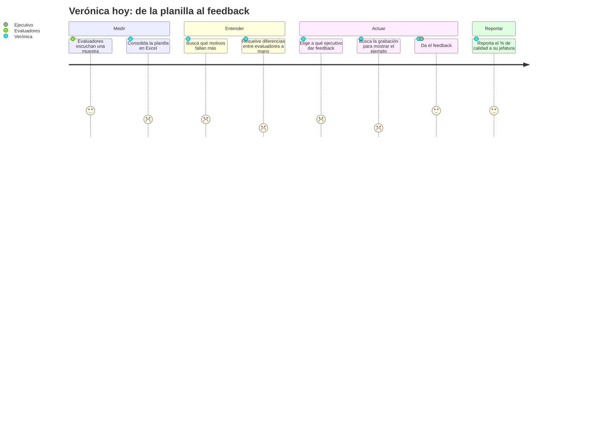

# Fase 1 · Investigación (comprimida) · Análisis de calidad

Fecha: 2026-11-17 · Estado: **pendiente de aprobación** · Alcance acordado en la ronda 1 (D-05): proto-persona, CUJ, benchmark corto y guion para la reunión presencial con Verónica.
Sin entrevistas: todo lo que no viene de la reunión del 16-nov o del repo es **[SUPUESTO]** y está en `hipotesis.md`. Sin temas legales (D-00).

---

## 1. Desk research (lo que ya sabemos, sin repetir el brief)

- **Cómo mide hoy la corredora:** un evaluador escucha una muestra de llamadas y llena la planilla de calidad con un veredicto por llamada y marcas por motivo (C01..C33). El veredicto de llamada sale de una regla aritmética sobre los motivos (Agustín, 16-nov).
- **Lo que mostró el análisis de Qubico:** el desacuerdo se concentra en pocos motivos (25 y 18) y una parte se explica por los datos, no por el ejecutivo (en el 25, la metadata trae una fila por grabación aunque se gestionen varios seguros). El 21 % de las llamadas apunta a un posible error del evaluador.
- **Práctica habitual en QA de contact center [SUPUESTO, conocimiento general del rubro]:**
  - *Calibración*: varios evaluadores puntúan la misma llamada y se mide la varianza. Si es alta, se corrige la pauta o se reentrena a los evaluadores, no al ejecutivo.
  - El indicador que se usa como "rigor" es el **acuerdo entre evaluadores** (inter-rater reliability), no la severidad. Un evaluador puede ser estricto y consistente a la vez.
  - Los reportes por agente que se aceptan bien muestran evidencia (la llamada, el minuto) y el desvío contra el equipo, no un ranking a secas.
- **Lo que esto implica para el diseño:**
  1. "Rigor" se separa en dos medidas: **severidad** (cuánto más o menos marca No cumple que el resto) y **consistencia** (si ante casos parecidos marca lo mismo). Mezclarlas lleva a castigar al evaluador estricto.
  2. Un motivo es "sospechoso de estar mal definido" cuando el desacuerdo es alto **en todos los evaluadores** y no solo en uno.
  3. Con la planilla como única fuente humana no hay calibración real (cada llamada la evalúa una persona). La IA hace de **evaluador común** que vio todas las llamadas: es el punto de comparación que hace medible la dispersión (por eso D-02 = IA como eje).

## 2. Benchmark corto

Los referentes son herramientas de QA de contact center conocidas en el rubro. Lo de "qué hacen" sale de conocimiento general y **no se verificó contra sus versiones actuales** [SUPUESTO]; sirve para patrones, no para copiar pantallas.

| Referente | Qué hace bien (patrón) | Qué hace mal o no aplica | Qué tomamos |
|---|---|---|---|
| Suites de QA de contact center grandes (tipo NICE, Verint, Calabrio) | Sesiones de calibración con varianza por evaluador y por pregunta del formulario | Muy configurables y pesadas; suponen varios evaluadores por llamada | Varianza por motivo y por evaluador como vista propia |
| Herramientas de QA ligeras (tipo MaestroQA, Scorebuddy, Playvox) | Reporte por pregunta del formulario: qué ítems fallan más y en qué equipo; desde la cifra se baja a la llamada | Puntaje sobre 100 con pesos; aquí la pauta no tiene puntaje | Motivo como unidad, ranking por motivo, bajada a la llamada en ≤ 2 clics |
| QA automático con IA (tipo Observe.AI, CallMiner) | Cobertura del 100 % y comparación "IA vs. evaluador" por ítem | Suelen vender el puntaje automático como verdad | IA y planilla lado a lado, siempre rotuladas "según IA" / "según la planilla" |
| Analítica de desempeño en general (BI) | Heatmap ítem × persona, filtros por segmento | Tableros de cifras sin conclusión (el problema de P-01 de `admin-presentation`) | Títulos que dicen la conclusión; heatmap motivo × ejecutivo que ya existe |
| Lo que ya tiene el producto | Tabla por evaluador (Cambio 20), Calidad de la IA por motivo (Cambio 15), "pocas llamadas", foto por corrida | Solo admin; sin severidad vs. consistencia | Se reutiliza como base de Evaluadores y Motivos |

**Patrones que se repiten:** motivo como unidad de análisis; comparación contra la media del equipo en vez de ranking; marca de muestra chica; cifra → lista → llamada; la calibración apunta primero a la pauta y a los evaluadores antes que a los ejecutivos.

## 3. Mapa de empatía · Verónica [SUPUESTO casi completo]

| Piensa | Siente | Dice | Hace |
|---|---|---|---|
| "Mi planilla es la referencia; la IA tiene que parecerse a ella" | Algo de desconfianza: un tercero mide la calidad de su equipo | "¿Y cómo sé que la IA tiene razón?" | Revisa la planilla, prepara reportes para su jefatura, da feedback a ejecutivos |
| "Necesito saber a quién capacitar y en qué" | Presión por cumplir indicadores con poca muestra | "No alcanzamos a escuchar todo" | Coordina a los evaluadores y resuelve diferencias entre ellos a mano |

- **Dolores:** muestra chica; criterios que cada evaluador entiende distinto; motivos que fallan por la tipificación o los datos y no por el ejecutivo; no tiene evidencia rápida para el feedback.
- **Ganancias:** saber qué motivo y qué ejecutivo mirar primero; tener la llamada y el minuto a mano; poder defender ante su jefatura que la medición es pareja.

## 4. UX Personas

### 4.1 Persona primaria · Verónica, supervisora de calidad de la corredora (proto-persona)

| Campo | Contenido | Confianza |
|---|---|---|
| Contexto | Supervisa la calidad del contact center de retención; tiene a cargo a los evaluadores que llenan la planilla y da feedback a los ejecutivos | Media (reunión 16-nov, H-02) |
| Nivel técnico | Usa planillas a diario; no es analista de datos. Lee tablas y porcentajes; no lee kappa ni intervalos | [SUPUESTO] |
| Dispositivo y momento | Escritorio, Chrome o Edge, en horario de oficina. Uso **semanal o por corrida**, no minuto a minuto; antes de reuniones con su jefatura o de feedback a ejecutivos | [SUPUESTO] (H-04) |
| Objetivos | 1) Saber qué motivos se incumplen y si eso es real. 2) Saber a qué ejecutivos capacitar y en qué. 3) Tener evidencia para el feedback | Media |
| Dolencias | P-01, P-02, P-03, P-04 del brief, más P-07 (nueva): **no tiene evidencia rápida** (llamada y minuto) para respaldar un feedback | [SUPUESTO] para P-07 |
| Motivaciones | Mejorar el estándar de servicio y que su medición sea defendible | [SUPUESTO] |
| Frustraciones | Cifras sin explicación; cifras que no coinciden con su planilla sin que se diga por qué | [SUPUESTO] |
| Tareas principales | Ver motivos con más falla → filtrar por tipo de seguro o flujo → comparar ejecutivos en un motivo → abrir llamadas de ejemplo | Derivado de R-01/R-03/R-04 |
| Lo que **no** ve | La vista por evaluador (D-01: interna). Costos, prompts e internos de Qubico | Decisión |
| Cita | "Si la IA dice que el motivo 25 falla, quiero ver en qué llamadas y por qué." | [SUPUESTO] |

### 4.2 Persona secundaria · Analista de Qubico que prepara y presenta (Johannes / Agustín, rol `qubico_admin`)

| Campo | Contenido |
|---|---|
| Contexto | Corre el análisis, publica la foto y los informes de Claude, y presenta los resultados a la corredora |
| Objetivos | Mostrar en la reunión que el producto vale más que aprueba/rechaza; detectar evaluadores inconsistentes y motivos defectuosos para ajustar el prompt o proponer cambios a la pauta |
| Dolencias | P-05 (los informes de Claude viven fuera del producto) y P-08 (nueva): hoy el análisis está repartido entre Calidad de la IA, Análisis de discrepancias y archivos locales, y armar la historia para la empresa toma tiempo |
| Tareas | Publicar la foto de una corrida; publicar un informe; revisar Evaluadores (solo él la ve); presentar Motivos y Ejecutivos a Verónica |
| Cita | "Quiero que Verónica vea los sesgos sin que se sienta atacada." [SUPUESTO] |

No se define una segunda persona secundaria: los ejecutivos y los evaluadores no usan la app.

## 5. Journey map actual (sin las vistas nuevas)

| Etapa | Acciones | Puntos de contacto | Piensa / siente | Dolencias |
|---|---|---|---|---|
| Medir | Los evaluadores escuchan una muestra y marcan los 33 motivos | Herramienta interna, planilla | "No alcanzamos a ver todo" | P-01 |
| Entender | Agrega la planilla por motivo y por ejecutivo | Excel | "¿Este motivo falla de verdad o lo marcamos distinto?" | P-02, P-03 |
| Actuar | Elige ejecutivo y busca evidencia | Planilla, grabaciones | Fricción: buscar la llamada y el minuto | P-07 |
| Reportar | Entrega el % por llamada | Correo o reunión | Lo binario esconde el porqué | P-02 |

Con el producto de hoy, Verónica entra como Auditor y solo ve la cola (D-22 de call-audit); no tiene ninguna de estas tareas cubiertas.

## 6. Critical User Journeys

### CUJ-1 · Detectar un motivo que se incumple (o que está mal definido)

| Campo | Contenido |
|---|---|
| Persona | Verónica |
| Disparador | Llega una foto nueva (corrida o planilla) o prepara una reunión con su jefatura |
| Objetivo | Saber qué motivos mirar primero y si el problema es del ejecutivo o del criterio |
| Pasos | Análisis de calidad → Motivos → ve el ranking con IA y planilla lado a lado → abre un motivo con brecha alta (p. ej. 25) → ve en qué tipos de seguro o flujos se concentra → abre llamadas de ejemplo |
| Éxito | Identifica al menos un motivo a revisar y entiende si la brecha viene de los datos, del criterio o del ejecutivo (K-01) |
| Puntos de falla | No entiende por qué IA y planilla difieren; la brecha del 25 parece culpa de los ejecutivos cuando viene de la metadata; muestra chica sin aviso |
| Métrica | % de sesiones que llegan desde un motivo hasta una llamada; tiempo hasta abrir la primera llamada |

### CUJ-2 · Comparar ejecutivos en un motivo y llevar evidencia al feedback

| Campo | Contenido |
|---|---|
| Persona | Verónica |
| Disparador | Quiere decidir a quién capacitar y en qué |
| Objetivo | Encontrar a los ejecutivos que más se desvían en un motivo y tener las llamadas que lo muestran |
| Pasos | Ejecutivos → filtra por motivo (y por tipo de seguro o flujo) → ordena por desvío contra la media del equipo → abre la ficha → lista de llamadas → `/calls/[id]` en el minuto de la evidencia |
| Éxito | Sale con un ejecutivo, un motivo y 1 a 3 llamadas de ejemplo en ≤ 2 clics desde la cifra (K-04) |
| Puntos de falla | El ejecutivo tiene pocas llamadas y la cifra engaña; IA y planilla dicen cosas opuestas sin explicación; la vista se lee como sanción (regla no negociable 5) |
| Métrica | Tiempo desde la vista hasta la llamada de ejemplo; llamadas abiertas por sesión |

### CUJ-3 · Publicar y presentar el análisis (interno, Qubico)

| Campo | Contenido |
|---|---|
| Persona | Analista de Qubico |
| Disparador | Corrida nueva, planilla nueva o informe nuevo de Claude |
| Objetivo | Que Verónica vea datos actualizados y coherentes, y que Qubico vea Evaluadores antes de la reunión |
| Pasos | Generar la foto (fuera de la UI o con un botón, pregunta 3) → revisar Evaluadores y Motivos → publicar el informe → presentar |
| Éxito | La foto y los informes muestran corrida y fecha; nada se recalcula en vivo (K-02, K-03); tiempo de preparación < 10 min [SUPUESTO] |
| Puntos de falla | Mezcla de corridas sin rótulo (v3.0 por llamada, v2.10 por motivo); informe publicado con datos de otra corrida |
| Métrica | Tiempo de preparación; cifras sin fuente en pantalla (meta 0) |

## 7. Plan de investigación con usuarios: guion para la reunión presencial

Lo usa Rodrigo (o quien presente) con Verónica. La reunión es para mostrar resultados, así que el guion se mete en ella: 10 a 15 minutos de preguntas abiertas antes de mostrar y 5 minutos de reacción después. Fecha: **pendiente**, no bloquea (D-05).

**Objetivos:** validar H-02, H-03, H-04, H-05 y H-06; entender cómo prioriza hoy y qué haría con estas vistas.

**Antes de mostrar nada (preguntas abiertas, sin sesgo):**
1. Cuéntame cómo fue la última vez que preparaste un reporte de calidad. ¿Qué hiciste, paso a paso?
2. Cuando un motivo sale con muchas fallas, ¿cómo decides si es un problema del ejecutivo, del evaluador o del criterio?
3. ¿Qué haces cuando dos evaluadores de tu equipo marcan distinto una situación parecida?
4. Cuando das feedback a un ejecutivo, ¿qué material llevas? ¿Qué te gustaría tener y no tienes?
5. Cuando hablas de "tipos de llamada", ¿cómo los separas? (valida H-05 sin nombrar FLUJO ni TIPO_SEGURO)
6. ¿Cada cuánto revisas estos números y para quién? (H-04)

**Mientras se muestran los resultados (observar, no explicar de entrada):**
- Mostrar Motivos con IA y planilla lado a lado y preguntar: "¿Qué ves aquí? ¿Qué harías primero?"
- Si mira el motivo 25: "¿Qué crees que explica esta diferencia?" (antes de contar la causa de la metadata).
- Anotar las palabras que usa para "evaluador", "motivo", "tipo", "falla" (insumo para la Fase 6).

**Después:**
7. ¿Qué de esto te sirve esta semana? ¿Qué no te sirve?
8. ¿A quién más de tu equipo le mostrarías esto?
9. Si pudieras ver cómo marca cada evaluador comparado con el resto, ¿para qué lo usarías? (sondea H-06 sin mostrar la vista, que es interna por D-01)

**Qué registrar:** respuestas textuales cortas, la primera reacción a cada vista, en qué cifra se detuvo y qué preguntó. Se vuelca en `01-investigacion.md` §8 como síntesis.

No aplica encuesta: hay una sola usuaria.

## 8. Síntesis

Pendiente de la reunión presencial. Hasta entonces la persona y los CUJ son proto.
