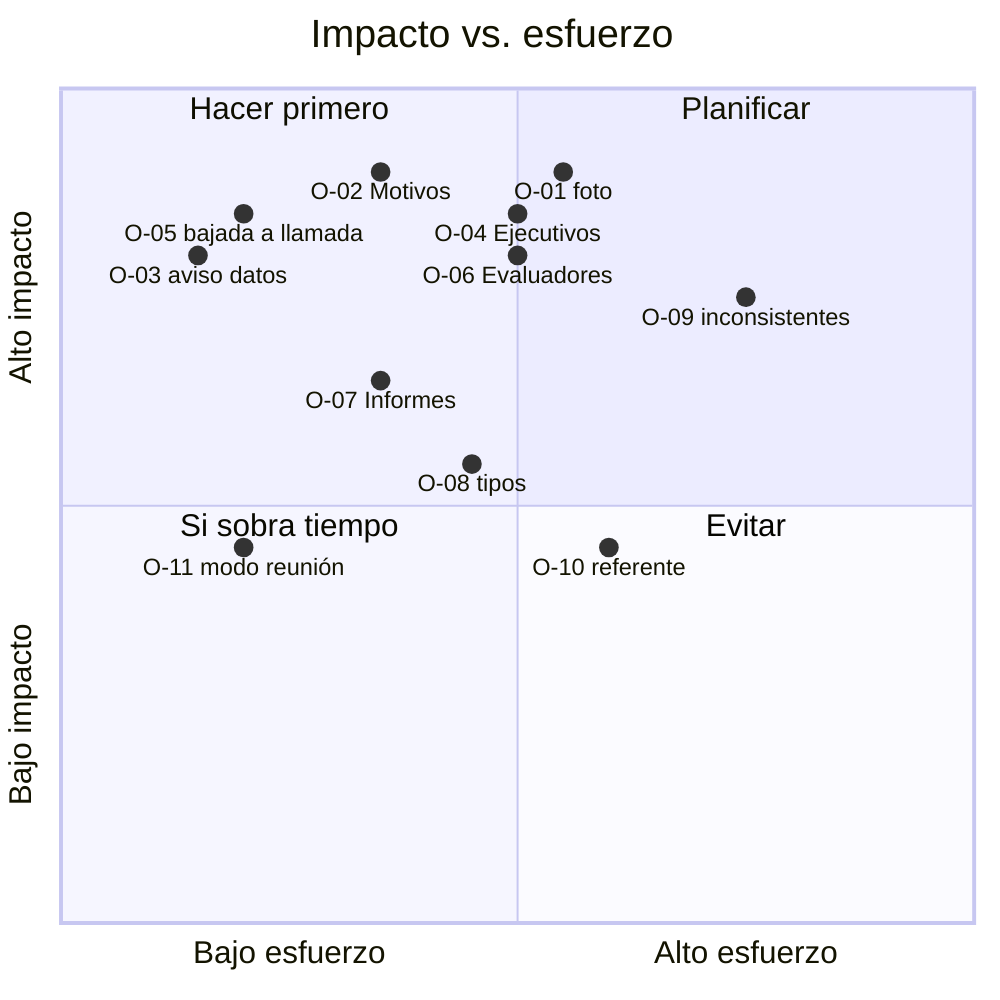
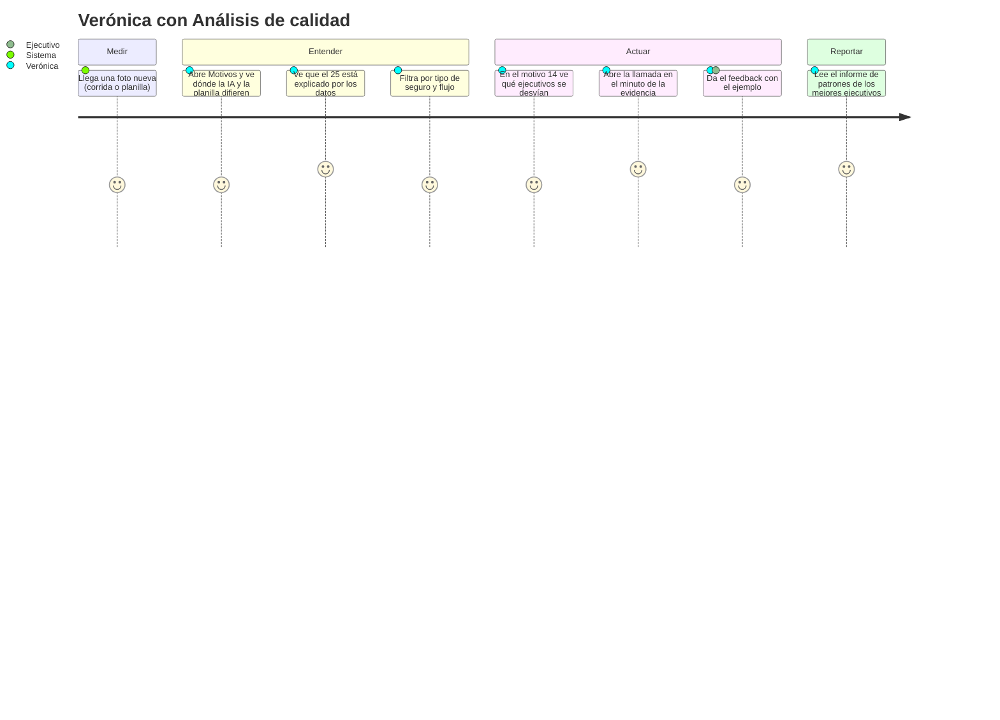

# Fase 2 · Ideación · Análisis de calidad

Fecha: 2026-11-17 · Estado: **pendiente de aprobación** (va junto con la Fase 3, D-05).
Parte de: brief aprobado (D-01 a D-05), investigación (`01-investigacion.md`) y ronda 2 (D-06 a D-10). Sin temas legales (D-00).

---

## 1. ¿Cómo podríamos…? (una por dolencia)

| Dolencia | ¿Cómo podríamos…? |
|---|---|
| P-01 Evaluadores con sesgos y criterios dispersos | …mostrarle a Qubico qué evaluador marca distinto, y en qué motivo, sin confundir "estricto" con "inconsistente"? |
| P-02 El veredicto binario esconde qué motivo falla | …hacer que el motivo, y no la llamada, sea la puerta de entrada al análisis? |
| P-03 Motivos con desacuerdo por los datos (25, 18) | …separar a simple vista el desacuerdo que viene de los datos del que viene del ejecutivo o del criterio? |
| P-04 La supervisora no tiene vistas con datos reales | …darle a Verónica una sola sección con datos reales que reemplace los cascarones vacíos? |
| P-05 Los informes de Claude viven fuera del producto | …publicar un informe en minutos, con su corrida y su audiencia, junto a las cifras que lo respaldan? |
| P-06 No escala consultar 100.000 llamadas en vivo | …que cada vista cargue al instante porque solo lee una foto ya calculada? |
| P-07 Sin evidencia rápida para el feedback | …llevar a Verónica de una cifra a la llamada y al minuto de la evidencia en 2 clics? |
| P-08 El análisis está repartido en varias vistas | …que Qubico prepare la reunión con la empresa desde un solo lugar? |

## 2. ¿Y si…? (divergencia)

| # | Idea | Tipo |
|---|---|---|
| W-01 | ¿Y si la pantalla de entrada fuera **Motivos** y no Ejecutivos? Primero "qué falla", después "quién" | Directa |
| W-02 | ¿Y si cada motivo tuviera un **semáforo de confianza del criterio**: "parejo", "se marca distinto", "explicado por los datos"? | Directa |
| W-03 | ¿Y si la IA y la planilla se mostraran como **dos barras pegadas** por fila, con la brecha en medio? | Directa |
| W-04 | ¿Y si el ejecutivo no se viera en una lista, sino solo **dentro de un motivo** ("en el motivo 14, estos ejecutivos se desvían")? | Directa |
| W-05 | ¿Y si los informes de Claude se **enlazaran a las cifras** (cada hallazgo con un botón "Ver en Motivos")? | Directa |
| W-06 | ¿Y si hubiera un **modo reunión** que oculta lo interno y deja solo lo que ve la empresa? | Directa |
| W-07 | ¿Y si Verónica pudiera **marcar un motivo como "a revisar con la pauta"** y eso llegara a Qubico? | Radical (agrega escritura) |
| W-08 | ¿Y si se reemplazara el promedio de evaluadores por un **"referente"**, la persona con mejor calce? | Radical (ola 2, D-05) |
| W-09 | ¿Y si la app **propusiera una redacción nueva del motivo** cuando detecta que está mal definido? | Radical (usa IA, fuera de alcance) |
| W-10 | ¿Y si Verónica viera **"llamadas gemelas"**: dos llamadas casi iguales con veredictos distintos? | Radical (ola 2, alertas de ambigüedad) |
| W-11 | ¿Y si no hubiera vistas y solo se mandara un **PDF semanal**? | Radical (alternativa mínima) |

**Convergencia:**
- **Quedan en la ola 1:** W-01, W-02, W-03, W-04 (como filtro, sin quitar la lista de Ejecutivos), W-05.
- **Pasan a la ola 2:** W-08 y W-10, como ya estaba en D-05.
- **Pregunta para Johannes:** W-06 (pregunta 2) y W-07 (pregunta 5).
- **Se descartan:** W-09, porque usa IA dentro de la vista y esto se diseña sin costo de IA. W-11, porque no resuelve P-07 (sin enlace a la llamada), aunque un informe en Markdown (D-09) cubre parte de esa idea.

## 3. Oportunidades priorizadas

| ID | Oportunidad | Dolencias | Impacto | Esfuerzo | Ola |
|---|---|---|---|---|---|
| O-01 | **Foto precomputada** por corrida/planilla con "Datos al {fecha} · corrida {versión}" en toda la sección (D-08) | P-06, P-08 | Alto | M (backend) | 1 |
| O-02 | **Motivos**: tabla de 33 motivos con % No cumple según la IA y según la planilla, la brecha y un estado del criterio (W-02, W-03) | P-02, P-03 | Alto | S–M | 1 |
| O-03 | **Aviso de "desacuerdo explicado por los datos"** en el motivo 25 (y 18 si se confirma), fuera del orden por defecto (D-10) | P-03 | Alto | S | 1 |
| O-04 | **Ejecutivos**: % No cumple por motivo filtrado, IA y planilla, desvío contra la media, bases visibles, "pocas llamadas", sin ranking (D-07) | P-04, P-07 | Alto | M | 1 |
| O-05 | **Bajada a la llamada**: desde cualquier celda a la lista paginada en el servidor y de ahí a `/calls/[id]` en el minuto de la evidencia (patrón D-58 de call-audit) | P-07 | Alto | S (reutiliza) | 1 |
| O-06 | **Evaluadores (interna)**: severidad y desacuerdo con la IA por motivo, contra la media del equipo; kappa en el detalle técnico (D-06) | P-01 | Alto (comercial) | M | 1 |
| O-07 | **Informes**: lista y lector de Markdown con encabezado (título, fecha, corrida, audiencia) (D-09), con enlaces a las vistas (W-05) | P-05, P-08 | Medio-alto | S–M | 1 |
| O-08 | **Tipos de llamada**: tipo de seguro × flujo como filtro global y como pestaña propia (D-03) | P-02 | Medio | S (filtro), M (pestaña) | Filtro: 1 · Pestaña: 2 |
| O-09 | **Casos inconsistentes** (alertas de ambigüedad) con una regla sin IA (H-09) | P-01 | Alto | M–L | 2 |
| O-10 | **Referente de calidad** | P-01 | Medio | M (+ decisión H-07) | 2 |
| O-11 | Modo reunión (W-06) | P-08 | Medio | S | Pregunta 2 |

## 4. Definiciones de cálculo que salen de D-06 y D-07

Las dejo aquí para que el backend calcule la foto. El texto visible se define en la Fase 6. Por motivo *m*, sobre las llamadas que tienen corrida vigente **y** marca de la planilla:

| Medida | Cálculo | Texto visible (borrador) |
|---|---|---|
| % No cumple según la IA | llamadas con *m* No cumple según la IA ÷ llamadas con corrida vigente | "Según la IA" |
| % No cumple según la planilla | llamadas con *m* No cumple según la planilla ÷ llamadas evaluadas | "Según la planilla" |
| Brecha | % planilla − % IA, sobre las llamadas que tienen ambas fuentes | "Diferencia" |
| **Desacuerdo** del evaluador *e* en *m* | (solo el evaluador marcó + solo la IA marcó) ÷ sus llamadas | "Marca distinto que la IA" |
| **Severidad** del evaluador *e* en *m* | (solo el evaluador marcó − solo la IA marcó) ÷ sus llamadas. Positivo: más estricto. Negativo: más permisivo | "Más estricto / más permisivo que la IA" |
| Comparación contra el equipo | La medida del evaluador frente a la del resto de los evaluadores en el mismo motivo | "Sobre / bajo el equipo" |
| Kappa (detalle técnico) | Cohen's kappa evaluador vs. IA por motivo | Solo en el detalle interno |
| Estado del criterio del motivo | "Explicado por los datos" si está marcado a mano (D-10). "Se marca distinto" si el desacuerdo supera el umbral U en la mayoría de los evaluadores con ≥ 10 llamadas. Si no, "Parejo" | Etiqueta en Motivos |
| Desvío del ejecutivo | % No cumple del ejecutivo en *m* − media del equipo en *m*, en puntos y por fuente | "+12 pts sobre el equipo" |

El umbral U queda en H-14 y se ajusta con los datos reales.

## 5. Journey futuro (to-be)

| Etapa | Antes | Ahora | Oportunidades |
|---|---|---|---|
| Medir | Muestra con un evaluador por llamada | El 100 % según la IA, más la planilla al lado | O-01 |
| Entender | Excel a mano; no sabe si el motivo está mal definido | Motivos con brecha y estado del criterio | O-02, O-03, O-08 |
| Actuar | Busca la grabación a mano | Cifra → llamadas → minuto | O-04, O-05 |
| Reportar | % binario | Informes con hallazgos y enlaces | O-07 |
| (Qubico) | Análisis repartido en cuatro lugares | Evaluadores e Informes en la misma sección | O-06, O-07 |

## 6. Narrativa

> Es lunes y Verónica prepara la reunión semanal con su jefatura. Abre **Análisis de calidad**. Arriba dice "Datos al 14-nov · corrida v3.0". Entra a **Motivos**. El 25 aparece al final con un aviso: la diferencia se explica en parte porque la metadata trae una fila por grabación. Lo anota para hablarlo con Qubico, no con los ejecutivos. Más arriba, el motivo 14 muestra que la IA marca No cumple en el 18 % de las llamadas y la planilla en el 9 %. Filtra por "Desempleo" y la diferencia crece. Cambia a **Ejecutivos** con el motivo 14 filtrado: tres ejecutivos están más de 10 puntos sobre el equipo según ambas fuentes. Uno dice "pocas llamadas" y lo deja para después. Abre la ficha de otro, elige una llamada y el reproductor parte en el minuto 2:41, donde el ejecutivo no indaga la objeción. Con esa llamada prepara su feedback. Antes de cerrar, lee el informe "Qué hacen distinto los ejecutivos con menos rechazo" y pega dos hallazgos en su presentación.
>
> En paralelo, Johannes revisa **Evaluadores** antes de la reunión con la corredora: un evaluador es "más permisivo que la IA" en el motivo 31 y otro "marca distinto" en casi todos los motivos de Tipificación. Lo presentará acompañado, sin mostrar la pantalla a la empresa (D-01).

## 7. Revisión de ideas

Sin revisión legal (D-00). Revisión contra las reglas del producto:
- **Regla 5 (la IA genera hallazgos, un humano decide):** nada de esta sección propone sanciones. Ejecutivos se muestra como desvío y sin ranking (D-07). Los textos se cuidan en la Fase 6.
- **Sin costo de IA nuevo:** todas las oportunidades de la ola 1 salen de datos existentes. W-09 queda descartada por eso.
