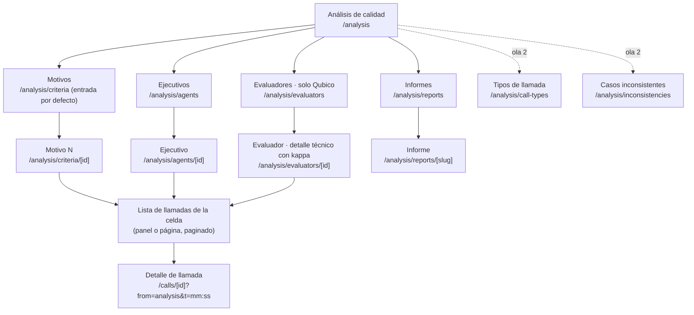

# Fase 3 · Arquitectura de la información · Análisis de calidad

Fecha: 2026-11-17 · Estado: **pendiente de aprobación** (va junto con la Fase 2).

> **Actualización 2026-11-17 (D-11 a D-15):** la sección se llama **Calidad del servicio** (D-14), con ruta `/analysis`. Donde este documento dice "Análisis de calidad", léase "Calidad del servicio". `/discrepancies` sale del rol `supervisor` (D-11) y `qubico_viewer` ve toda la sección (D-13).
Base: D-01 a D-10 en `estado.md`. Navegación actual en `frontend/src/components/shell/sidebar-nav.tsx`.

---

## 1. Inventario

| Contenido / función | Hoy | Debe existir (ola 1) | Ola 2 |
|---|---|---|---|
| Encabezado de la foto: fecha, corrida por llamada y por motivo, planilla usada | — | Sí, en todas las pestañas (O-01) | |
| Filtros globales: tipo de seguro, flujo | — | Sí (D-03) | + otras dimensiones si las confirma Verónica |
| Motivos: 33 filas, IA / planilla / diferencia / estado del criterio, agrupados por los 5 bloques | `/dashboard/criteria` (sin datos reales en el cruce) | Sí (O-02, O-03) | |
| Detalle de un motivo: dónde se concentra (tipo × flujo), ejecutivos que se desvían, llamadas | — | Sí | |
| Ejecutivos: lista con % No cumple (IA y planilla), desvío, base, "pocas llamadas"; filtro por motivo | `/agents` (vacío en modo real) | Sí (O-04) | |
| Ficha del ejecutivo: perfil por motivo y sus llamadas | `/agents/[id]` (vacío en modo real) | Sí, en la sección nueva | |
| Evaluadores (interna): desacuerdo, severidad, contra el equipo, por motivo; kappa en el detalle | Tabla por evaluador en `/admin/discrepancies` | Sí (O-06), solo `qubico_admin` | Referente (O-10) |
| Lista de llamadas de una celda (paginada en el servidor) | Distintas listas por vista | Sí, un solo componente (O-05) | |
| Detalle de llamada | `/calls/[id]` | Se reutiliza, con banner de origen y minuto (patrón D-58) | |
| Informes: lista y lector | — | Sí (O-07) | |
| Tipos de llamada como pestaña | — | No (solo filtro) | Sí (O-08) |
| Casos inconsistentes | — | No | Sí (O-09) |

## 2. Card sorting (propuesta para validar)

Se propone **cerrado y con una sola participante (Verónica)**, metido en la reunión presencial (5 minutos, en papel o en pantalla):
- **Tarjetas (12):** % de fallas por motivo, Diferencia IA vs. planilla, Motivo explicado por los datos, Ejecutivos que se desvían en un motivo, Ficha de un ejecutivo, Llamadas de ejemplo, Filtro por tipo de seguro, Filtro por flujo, Informe de patrones de los mejores ejecutivos, Fecha de los datos, Llamadas parecidas con distinto veredicto, Ejecutivo referente.
- **Grupos:** Motivos · Ejecutivos · Tipos de llamada · Informes · "No lo usaría".
- **Qué valida:** si espera entrar por motivo o por ejecutivo (W-01) y dónde busca las inconsistencias (ola 2).

**Agrupación preliminar** (la del sitemap): Motivos como entrada, Ejecutivos, Informes, y Evaluadores aparte para Qubico.

## 3. Sitemap

- **Navegación interna:** pestañas bajo el `PageHeader` (mismo patrón que `/admin/stats` y `/admin/discrepancies`), cada una con su ruta para poder compartir el enlace.
- **Estado en la URL:** `type` (tipo de seguro), `flow`, `criterion` (en Ejecutivos), `source` (IA / planilla, solo para ordenar) y el orden. Es el mismo criterio de `admin-stats-filters`.
- **Volver:** desde `/calls/[id]` se vuelve a la celda de origen con los filtros intactos (patrón D-65 de call-audit).

## 4. Visibilidad por rol y cambio en la sidebar

| Elemento | `supervisor` (Verónica) | `qubico_admin` | `qubico_viewer` | `auditor` |
|---|:-:|:-:|:-:|:-:|
| Análisis de calidad: Motivos, Ejecutivos, Informes con audiencia "empresa" | ✓ | ✓ | Pregunta 3 | — |
| Evaluadores | — | ✓ | Pregunta 3 | — |
| Informes con audiencia "interna" | — | ✓ | Pregunta 3 | — |

**Sidebar del supervisor (propuesta):**
- Se agrega **"Análisis de calidad"** después de "Inicio".
- En modo real, se reemplazan "Ejecutivos", "Motivos" y "Auditores", que hoy muestran "no disponible", y sus rutas antiguas redirigen a la pestaña equivalente (D-04).
- En modo demo quedan como están.

**Sidebar del admin:** se agrega "Análisis de calidad" junto a "Análisis de discrepancias". Los nombres se parecen; la diferencia se resuelve en el glosario (§5) y queda la pregunta 4.

**Hallazgo que hay que decidir (pregunta 1):** el rol `supervisor` hoy también ve **Discrepancias** (`/discrepancies`), con la clasificación de discrepancias y la lista "Por presentar", que es trabajo de Qubico para mostrarle a la empresa. Si Verónica pasa a `supervisor` (D-01), vería ese trabajo interno.

## 5. Taxonomía y glosario

| Término en la UI | Significa | No usar |
|---|---|---|
| **Análisis de calidad** | La sección: calidad del servicio de la empresa, según la IA y la planilla | "Dashboard", "Analytics" |
| **Análisis de discrepancias** (existente, admin) | Por qué la IA y la planilla difieren, para mejorar el prompt | — |
| **Motivo** | Uno de los 33 ítems de la pauta | "Criterio" en la UI (sí en código: `criterion`) |
| **Según la IA** / **Según la planilla** | La fuente de la cifra (D-02) | "Real", "Correcto" |
| **Diferencia** | % planilla − % IA en las mismas llamadas | "Error" |
| **Evaluador** | Quien llenó la planilla de calidad (persona de la empresa) | "Auditor" (en la app, el auditor es otro rol) |
| **Marca distinto que la IA** | Desacuerdo (D-06) | "Inconsistente", "Malo" |
| **Más estricto / más permisivo** | Severidad (D-06) | "Sesgado" en la UI |
| **Sobre / bajo el equipo** | Desvío contra la media | "Ranking", "Peor" |
| **Pocas llamadas** | Menos de 10 llamadas en la base (D-07) | — |
| **Explicado por los datos** | Desacuerdo con causa en la metadata o la tipificación (D-10) | — |
| **Datos al {fecha}** | Fecha de la foto (D-08) | "Actualizado" (no es en vivo) |
| **Informe** | Documento publicado con su corrida y su audiencia (D-09) | "Reporte IA" |
| **Tipo de seguro**, **Flujo** | Filtros desde la metadata (D-03) | "Tipo de llamada", hasta que se confirme |

Los términos nuevos se sumarán a `docs/ux/call-audit/06-ux-writing.md` §5 en la Fase 6.

## 6. Contenidos legales

No aplica (D-00).
