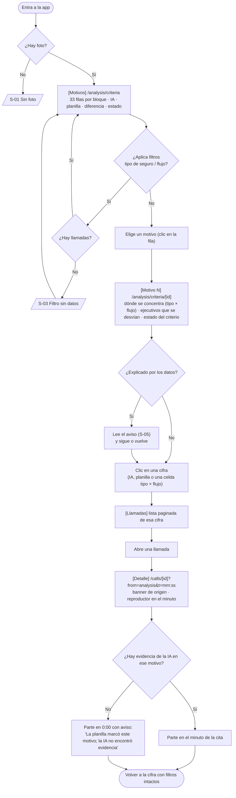
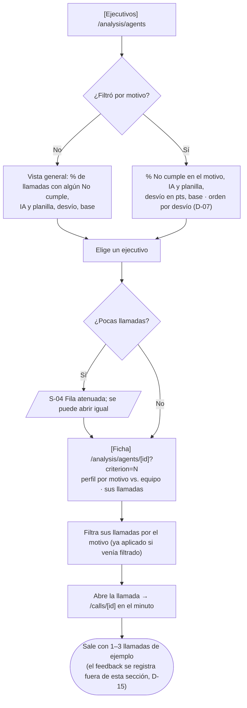
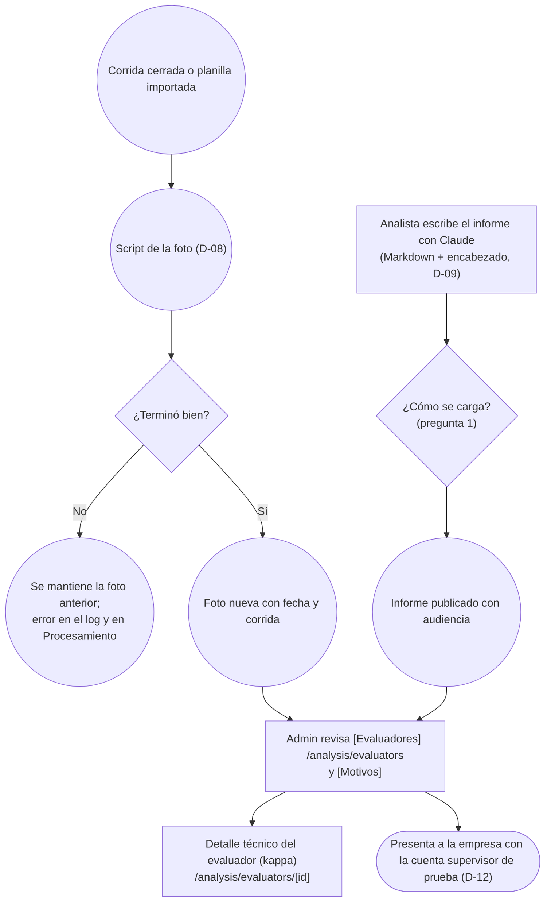
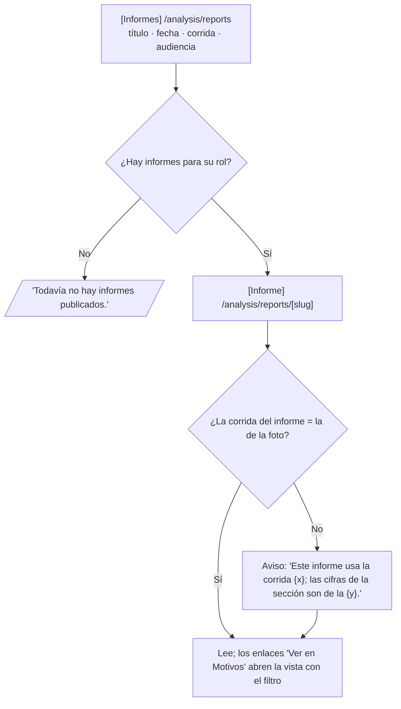

# Fase 4 · User flows · Calidad del servicio

Fecha: 2026-11-17 · Estado: **pendiente de aprobación**.
Base: D-01 a D-15 (`estado.md`), sitemap en `03-arquitectura-informacion.md` §3. Nombre de la sección: **Calidad del servicio**, ruta `/analysis` (D-14). La ola 1 es solo lectura (D-15). Sin puntos legales (D-00).

Convenciones: `[ ]` pantalla · `{ }` decisión · `(( ))` estado del sistema · las líneas punteadas son estados vacíos o de error.

---

## 0. Estados comunes a toda la sección

| ID | Estado | Cuándo | Qué ve el usuario | Salida |
|---|---|---|---|---|
| S-01 | **Sin foto** | El script todavía no corrió nunca | "Todavía no hay datos de calidad del servicio. Aparecerán cuando se procese la próxima corrida o planilla." | Ninguna acción; enlace a Inicio |
| S-02 | **Sin planilla** | Hay corrida pero ninguna llamada trae planilla | Columnas "Según la planilla" con "—" y nota "Esta foto no trae planilla de calidad"; la IA se muestra igual | Sigue navegable |
| S-03 | **Filtro sin datos** | El cruce de tipo de seguro × flujo no tiene llamadas | "No hay llamadas con {tipo} y {flujo} en esta foto." + "Quitar filtros" | Quitar filtros |
| S-04 | **Pocas llamadas** | Base menor a 10 (D-07) | La fila sigue visible, atenuada, con "pocas llamadas"; no entra en el orden por desvío | — |
| S-05 | **Explicado por los datos** | Motivo marcado (D-10) | Aviso en la fila y en el detalle; va al final del orden por defecto | Leer el aviso |
| S-06 | **Error de carga** | Falla la API | Patrón `AsyncView` existente: "No pudimos cargar {qué}. Reintentar" | Reintentar |
| S-07 | **Foto con corridas mezcladas** | Los datos por llamada y por motivo vienen de corridas distintas | Encabezado: "Por llamada: corrida v3.0 · Por motivo: corrida v2.10 · Datos al {fecha}" | Depende de la pregunta 3 |

Encabezado fijo de todas las pestañas: **"Datos al {fecha} · corrida {versión} · planilla hasta {fecha}"**. Usa `SourceBadge` (existe en `/dashboard`) para "Según la IA" y "Según la planilla".

## 1. CUJ-1 · Detectar un motivo que se incumple o que está mal definido (Verónica)

## 2. CUJ-2 · Comparar ejecutivos en un motivo y llevar evidencia al feedback (Verónica)

También se entra desde **Motivo N** → "Ejecutivos que se desvían" → ficha (atajo hacia CUJ-2).

## 3. CUJ-3 · Publicar la foto y los informes, y presentar (Qubico)

Si una nueva foto queda vigente mientras alguien mira la sección, la página no cambia sola. Al navegar aparece un aviso: "Hay datos nuevos (al {fecha}). Actualizar" (pregunta 4).

## 4. Tarea secundaria · Leer un informe (Verónica o Qubico)

Verónica solo ve los informes con audiencia "empresa". Un enlace directo a uno "interno" responde "No encontramos este informe" (no "no tienes permiso"), para no revelar que existe.

## 5. Auditoría de los flujos

| Tipo | Hallazgo | Dónde | Cambio |
|---|---|---|---|
| Paso de más | En el borrador, Motivos → Motivo N → "Ver llamadas" → lista. El botón intermedio no aporta | CUJ-1 | La cifra misma es el enlace a la lista (−1 clic) |
| Paso de más | Para filtrar Ejecutivos por motivo, había que ir a Ejecutivos y elegir el motivo de nuevo | Motivo N → Ejecutivos | "Ejecutivos que se desvían" dentro de Motivo N, y enlace a `/analysis/agents?criterion=N` (−2 pasos) |
| Cuello de botella | En el detalle de la llamada había que buscar el minuto a mano | `/calls/[id]` | Parámetro `t` + banner de origen (patrón D-58) |
| Cuello de botella | La diferencia IA vs. planilla del 25 genera dudas sin explicación | Motivos | Aviso S-05 y orden al final (D-10) |
| Redundancia | Los filtros se pedían otra vez al volver de la llamada | Todas | Filtros en la URL; volver los conserva (D-65 de call-audit) |
| Redundancia | Rutas antiguas `/agents`, `/dashboard/criteria`, `/auditors` y las nuevas mostraban lo mismo | Sidebar | En modo real, redirección a `/analysis/…` (D-04) |
| Callejón sin salida | Celda "IA No cumple" sin evidencia en la transcripción | `/calls/[id]` | El aviso del flujo §1 y el reproductor en 0:00 |
| Callejón sin salida | Filtro sin llamadas | Todas | S-03 con "Quitar filtros" |
| Callejón sin salida | Enlace antiguo a `/discrepancies` para un supervisor (D-11) | Marcadores | Redirige a `/analysis` (a Inicio si no tiene acceso) |
| Error sin recuperación | El script falla y la sección queda vacía | CUJ-3 | Se mantiene la foto anterior (C1) y nunca se muestra una foto a medias |

**Conteo de clics (desde que entra a la app):**

| Tarea | Antes (el borrador) | Después |
|---|---|---|
| CUJ-1: ver la llamada de ejemplo de un motivo | Sidebar → Motivos → motivo → "Ver llamadas" → llamada → buscar el minuto = 5 + búsqueda | Sidebar → motivo → cifra → llamada = **4**, ya en el minuto |
| CUJ-2: llamada de ejemplo de un ejecutivo en un motivo | Sidebar → Ejecutivos → elegir el motivo → ejecutivo → filtrar llamadas → llamada = 6 | Desde Motivo N: ejecutivo → llamada = **2** desde la cifra (K-04); desde la sidebar = 5 |
| Leer un informe | — | Sidebar → Informes → informe = **3** |

Hoy (producto actual, modo real) ninguna de estas tareas es posible: las vistas muestran "no disponible".

## 6. Puntos legales

No aplica (D-00).
